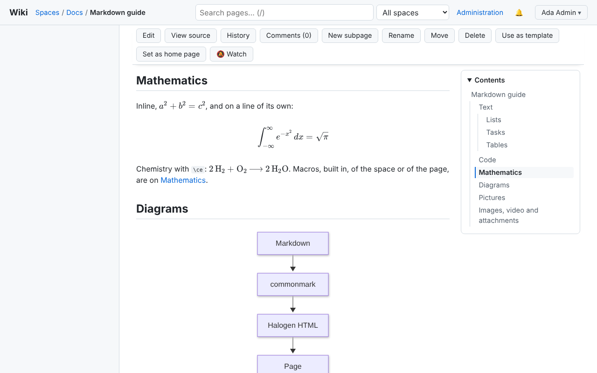
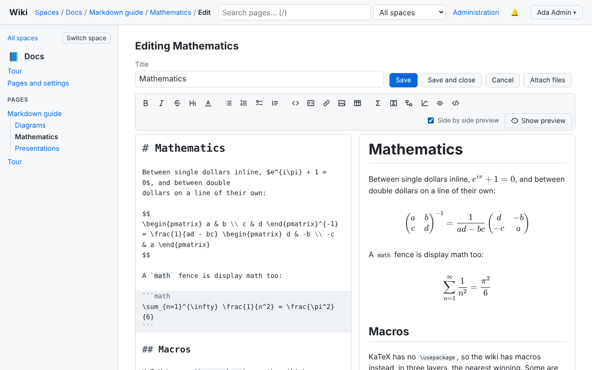
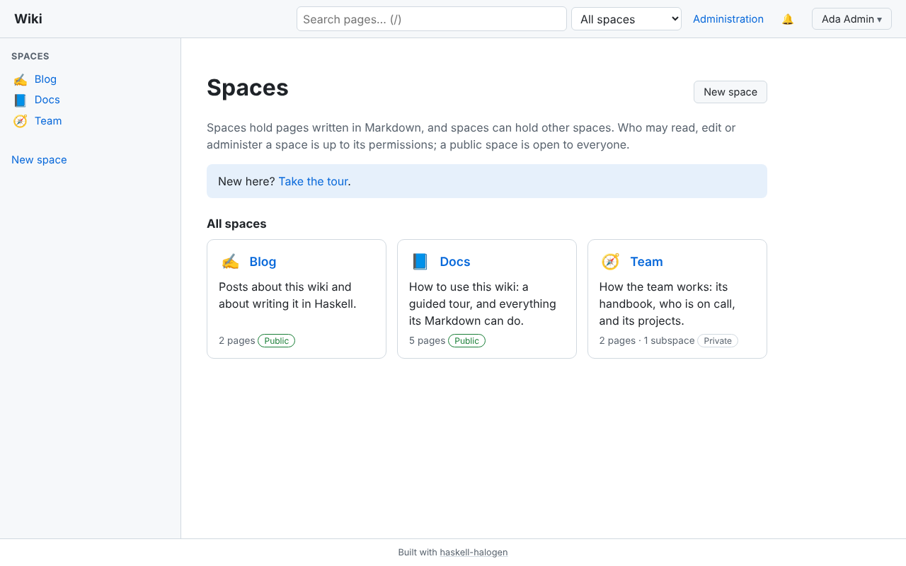
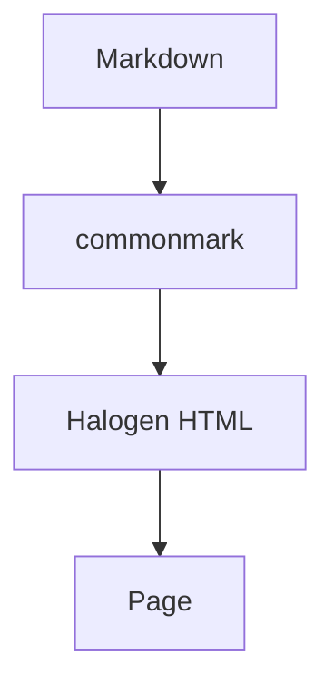
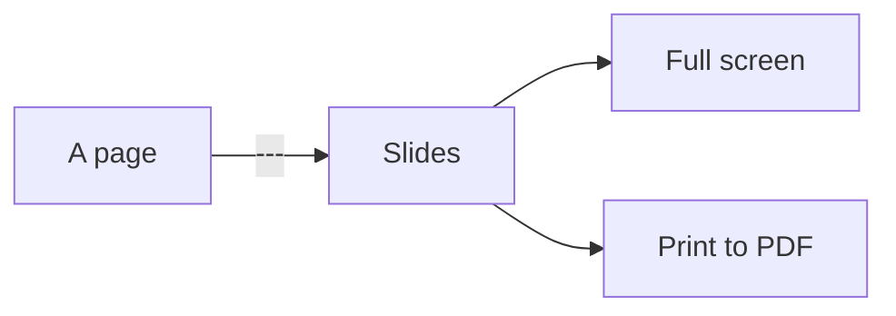
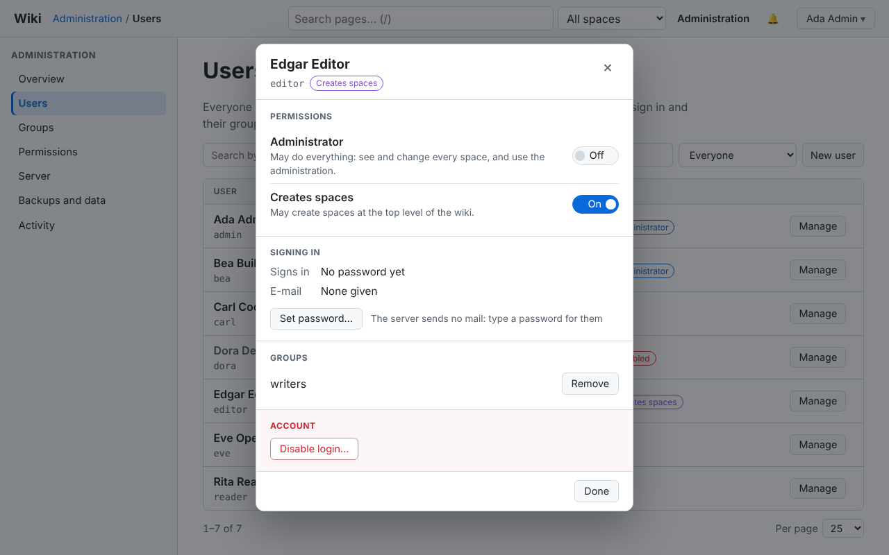
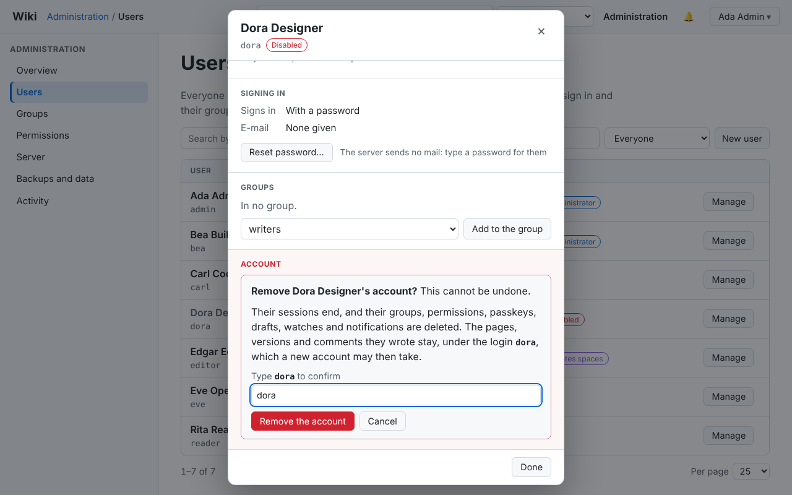

# blog

[](https://github.com/Swordlash/blog/actions/workflows/build.yml)

A wiki in the manner of Confluence, written in Haskell and running in the
browser: spaces and subspaces, each a tree of pages written in Markdown with
formulas, diagrams, TikZ pictures, highlighted code and attachments; an editor
with the page previewed beside it as you type; pages shown as slide decks;
comments, history, search; and users, groups and permissions on spaces, where a
public space makes the same wiki a blog. The browser application is
[haskell-halogen](https://github.com/Swordlash/haskell-halogen) components
compiled to WebAssembly, and it renders the Markdown itself, so the preview never
waits for a server. It runs as a serverless demo that keeps its wiki in the
browser, served as static files, or over its own server, `wiki-server`, which
keeps the wiki in PostgreSQL, or in SQLite where a second process is too much.

**The demo: <https://swordlash.github.io/blog/>.** It opens at a tour that says
what to try, and nothing written there leaves your browser.

It runs in browsers released within the last year: Chrome and Edge 140 or
later, Firefox 133 or later, Safari 18.2 or later.

| | |
| --- | --- |
|  |  |
| A page: formulas set by KaTeX, a diagram drawn by Mermaid. | The editor, the preview beside the Markdown. |
|  |  |
| A page presented as slides. | The front page: the directory of spaces. |

## Writing pages

Pages are Markdown, [CommonMark](https://commonmark.org) with GitHub's
extensions, and what the wiki adds to it is written in Markdown too. Each example
below is part of a page of the demo, as its author typed it, and the line under
it links to that page, where it renders. The complete reference for authors is
[docs/markdown.md](docs/markdown.md); the demo's
[Markdown guide](https://swordlash.github.io/blog/s/docs/p/markdown-guide/) is
the same, written in what it describes (open any page's "Source" to see its
Markdown).

### Mathematics, with KaTeX

Formulas are set in the browser by [KaTeX](https://katex.org), between dollars
or between LaTeX's own delimiters (`\(…\)` inline, `\[…\]` on a line of their
own), or in a `math` fence:

```markdown
Between single dollars inline, $e^{i\pi} + 1 = 0$, and between double
dollars on a line of their own:

$$
\begin{pmatrix} a & b \\ c & d \end{pmatrix}^{-1}
= \frac{1}{ad - bc} \begin{pmatrix} d & -b \\ -c & a \end{pmatrix}
$$
```

Euler's identity in the line, and a matrix's inverse set on its own:
[Mathematics](https://swordlash.github.io/blog/s/docs/p/markdown-guide/mathematics/).

KaTeX has no `\usepackage`; macros take its place, in three layers. Some are
built in for every page (`\abs`, `\norm`, `\dv`, `\E`, `\Var` and more). A
space's administrator gives the space its own, one `\newcommand` a line, under
"Math macros" in its settings; these are the demo's `Docs` space's:

```tex
\newcommand{\vect}[1]{\boldsymbol{#1}}
\newcommand{\Hom}{\operatorname{Hom}}
\newcommand{\eps}{\epsilon}
```

They are on [Docs' pages and settings](https://swordlash.github.io/blog/s/docs/pages/),
and every page of the space and of its subspaces may use them:

```markdown
This space has its own, in its settings, which its pages and its
subspaces' pages may use: $\vect{v} \in V$, $f \in \Hom(V, W)$; and
here $\eps$ is $\epsilon$, where the built-in one is $\varepsilon$.
```

A bold vector, an upright Hom, and the space's `\eps` set over the built-in one:
[Mathematics](https://swordlash.github.io/blog/s/docs/p/markdown-guide/mathematics/#macros).
And a formula may define its own, which then holds in every formula after it on
the page, as in a LaTeX document:

```markdown
$$
\newcommand{\dist}[2]{d\left(#1, #2\right)}
\dist{x}{z} \le \dist{x}{y} + \dist{y}{z}
$$

so that from here on $\dist{x}{x} = 0$.
```

The triangle inequality, and the macro used again further down:
[Mathematics](https://swordlash.github.io/blog/s/docs/p/markdown-guide/mathematics/#macros).
Chemistry is mhchem's `\ce`, which KaTeX comes with:

```markdown
`\ce` writes chemical formulas and equations (mhchem): $\ce{H2O}$,
$\ce{SO4^2-}$, and

$$\ce{CO2 + C -> 2 CO}$$
```

Formulas and a reaction, with sub- and superscripts in their places:
[Mathematics](https://swordlash.github.io/blog/s/docs/p/markdown-guide/mathematics/#chemistry).

### Diagrams, with Mermaid

A `mermaid` fence is drawn by [Mermaid](https://mermaid.js.org), in the browser:

````markdown

````

A flowchart of how a page is rendered:
[Markdown guide](https://swordlash.github.io/blog/s/docs/p/markdown-guide/#diagrams);
a class diagram and a pie chart are on
[Diagrams](https://swordlash.github.io/blog/s/docs/p/markdown-guide/diagrams/).

### Pictures, with TikZ

A `tikz` fence is drawn by TikZ, real TeX run in the browser by
[TikZJax](https://github.com/drgrice1/tikzjax), for a figure whose every point
you place. It holds a picture's commands, a whole `tikzpicture` or a `tikzcd`
diagram, and the lines at its top that load a library or a package:

````markdown
```tikz
\usetikzlibrary{positioning, arrows.meta}
\begin{tikzpicture}[node distance=2cm, box/.style={draw, rounded corners}, >={Stealth[length=3mm]}]
  \node[box] (md) {Markdown};
  \node[box, right=of md] (html) {Halogen HTML};
  \node[box, right=of html] (page) {the page};
  \draw[->] (md) -- node[above] {parse} (html);
  \draw[->] (html) -- node[above] {render} (page);
\end{tikzpicture}
```
````

Three boxes in a row, placed by `positioning`, joined by `arrows.meta`'s arrows:
[Diagrams](https://swordlash.github.io/blog/s/docs/p/markdown-guide/diagrams/),
beside a commutative diagram and a plot drawn with pgfplots. Which libraries and
packages TeX has is in [docs/markdown.md](docs/markdown.md#pictures).

### Highlighted code

A fence with a language is highlighted by [highlight.js](https://highlightjs.org):

````markdown
```haskell
main :: IO ()
main = putStrLn "Hello, world"
```
````

Haskell, coloured by its syntax:
[Markdown guide](https://swordlash.github.io/blog/s/docs/p/markdown-guide/#code).
The names a fence may give each of some seventy languages are listed in
[docs/markdown.md](docs/markdown.md#code).

### Alerts

GitHub's alerts make a box of their kind (`NOTE`, `TIP`, `IMPORTANT`,
`WARNING`, `CAUTION`):

```markdown
> [!NOTE]
> Your edits are kept in this browser, so a reload finds them. On the
> **Administration** page, linked at the top right for an administrator,
> under **Backups and data**, **Export the wiki** saves all of it as a zip
> file, **Import a wiki** brings such a file back, and **Reset the demo
> content** puts back the pages you see now.
```

A note, marked as one, at the top of the
[Tour](https://swordlash.github.io/blog/s/docs/p/tour/).

### A table of contents

Every heading gets an `id` to link to. A page with three headings or more has a
"Contents" panel beside it; `[[toc]]` on a line of its own puts the list in the
page instead:

```markdown
# Team handbook

Private to the team: only people granted a permission on this space, or
on the wiki as a whole, can read it.

[[toc]]

## The week
```

The page's headings, listed where `[[toc]]` is, each a link to its section:
[Team handbook](https://swordlash.github.io/blog/s/team/p/team-handbook/) (in
the private `Team` space, which the demo's `admin`, whom it starts as, may read).

### Images and attachments

An image is Markdown's, from the web:

```markdown
An image from the web:


```

The photograph, under the guide's
[Images, video and attachments](https://swordlash.github.io/blog/s/docs/p/markdown-guide/#images-video-and-attachments),
beside a video from the web written the same way. A file attached to the page
is named with `attachment:`, and shows as what it is: an image, a video or audio
player, or else a link that downloads it.

```markdown
And a file attached to this page, by its name:


```

The attached image, under the photograph and the video:
[Markdown guide](https://swordlash.github.io/blog/s/docs/p/markdown-guide/#images-video-and-attachments).
The editor writes these for you when a file is dropped or pasted into it.

### Links between pages

A link to another page is its path, from this page or (with a leading `/`)
from the wiki's root, and a wiki link is shorter still:

```markdown
Paragraphs, *emphasis*, **strong emphasis**, ~~strikethrough~~,
`inline code` and links, to the web (<https://commonmark.org>) or to other
pages by their path from this one: [diagrams](markdown-guide/diagrams), or
the [tour](tour) next to this page, or [[tour|the same, as a wiki link]].[^paths]
```

Links to the guide's subpage and to the tour, a wiki link with a label of its
own, and a footnote: [Markdown guide](https://swordlash.github.io/blog/s/docs/p/markdown-guide/#text).
A link to a page that is not there is shown as broken.

Tables, task lists, footnotes, `@` mentions, the HTML a page may hold and its
colours are in [docs/markdown.md](docs/markdown.md), with everything above in
full.

## Presentations

Any page can be a slide deck, and is an ordinary page all the same. This is the
demo's [Presentations](https://swordlash.github.io/blog/s/docs/p/markdown-guide/presentations/),
whole:

````markdown
# Presentations

::: {.slides theme=beamer aspect=16:9}
:::

Any page can be a slide deck. Press **Present** above the page: this one is
a deck, and its slides tell you how it is written.

::: notes
These are the speaker's notes: on the page they are a box like this one;
on the slides they are hidden until you press **n**.
:::

---

## Slides

- A line with `---` alone on it, after a blank line, starts the next slide.
- The first heading on a slide is its title; a `#` heading makes a title
  slide, like this deck's first.
- A `::: notes` box holds what only the speaker sees.
- Everything a page shows, a slide shows: tables, code, formulas, diagrams.

::: notes
Mention that a page with no `---` is one slide, and is not offered as a
deck.
:::

---

## Formulas

Euler's identity, $e^{i\pi} + 1 = 0$, set by KaTeX, and on its own:

$$
\int_{-\infty}^{\infty} e^{-x^2}\,dx = \sqrt{\pi}
$$

::: notes
The macros a page defines hold on every slide after the one that defines them.
:::

---

## A diagram



---

## Code

```haskell
-- A deck is a page's Markdown, cut at its breaks.
deckOf :: [Block] -> Deck
```

---

## Presenting

| Key | What it does |
| --- | --- |
| → Space PageDown | the next step, then the next slide |
| ← PageUp | back a step, or to the slide before |
| Home End | the first and the last |
| f | full screen (Escape leaves it) |
| n | the speaker's notes |
| o | every slide, to pick one |

On a touch screen, swipe. **Print** puts one slide on each page: choose
"Save as PDF" to keep the deck as a file.

---

## Steps

A slide can show its content a step at a time. Three dots, `. . .`, alone
on a line between blank lines, are a pause: what follows waits for the next
press of → or Space.

. . .

Like this line, which waited for you. ← hides it again.

. . .

On the page itself a pause shows nothing. Printed, each slide is whole,
unless you tick "each step on its own page"; a Beamer PDF has a page for
each step.

::: notes
The pauses are pandoc's, so the Beamer export shows the same steps.
:::

---

## One item at a time

A list in a box with the class `incremental` shows its items one by one:

::: incremental
- the box is written `::: incremental`, the list, then `:::`;
- each press of → or Space shows the next item;
- off the slides, it is an ordinary list.
:::

---

## Themes

A `slides` box anywhere in the page says how the slides look:

```markdown
::: {.slides theme=dark aspect=4:3}
:::
```

Themes are `beamer` (the default), `light` and `dark`; slides are `16:9`
(the default) or `4:3`.
````

It is [these nine slides](https://swordlash.github.io/blog/s/docs/p/markdown-guide/presentations/slides/)
(`Wiki.Core.Slides` cuts them):

- **What makes it a deck.** There is no front matter: a page with a `---` at
  its top level is a deck, and so is one with a box of the class `slides`,
  which, anywhere in the page, says how the deck looks and shows nothing
  itself: `theme=beamer` (the default: a title bar, and a footer with the
  page's title and the slide's number), `light` or `dark`, and `aspect=16:9`
  (the default) or `4:3`.
- **Slides.** A `---` on a line of its own, after a blank line, starts the next
  slide (inside a list, a quotation or a box it stays a rule). The first heading
  on a slide is its title; a slide titled with a `#` heading is a title slide.
  Formulas, diagrams, pictures, code, tables and images are on a slide as on a
  page, with the macros defined on the slides before.
- **Notes.** A `::: notes` box holds the speaker's notes of its slide: a box on
  the page, hidden on the slide until **n** shows them under it.
- **Steps.** Three dots, `. . .`, alone between blank lines, are a pause, as in
  pandoc: the slide shows what comes after it one press later. A list in a
  `::: incremental` box shows one item at a time. On the page, a pause shows
  nothing and the box is an ordinary one. The Beamer export makes the same
  steps, one PDF page each.
- **Showing it.** "Present", above a page that is a deck, opens it full screen:
  the arrow keys, Space, PageUp and PageDown move, Home and End go to the ends,
  **f** fills the screen, **o** shows every slide to pick one, and on a touch
  screen a swipe moves; the next key shows a slide's next step before the next
  slide. The slide and its step are in the address (`?slide=3&step=2`), so a
  link or a reload comes back to them. "Print" puts one slide on each page, of
  the slide's shape, so the browser's "Save as PDF" keeps the deck as a file;
  "with notes" prints each slide on an A4 page above its notes, and "each step
  on its own page" prints a page for each step.
- **Exporting it.** On a wiki served by `wiki-server` (the demo has no server,
  so no "Export"), "Export" above a deck downloads it as PowerPoint, as Beamer
  LaTeX, or as a Beamer PDF where the server has `xelatex`: its slides cut as
  "Present" cuts them, a first title slide made the title page, the notes as
  Beamer's notes or PowerPoint's speaker notes, `beamer` as Beamer's Madrid
  theme, `light` its plain look and `dark` light on dark, the aspect carried
  over (PowerPoint gets 16:9), the steps as Beamer's overlays (PowerPoint
  shows an incremental list one item at a time, but has no pauses). Every page, deck or not, also exports as Word, a
  web page, an e-book or a PDF; see
  [docs/markdown.md](docs/markdown.md#exported-as-documents).

## What it does

- **Spaces** in a tree, public or private, each a tree of pages, shown one at a
  time as Confluence shows them; the front page is a directory of spaces, and a
  space has a description, an icon and a home page of its own. Pages are listed
  by name, by date or in an order put by hand.
- **Pages in Markdown** ([above](#writing-pages), and
  [docs/markdown.md](docs/markdown.md)), with templates to start one from.
- **An editor** that shows the Markdown as it will look while it is typed
  (CodeMirror), with the preview beside it or in its place, files dropped or
  pasted in as attachments, drafts kept a few seconds after the typing stops,
  and a conflict shown in place when someone else saved first.
- **A writing assistant** in the editor, with your own API key for Anthropic's
  Claude or OpenAI, or any service that speaks OpenAI's API (GitHub Models,
  OpenRouter, Ollama on your own machine): a chat beside the Markdown, whose
  model edits the page through tools, each edit shown as a change you accept or
  reject, with the models the provider lists for your key. The key stays in
  your browser, sealed, and goes to its provider only; every request sends
  [docs/markdown.md](docs/markdown.md) first, cached by the provider, so the
  model writes this wiki's Markdown. Over `wiki-server`, the keys follow you
  to your other devices, unlocked by a passkey ([below](#keys-across-devices)).
- **Slides** made of any page, presented, printed and exported
  ([above](#presentations)).
- **History**: every save a version, its changes shown word by word, and any
  version restored.
- **Comments** on a quote of the page or on the whole page, in threads, with
  replies and resolving, arriving live in every tab over `wiki-server`.
- **Mentions and notifications**: `@login` tells someone, under a bell in the
  header, as do comments on and changes to the pages they watch; over
  `wiki-server`, by mail too.
- **Search** by title and text (`/` to focus it), in every space or one.
- **Blogs**: a space shown as a blog lists its pages as posts, newest first,
  with an Atom and an RSS feed over `wiki-server`.
- **Users, groups and permissions** to view, edit or administer a space; over
  `wiki-server`, accounts with passwords, a second factor, sign-in with Google,
  GitHub, Apple or any OpenID Connect provider, and invitations.
- **Export** of a page or a space as Word, a web page, an e-book, a PDF, a deck
  as PowerPoint or Beamer (over `wiki-server`), and of the whole wiki as a zip
  file, which another wiki, the demo's or a server's, imports.
- **Every route at an address of its own**, prerendered for the demo and
  rendered per request by `wiki-server`, so a page arrives complete and the
  program adopts it rather than draw it again.
- **Offline reading and installing**: a service worker keeps the application and
  the last pages read, and the wiki installs as an application.
- **For the operator** of `wiki-server`: backups (before every deploy, on a
  schedule, copied off the machine), an administration panel, health and
  Prometheus metrics ([below](#the-wikis-server)).

### Keys across devices

The assistant's API keys stay out of the server's sight. In the browser they
are sealed (AES-GCM, with WebCrypto) under a vault key the browser keeps and
cannot export, so even this browser's storage holds no key as text, in the
demo too. Over `wiki-server` the assistant's settings page offers **Sync
across devices**:

- **Turn on with a passkey.** The browser asks you to make a passkey for the
  wiki (Touch ID, Windows Hello, your phone, a security key, or the passkeys
  of Google Password Manager or iCloud Keychain, which follow you). The
  passkey's PRF extension gives the browser a secret no one else can compute;
  the vault key is encrypted with a key derived from it, and the server keeps
  the sealed settings and that encrypted vault key, neither of which it can
  open. A passkey without the PRF extension is said to be one, and removed.
- **Unlock with passkey**, on another device: one touch, and the keys are
  there. A key typed there before unlocking stays there, and joins the
  synced keys once you unlock; it never replaces a synced one.
- **A changed key** is sealed and sent again; your other devices fetch it
  the next time the wiki opens there, with no touch.
- **Add passkey** (on a device where the keys are unlocked: one touch of a
  passkey you have, then the new one), **Remove**, and **Ask for the
  passkey each time the wiki opens**, which keeps no key on the device, only
  the sealed vault.
- **Turn off** deletes the vault and the passkeys on the server and needs no
  passkey, which is the way back after losing every one; the keys stay in
  your browsers.

Passkeys need HTTPS (or the machine's own address), so over plain HTTP the
page says so instead. A browser offers no encryption to such a page either:
there the keys are kept in the browser as text, as the settings page warns. Behind a proxy that serves the wiki over HTTPS, set the
wiki's public address in the administration, or have the proxy send
`X-Forwarded-Proto: https`: the server checks that a passkey was used on the
wiki's own origin. They need a browser with the PRF extension, which the
browsers the wiki runs in have: Chrome and Edge 140 or later, Firefox 133 or
later, Safari 18.2 or later. A passkey here does
not sign you in; it only unlocks the assistant's keys.

## How it is built

The browser application is Halogen components over a backend interface,
implemented once in memory (the serverless demo) and once over HTTP to the
Haskell server. Markdown is parsed (`commonmark-hs`) and rendered to Halogen
HTML in the browser, by the same `wiki-core` the server renders pages with;
KaTeX, Mermaid, TikZJax and highlight.js fill the elements Halogen leaves to
them.

There are two ways to run it, from the same `app.wasm`: the serverless demo,
the whole reading and writing experience over a wiki seeded with demo content
and kept in the browser, deployable as static files; and the wiki's server,
`wiki-server` (servant over PostgreSQL or SQLite), which keeps the wiki and serves the
application, which then reads and writes the wiki over HTTP. The page says which
(`<meta name="wiki-backend" content="demo">` or `"server"`), so the build decides
by the pages it writes: `npm run build-wasm` writes the demo's (what GitHub Pages
serves), `WIKI_BACKEND=server npm run build-wasm` the server's, and
`toolchain/deploy-local.sh` deploys the server with those (and, with `--static`,
the demo).

## Running the demo

The demo runs at **<https://swordlash.github.io/blog/>**, deployed from `main` by
CI (below): everything you write there stays in your browser.

Or build it and serve it on <http://127.0.0.1:8080>, with the toolchain below:

```sh
npm ci
npm run serve-wasm      # runs build-wasm first; or build-wasm alone, to build only
```

Or, without a toolchain, take the page a CI run built: download the `app`
artifact of a run of the `CI` workflow on GitHub (the run's page, under
*Artifacts*, kept for three days), unzip it, and serve the directory under
`/blog/`, the path it is built for, with any static server that answers an
address with no file of its own with the directory's `404.html`, as GitHub
Pages does. `npx http-server` does, from a directory holding it as `blog/`
(then open <http://127.0.0.1:8080/blog/>):

```sh
mkdir site && unzip app.zip -d site/blog && cp site/blog/404.html site/ && npx http-server site -p 8080
```

The front page invites you to the tour, which says what to try. Nothing you do is
sent anywhere, and a reload starts the demo over.

## Deploying on your own machine

`toolchain/deploy-local.sh` builds the wiki's server (see
[The wiki's server](#the-wikis-server)), or with `--static` the demo, and serves it
from a Linux machine of your own (x86_64 Debian or Ubuntu) as a systemd user
service, for you and your devices on its Tailscale network, over HTTPS at the
machine's name there, `https://<machine>.<tailnet>.ts.net/`. Run it from the
checkout, as the user the service should run as (not root):

```sh
sh toolchain/deploy-local.sh --port 8080    # or: npm run deploy-local -- --port 8080
```

The first run deploys the server, since the demo's home is GitHub Pages and a
machine of your own is for a wiki that keeps what is written in it; `--static`
deploys the demo instead, as static files. Later runs deploy what the previous one
did until told otherwise (`--server`, `--static`), so a deployment keeps its kind
across redeploys, the demo deployments of earlier versions included.

It runs the bootstrap (`toolchain/bootstrap.sh toolchain`), `npm ci` and
`npm run build-wasm-opt`, the `-O2` production build, and stops on any failure
before touching what is running. The first `-O2` build compiles every dependency
again and can take over an hour; later ones take minutes. What follows is the
demo's deployment (`--static`); the server's installs `bin/wiki-server` in place of
`server.mjs`, beside its data, and adds its admin listener (below). It stops the
running service, empties `~/wiki-demo` (or `--dir`) and copies into it the built page
(`app/`, with a brotli'd copy of each compressible file for browsers that accept it)
and `server.mjs`, a static server with no dependencies that serves the page as
GitHub Pages does, `404.html` included. It writes and enables
`~/.config/systemd/user/wiki-demo.service`, which runs that server with the Node the
bootstrap installed, by absolute path, so the service depends on neither the checkout
nor its `node_modules`; starts it on `127.0.0.1:8080`, checks that it answers, puts
it behind `tailscale serve`, checks that the HTTPS address answers, and prints it
first among the addresses to open.

### HTTPS, through `tailscale serve`

The server listens on 127.0.0.1 only, and Tailscale serves it to your tailnet:
the deploy runs, as you,

```sh
tailscale serve --bg http://127.0.0.1:8080
```

after which tailscaled answers `https://<machine>.<tailnet>.ts.net/` on port 443,
terminating TLS with a Let's Encrypt certificate it fetches and renews itself, and
proxies to the server. It is reachable from your tailnet only: the script never
turns on Funnel, which would publish it on the internet. tailscaled keeps that
configuration across restarts, so it is set once; every later deploy reads
`tailscale serve status` and leaves it as it is when it already proxies to the
port (a serve you set by hand for that port counts as the deployment's), moves it
when the port changed, and leaves alone, saying so, anything else served at that
address. The wiki's server runs with `--secure-cookies` behind it.

Before the first deploy, once for the tailnet:

- Turn on **MagicDNS** and **HTTPS Certificates** in the
  [DNS settings](https://login.tailscale.com/admin/dns) of Tailscale's admin
  console. Without them the deploy says which is off and serves plain HTTP, as
  `--http` does, until a later run finds them on. The machine's name, as with any
  publicly trusted certificate, is then written into the public Certificate
  Transparency logs: `<machine>.<tailnet>.ts.net` is visible to anyone who looks,
  though nothing behind it is reachable from outside the tailnet.
- Let your user change Tailscale's configuration without sudo, once:
  `sudo tailscale set --operator=$USER`. Otherwise the deploy cannot set the serve
  itself; it prints the command to run as root
  (`sudo tailscale serve --bg http://127.0.0.1:8080`) and the operator command, and
  goes on, the wiki answering on 127.0.0.1 meanwhile. Run either, and the next
  deploy finds the serve set. A Tailscale older than 1.52, whose `serve` command
  had another form, gets that form printed instead (`tailscale serve https:443 /
  http://127.0.0.1:8080`); upgrading is better.

The first request to the address fetches the certificate, which can take a
minute: the deploy tries for that long, then warns rather than fails (try
`curl https://<machine>.<tailnet>.ts.net/` a little later). The service worker
and "Install" (reading offline, above) need HTTPS, as a browser lets them in only
on a secure page.

`--http` serves plain HTTP instead, for a tailnet without HTTPS certificates: the
server listens on the machine's Tailscale address (`tailscale ip -4`), without
`--secure-cookies`, and is opened at `http://<tailscale address or MagicDNS
name>:8080/`; a serve an earlier deploy set is turned off (`tailscale serve
--https=443 off`). It is remembered like the other options, and `--https` goes
back. `--bind` with any other address than 127.0.0.1 implies `--http`; `--bind
0.0.0.0` listens everywhere.

### What else it does

- When Tailscale does not answer at all, it listens on 127.0.0.1 and says so.
- With `--http`, if ufw is installed and active, it allows the port on `tailscale0`
  only (`ufw allow in on tailscale0 to any port 8080 proto tcp comment 'wiki-demo'`),
  through `sudo -n`; when sudo needs a password it prints the commands for you to
  run instead. Over HTTPS the port is on 127.0.0.1 and needs no rule, and the rule
  of an earlier plain-HTTP deploy is deleted. `--no-firewall` leaves the firewall
  alone. Without ufw it changes nothing: Tailscale's ACLs and the bind address
  already limit who can connect. With nftables instead, add the rule yourself, for
  example `sudo nft add rule inet filter input iifname "tailscale0" tcp dport 8080
  accept` (and the same in `/etc/nftables.conf` to keep it after a reboot).
- A user service stops when you log out and does not start at boot unless lingering
  is on for your user. It says whether it is; `sudo loginctl enable-linger $USER`
  (or `--enable-linger`) turns it on.
- Running it again rebuilds and replaces the deployment: the old service stops
  before its files are replaced, the serve stays as it is, and when the port
  changes the serve (or with `--http` the firewall rule) moves to the new one. Options not given are those of the previous run,
  kept in `~/.config/wiki-demo/wiki-demo.state`; `--no-build` redeploys the last
  build as it is, for a quick change of port.
- It only ever empties a directory it created (it leaves a `.wiki-demo-deployment`
  marker in it), an empty one or a new one; never `~`, `/` or above `~`, and nothing
  outside `~` without `--force`.
- `--name NAME` (default `wiki-demo`) names the deployment and its unit, so that two
  can run side by side, each with its own `--dir` (default `~/NAME`) and port.

`journalctl --user -u wiki-demo -f` shows the requests, one line each;
`sh toolchain/deploy-local.sh --status` the deployment, its serve and its service.
To take it down without deploying anything new:

```sh
sh toolchain/undeploy-local.sh              # or: npm run undeploy-local
```

which stops and disables the service, removes its unit, closes the port it
opened (as above, printing the commands when sudo needs a password), turns its
serve off (`tailscale serve --https=443 off`, when it still proxies to the
deployment's port; printed for you to run when you may not), and keeps the
files; `--purge` deletes them and the deployment's state as well (but for a server's
`data/`, which `--purge-data` deletes too), `--name` picks the deployment. It needs no toolchain, and with nothing deployed it says so and
succeeds. `sh toolchain/deploy-local.sh --stop` does the same.

### The wiki's server

On a first run, or with `--server` (which also moves a demo deployment over), the
script deploys the wiki's server, `wiki-server`: the wiki's pages, kept on this
machine, served to your tailnet.

```sh
sh toolchain/deploy-local.sh --server --port 8080
```

It builds the application as above and `wiki-server` natively with this
repository's packages at `-O2` (`cabal-native-opt.project`, into
`dist-newstyle/native-opt`; the first time compiles only those four packages, the
dependencies come from the cabal store), and installs into the deployment's
directory. The server links pandoc, for exporting pages as documents: the
first build that needs it compiles pandoc and its dependencies into the cabal
store, which takes a while (twenty minutes or more), once.

```
~/wiki-demo/bin/wiki-server   the server
~/wiki-demo/bin/wiki          its console: wiki-server with the deployment's database
~/wiki-demo/app/              the application it serves
~/wiki-demo/data/             the wiki's files: attachments/, backups/ (and wiki.sqlite with --sqlite)
```

**The database is PostgreSQL by default**, in Docker beside the server: the
`postgres` service of `docker-compose.yml` (`postgres:17`), run as the compose
project `wiki-demo` (the deployment's `--name`), its data in the named volume
`wiki-demo_wiki-db`, its port published on `127.0.0.1` only (`--db-port`, default
5433). The first deploy makes the container, with a password of its own in
`~/.config/wiki-demo/wiki-demo.postgres/db-password` (readable by you alone), and
waits for its health check before it goes on; a later deploy finds it and starts it
if it was stopped. The server is given the database's URL without the password and
the password's file (`--database postgres://wiki@127.0.0.1:5433/wiki
--database-password-file …`), so that the password is never on a command line.
Docker and its compose plugin must be installed, and your user allowed to use
them; without them the deploy stops before it builds anything and says so.

`--sqlite` keeps the database a file in `data/` instead, `wiki.sqlite`, with no
container and no second process: the deployment of before, for a small machine.
The choice is remembered for the next run. Changing it on a deployment that has a
wiki starts an empty one, so the deploy asks first, or takes `--fresh`: from
PostgreSQL to `--sqlite` it stops the container and keeps its volume, and
`--postgres --fresh` goes back to it (moving `data/wiki.sqlite` aside). The two hold
the same wiki and do the same, but for the search: on PostgreSQL it is
PostgreSQL's full-text search, which finds whole words, ranks the pages by how
well they match, and takes a phrase in quotes, `or` and `-word`; on SQLite it is
the demo's, which finds a part of a word too. `/api/v1/info` says which
(`capabilities`).

A wiki moves between the two, and from a server of before PostgreSQL (whose
`wiki.sqlite` has a schema this one does not read), by an export and an import
(the administration's "Backups and data"), never by copying the database. A deploy that
finds such a `data/wiki.sqlite` stops before it changes anything, says the state
is incompatible, and goes on only with `--fresh` (or `yes` at its question, on a
terminal), which moves the file aside into `data/replaced/<time>/` (it is never
deleted) and starts an empty wiki: export the old wiki with the running server
first, and import the archive into the new one after. The schema's version
starts again at 1 with this release, on either database: `/healthz` says
`schemaVersion` 1 where a server of before said 16, and a check that compares
the number with an earlier one must expect the drop once.

The application it serves is the server's build (`WIKI_BACKEND=server`): the same
`app.wasm` as the demo's, which reads and writes the wiki through the server's API
(`/api/v1/…`, see `docs/api.md`). The server renders every page itself, per
request, as whoever is asking sees it: the application at the address's route,
over the server's own API in the same process, written into the build's
`template.html`. So a page arrives complete, readable without JavaScript and by a
search engine; a private space's page says only that it is private (a 403), a
space or a page that is not there is a 404, and so is an address that is no
route. The page carries the data it was rendered from as JSON
(`<script type="application/json" id="wiki-preload">`), which the program starts
from, so it adopts the page as it is and asks the server nothing more until the
reader goes elsewhere. If a page cannot be rendered (the log says why, in a
`level=error event=render` line), the build's own page is sent instead: the application
before it has loaded anything, which then loads the route itself. The administration's "Backups and data" section exports the server's wiki and
imports another's into it, merging rather than replacing (below).

The unit runs `wiki-server serve --data ~/wiki-demo/data --static ~/wiki-demo/app
--listen 127.0.0.1:8080 --admin-listen 127.0.0.1:8081 --secure-cookies` and the
database's options (above) behind
`tailscale serve` (with `--http`, `--listen <tailscale address>:8080` and no
`--secure-cookies`), and checks that both listeners and the HTTPS address answer.
The admin listener is not served: it stays on this machine. When the
administration's Server section has no public address yet, the deploy says to
set it to the HTTPS one (and says so too when it holds another); it is a setting
of the panel, not of the script. The kind of deployment (`--server`, or `--static`) and
the ports are remembered for the next run, like the other options; `--static` goes over
to the demo, keeping `data/`.

- **PDFs, optionally.** Pages export as Word, HTML, EPUB, PowerPoint and Beamer
  LaTeX with nothing installed. The PDFs are typeset by `xelatex`, which the
  server looks for on its `PATH` each time: install it and they are offered at
  once, with no restart (`sudo apt install texlive-xetex`, and
  `texlive-pictures` for TikZ pictures, `texlive-science` for `\ce` and
  `\pu` chemistry, `texlive-plain-generic` for struck-out and underlined
  text, which pandoc sets with `soul`; a missing package is named in the
  export's error). The administration's "Server" section says whether it was
  found.
- **Where the data lives.** The database (in the volume `wiki-demo_wiki-db`, or
  `data/wiki.sqlite` with `--sqlite`) and `data/`: the attachments under their
  content hash, and the backups. No deploy ever deletes either: a redeploy
  replaces everything else in the directory, and so does going back to the demo.
  `sh toolchain/undeploy-local.sh` stops the PostgreSQL container with the
  service, keeping its volume; `--purge` deletes the deployment but keeps
  `data/` and the volume, for a later deploy into the same directory; only
  `--purge-data` deletes them. To move a deployment, move `data/` yourself with the service stopped; the
  script refuses to leave it behind.
- **Backups.** Before each deploy starts the new server (which brings the
  database's schema up to its own as it starts: the schema's steps are the
  numbered files of `wiki-server/migrations/`, applied in order, all of a step
  or none), it stops the old one and runs `wiki-server backup`, which copies the
  database with its own means and keeps the last ten: on PostgreSQL with
  `pg_dump`, the container's own (a `pg_dump` older than the server refuses it),
  into `data/backups/<time>.pgdump`, with `<time>.pgdump.json` beside it (the
  schema's version and the attachments it names, read in the dump's snapshot);
  on SQLite with `VACUUM INTO`, into `data/backups/<time>.sqlite`. If the backup
  fails, the old server is started again and nothing changes. Take one at any
  time with `~/wiki-demo/bin/wiki backup --data ~/wiki-demo/data`, even with the
  server running; attachments are never deleted while a kept backup names them.
- **Scheduled backups.** The server backs itself up only once an administrator
  turns that on, in the administration's "Backups and data" section (off on a new
  server, and no option or environment variable turns it on). There you choose
  how often (every day at a time, in UTC, or every so many hours), how many to
  keep (the newest of each of the last so many days and weeks; the deploy's
  backups are in the same directory and count among them), and, if you like,
  where to copy each off the machine: a directory where another disk is mounted
  (it must be there, so that an unmounted disk is a failure rather than a copy
  onto the mount point), or an [rclone](https://rclone.org/) remote such as
  `b2:my-bucket/wiki`, with the remote's section of `rclone.conf` pasted in once
  (it is never shown again; left empty, rclone uses the server user's own
  configuration; the `rclone` program must be installed, or named with
  `--rclone PATH`). Each backup is checked (a dump by listing it with
  `pg_restore --list`, a SQLite copy with `PRAGMA integrity_check`; one that
  fails is deleted), and the destination receives it as `backups/<time>.pgdump`
  with its `.json`, or `backups/<time>.sqlite`, and the attachments' files under `attachments/`,
  the files it already has skipped; nothing is ever deleted there. The section
  shows the last backup's time, size and result, when the next is due, and has
  "Back up now". Both prune the same directory, each by its own rule: a
  scheduled backup deletes the deploy's backups that its days and weeks do not
  keep, and the deploy's `--keep` counts every file in `data/backups`, so a
  deploy keeps only the ten newest even when the panel asks for weeks more.
- **Restoring.** `wiki-server restore BACKUP --data DIR [--attachments DIR]`
  (with the database's options, or `bin/wiki restore …`, which has them) puts a
  backup back as the database of a data directory no server is running on: it
  checks the backup, refuses a directory whose server is running (the server
  holds `DIR/wiki.lock` while it runs), and on PostgreSQL a database that any
  server or console has open, from whatever directory (each holds an advisory
  lock on the database), keeps the database it replaces in
  `DIR/replaced/<time>/` (a SQLite file moved there as it is, a PostgreSQL
  database dumped there first with its facts, so that `wiki-server restore`
  takes it back as it takes a backup), restores the backup (`pg_restore` into
  the PostgreSQL database, in one transaction; or the file copied in), and
  brings from `--attachments` the attachments' files the directory lacks,
  saying how many it still lacks.
  The drill, which the server's tests run too (`wiki-server-test`, "restore"):

  ```sh
  systemctl --user stop wiki-demo
  ~/wiki-demo/bin/wiki restore ~/wiki-demo/data/backups/<time>.pgdump --data ~/wiki-demo/data
  systemctl --user start wiki-demo
  ```

  From a copy off the machine, into a fresh directory (to check the copy, or on
  a new machine):

  ```sh
  wiki-server restore /mnt/backup/wiki/backups/<time>.sqlite \
    --data /tmp/wiki-check --attachments /mnt/backup/wiki/attachments
  wiki-server serve --data /tmp/wiki-check --listen 127.0.0.1:8090 --admin-listen 127.0.0.1:8091

  # A PostgreSQL backup goes into a PostgreSQL database (an empty one, here),
  # which needs pg_restore of the server's major version or newer:
  WIKI_DATABASE_URL=postgres://wiki@127.0.0.1:5433/wiki_check \
    wiki-server restore /mnt/backup/wiki/backups/<time>.pgdump \
    --data /tmp/wiki-check --attachments /mnt/backup/wiki/attachments
  ```

  (For an rclone remote, `rclone copy <remote>/backups/<time>.sqlite .` and
  `rclone copy <remote>/attachments ./attachments` first.)
- **Who is asking.** The public address serves whoever has signed in ("Sign in"
  at the top right, with a login and a password), and anyone else as an anonymous
  reader, who sees the public spaces and changes nothing. (Before there were
  accounts, `--trust-network` took everyone at that address for the
  administrator. It is gone: a deployment that had it loses it on its next run,
  and the script refuses it, pointing at the console below.)
- **The first administrator.** There is no administrator account in the
  configuration: make one on the machine itself, with the server running or not.
  The password is asked for (twice, not shown), or read as the first line of
  standard input:

  ```sh
  ~/wiki-demo/bin/wiki users add --data ~/wiki-demo/data you --display-name "Your Name" --admin
  ~/wiki-demo/bin/wiki users list --data ~/wiki-demo/data
  ```

  `bin/wiki` is `wiki-server` with the deployment's database (PostgreSQL in its
  container, or the SQLite file of `--sqlite`); `bin/wiki-server` alone would open
  `data/wiki.sqlite`, which a PostgreSQL deployment does not use.

  The same command gives a user a new password (`users password LOGIN`, which
  signs them out), makes or unmakes an administrator (`users admin LOGIN --on`,
  `--off`), disables a login (`users disable LOGIN --on`, which signs them out;
  `--off` enables it), takes away a second factor its user has lost
  (`users second-factor-remove LOGIN`) and removes the account of a disabled
  login (`users remove LOGIN`), keeping what the person wrote under the login. It is also how an installation whose
  administrators are all locked out is recovered. Sign in on the public address
  with that login. Sessions last two weeks without use. Behind HTTPS the server
  must run with `--secure-cookies`, which the deploy script passes over HTTPS;
  behind a proxy of your own, pass it yourself.
- **Keeping an account safe.** The panel under a signed-in user's name lists
  where they are signed in (when, from which address, this browser marked),
  with "Sign out" for each other session and "Sign out everywhere"; sets up a
  second factor (a code from an authenticator application, scanned from a QR
  code or typed, with ten recovery codes shown once), which signing in then
  asks for after the password or a provider; and takes an e-mail address,
  verified by a link mailed to it. "Forgot your password?" under the sign-in
  form mails a link that sets a new password, once, within thirty minutes, to
  a verified address only, and says the same whether or not the login exists.
  Both need the mail server of the "Server" section; without it the forms say
  so. An administrator removes a lost second factor from the Users table, and
  there sends a user that same link with "Send a password link…" rather than
  typing a password for them (mailed at once, at most one a minute); where the
  server sends no mail, or the user has no verified address, the table types one
  instead ("Set password…", "Reset password…") and says why under the button.
- **What a page may load and run.** Every page carries a Content Security
  Policy (`Wiki.Api.ContentPolicy`): scripts from the wiki only, no text
  evaluated as code, connections to the wiki and to Anthropic's and OpenAI's
  APIs only, no forms posted elsewhere, no frames of the wiki on other sites.
  The demo carries it in its pages; the server sends it as a header too, and
  turns off the camera, the microphone and the location. So a script slipped
  into a page, past the allowlist of its HTML, has nowhere to send an
  assistant's key. A user whose assistant talks to another service (Ollama,
  LM Studio, OpenRouter, a proxy) needs its address among the assistant's
  hosts: the "Server" section's "The assistant's hosts", or
  `--assistant-hosts https://openrouter.ai,http://localhost:11434`. The
  assistant's settings say so when an address is not allowed.
- **Open or closed.** The administration's "Permissions" section, "Who may come
  in", says whether the
  wiki is open (the default: anyone reads the public spaces, and "Create account"
  beside "Sign in" lets anyone make an account, which holds no grant until given
  one) or closed (anyone not
  signed in sees the way to sign in and nothing else, and accounts come by
  invitation). An invitation is for an e-mail address; its link makes one
  account, once, within a week. "Let every new account create spaces", in the
  same section, gives `create-spaces` to every account made from then on by the
  person it is for: by themself, by invitation, or by signing in with a provider
  for the first time (an administrator may also grant it per user, in the
  user's "Manage" dialog under "Users"; an administrator creates spaces anyway). The server mails invitations
  when it has a mail server (below); otherwise the panel shows each invitation's
  link once, as it is made, to pass on.
- **Accounts with a password only from the console.** "The administration may
  create accounts with a password", in "Who may come in" and on by default, lets
  an administrator make a user with a password under "Users" ("New user"). Turned
  off, the panel shows a note there instead, and the API refuses such a request:
  accounts with a password are then made on the machine only, with
  `wiki-server users add` (above). Invitations, "Create account" in an open wiki,
  sign-in providers, and a password or "Send a password link…" for a user who
  exists already work as before. A change of the setting is in "Activity".
- **The server's settings: the public address, mail and providers.** These are
  set in the administration's "Server" section and nowhere else: on the admin
  listener (`http://127.0.0.1:8081/admin/admin/`, below), which serves it before
  anyone can sign in, or by an administrator signed in on the public address. A
  change takes effect at once, with no deploy and no restart. The section has:

  - *the public address*, the wiki's address as people reach it
    (`https://your-machine.tailnet.ts.net/`, `https://wiki.example.org/`), which
    mailed links and the providers' redirect URIs start with; mail and providers need
    it;
  - *mail*: the SMTP server's host and port (587 is STARTTLS, 465 implicit TLS; "none"
    only for a relay on the same machine or network), the sender
    (`Wiki <wiki@example.org>`), the account and its password if it wants one; "Send a
    test mail" checks it;
  - *sign-in providers*, added, changed and removed one at a time (below), each with
    the redirect URI to register with it and a "Check" that asks the provider how to
    sign in.

  The mail password and the providers' client secrets are typed once, kept in the
  wiki's database (beside the password and session hashes it holds already, so as
  sensitive as `data/`, which is the operator's alone) and never shown or sent back
  again: the section says "set" or "not set", with "Replace…" to type a new one.
  `wiki-server oidc check --data <dir>/data [NAME]` asks the providers set there how
  to sign in, from the machine, and prints their redirect URIs. Earlier versions took
  these as options (`--smtp-*`, `--public-url`, `--oidc`, with `WIKI_SMTP_PASSWORD`
  and `WIKI_OIDC_<NAME>_SECRET`); both the server and `deploy-local.sh` now refuse
  them, and the first deploy over such a deployment deletes the file of their secrets
  (`~/.config/wiki-demo/<name>.env`) and lists what to set again in the panel.
- **Signing in with Google, GitHub, Apple or another provider.** Beside passwords,
  people may sign in with an account they have at a provider (OpenID Connect; GitHub
  through its OAuth apps). In the "Server" section, "Add a provider" asks for its
  name (lower-case letters, digits and dashes: it is in the redirect URI,
  `<public address>auth/<name>/callback`), its kind (Google, Apple, GitHub, or any
  OpenID Connect provider, with the issuer its discovery document is under, e.g. a
  Keycloak realm), the client ID and the client secret. Register the wiki with the
  provider first, with that redirect URI:

  - *Google*: Google Cloud console, APIs & Services, Credentials, "Create credentials",
    OAuth client ID of type "Web application"; add the redirect URI under "Authorized
    redirect URIs". The client ID and secret are shown there (configure the OAuth
    consent screen first, with the scopes `openid`, `email` and `profile`).
  - *GitHub*: Settings, Developer settings, OAuth Apps, "New OAuth App"; the
    "Authorization callback URL" is the redirect URI. The client ID is on the app's
    page, and "Generate a new client secret" makes the secret. (A GitHub Enterprise
    server: give its address as the fourth field.)
  - *Apple*: Apple Developer, Certificates, Identifiers & Profiles: a Services ID with
    "Sign in with Apple" enabled, whose return URL is the redirect URI (Apple takes
    only `https` addresses, so the wiki must be reached over HTTPS); the Services ID
    is the client ID. The client secret is a JWT you sign with a "Sign in with Apple"
    key (ES256, `iss` your team ID, `sub` the Services ID, `aud`
    `https://appleid.apple.com`, at most six months long); give that JWT as the secret,
    and make a new one before it expires.
  - *Any other provider* (Keycloak, Authentik, Microsoft Entra, GitLab…): register a
    confidential client with the redirect URI and the scopes `openid email profile`;
    its issuer is the address whose `/.well-known/openid-configuration` it serves.

  Then "Check" beside the provider asks it how to sign in and says what it found, and
  "Sign in with …" appears under the sign-in form at once.

  In an open wiki someone signing in with a provider for the first time gets an
  account (its login from their name there, which they may not choose); in a closed
  one they need an invitation, whose page offers the providers too. A user signed in
  connects a provider's account, or disconnects one, from the menu under their name
  (never the last way they have in); the administration shows who signs in with what
  and may disconnect an account. An account that signs in with a provider and has
  no password has none to set: neither its user nor an administrator gives it one,
  and "Forgot your password?" mails it nothing. Once its last provider is
  disconnected, or removed from the "Server" section, it has no way in, and the
  administration offers a password for it as for anyone else.
- **One's own password.** A user signed in changes their password from the menu
  under their name ("Change password…", giving the current one); their other
  sessions end, this one stays. Wrong current passwords count against the
  sign-in limit. A user who signs in with a provider and has no password is
  offered none to set: they sign in there. One left with no way in (no password,
  and their provider gone from the server) sets one there without a current one
  ("Set a password…").
- **The admin listener.** `http://127.0.0.1:8081/admin/` (`--admin-port` changes
  the port) serves the same application to whoever is on the machine, as the
  administrator, with no login; it listens on loopback only, and no firewall rule
  is opened for it. From another machine, through an SSH tunnel:

  ```sh
  ssh -L 8081:127.0.0.1:8081 you@your-machine
  # then open http://127.0.0.1:8081/admin/ there
  ```

  `curl http://127.0.0.1:8081/admin/api/v1/admin/status` says which version
  runs, where its data is and how much it holds. Its "Administration" is a
  page per section, listed down the left (a row of tabs on a phone), each at
  its own address (`/admin/users/`, `/admin/server/`, …; `/admin/` opens the
  first): "Overview" (the server's status: version, data, newest backup, the
  last twenty errors logged), "Users", "Groups" and their members,
  "Permissions" (who may come in, and invitations), "Server", "Backups and
  data", and "Activity" (every change made to the administration). "Users" is
  a table read from the server a page at a time, 25, 50 or 100 a page (the
  browser remembers which), searched by login and display name, filtered to
  the administrators or the disabled accounts, with the words and the page in
  the address so that a page can be shared; each row has the user's badges
  and one button, "Manage", which opens a dialog with everything about the
  user: administrator, creates spaces, how they sign in (a new password or a
  password link, a provider's account to disconnect), their address, their
  groups, and, apart and asked once, disabling their login and removing their
  second factor. Once a login is disabled, the dialog also offers to remove the
  account, confirmed by typing the login: the account goes with its sessions,
  groups, permissions, passkeys and drafts, while the pages, versions and
  comments the person wrote stay under their login, which is then free for a
  new account. Each change is saved as it is made. Who may read, edit and
  administer a space is in that space's "Space settings". `docs/api.md` says
  what each listener serves
  ([The two listeners](docs/api.md#the-two-listeners)).

  

  

- **Health and metrics.** `/healthz`, on either listener and with no login,
  says whether the server can read its database and how old its last backup is;
  `http://127.0.0.1:8081/metrics`, on the admin listener only, gives Prometheus
  its metrics. [docs/api.md](docs/api.md#health-and-metrics) lists them.
- **Logs.** `journalctl --user -u wiki-demo -f`: one `key=value` line per request
  (listener, who, method, path, route, status, milliseconds), and an error line
  with the exception for anything that fails, or answers with a 5xx.

#### Bringing the demo's pages into the server

What you wrote in the demo lives in your browser (IndexedDB, kept per address), and
the server's administration imports it from there, or from the demo's export:

1. Deploy the server with the demo's name and port (the defaults, as the demo was
   deployed), so that it serves the address the browser kept the demo's data for:
   `sh toolchain/deploy-local.sh --server`, and make yourself an administrator
   with the console (above). The address includes the scheme: a demo deployed
   over plain HTTP (before HTTPS was the default, or with `--http`) kept its data
   for `http://…:8080/`, which the HTTPS address does not reach, so deploy the
   server with `--http` for the import, or export the demo first (below).
2. In the browser you wrote the demo in, open the wiki at that address, sign in,
   then "Administration" in the header. Under "Backups and data", "Import this browser's demo
   data…" is offered when the demo left its wiki in this browser at this address.
   Anywhere else (another browser, another address), export the demo first: in the
   demo's own administration, "Export the wiki" downloads a zip file, which the
   server's "Import a zip export…" takes. (Deploying the server over the demo keeps
   the demo's data in the browser, but the demo itself is gone from that address,
   so export it before switching if you want the file.)
3. "What to migrate" lists the source's spaces as a tree with their pages, every
   box checked, each marked against the server's content: *New*, *Already here:
   merged* (a space at the same path: its pages are added to it and it keeps the
   server's settings), *Already here, the same*, or *In conflict* (a page at the
   same path that differs), where you choose "Keep the server's" (the default) or
   "Take the imported". Uncheck what you do not want: a space unchecked leaves out
   its pages and subspaces, a page the pages under it.
4. "Import" brings it in, in one transaction, and says what it did. Attachments
   come with their pages. Importing the same wiki again brings in only what is not
   there yet: nothing is ever there twice. The demo's users, groups and
   permissions are not imported.

### Testing the scripts

The regression tests run both scripts against fakes of systemctl, loginctl, ufw,
sudo, tailscale (with `tailscale serve`), curl, docker (whose PostgreSQL
container is a file saying whether it was made and runs) and cabal (whose
`wiki-server` is a script) in a temporary home,
start the installed server as the unit would, test the static server over HTTP,
and run the same cases against the real `wiki-server` (`npm run build-native`
first, or name one with `WIKI_SERVER`):

```sh
sh toolchain/test-deploy-local.sh
```

CI runs them in its `native` job, after the native tests (about two minutes).

## Running in Docker

For a machine that should not carry the toolchain (a VPS, say), the server and
its application come as one image: `Dockerfile` builds both as the deploy script
does (`wiki-server` natively at `-O2`, the application for the browser at `-O2`
in its server mode, with the `template.html` the server renders pages into), on
the pinned toolchain that `toolchain/bootstrap.sh build` installs in the builder,
and copies them into a Debian slim image with nothing else but `curl` and
PostgreSQL's client programs. `docker-compose.yml` runs it beside PostgreSQL
(`postgres:17`, its data in the volume `wiki_wiki-db`), which the wiki waits for
(a health check). The database's password is a file, `secrets/db-password`,
given to both containers as a compose secret; make it once:

```sh
mkdir -p secrets && openssl rand -hex 24 >secrets/db-password
docker compose up -d --build        # build the image and start the server on :8080
docker compose logs -f wiki         # the server's log
docker compose down                 # stop it; the data stays in its volume
```

The first build installs the toolchain (give Docker around 15 GB of free disk:
the builder's toolchain takes about 10, and ghcup unpacks each compiler before it
installs it) and compiles every dependency, those of the wasm build at `-O2`,
`ghc-lib-parser` among them: well over an hour. Later builds reuse those layers, and the build directories through a BuildKit cache mount, so a
change to the sources compiles only what it touches. The image itself is about
240 MB (60 MB compressed). Only x86_64 Linux is supported, as by the bootstrap.
The server exports pages as documents with the pandoc linked into it, but the
image has no TeX, so it offers no PDFs; `docker compose build --build-arg
WIKI_TEX=1` adds `xelatex` (with TikZ and mhchem), several hundred megabytes more.
On a small VPS, build the image elsewhere and carry it over:
`docker save wiki-server | ssh you@vps docker load`, then `docker compose up -d`
there with the compose file beside it.

- **Where the data lives.** The database in the named volume `wiki_wiki-db`,
  PostgreSQL's; the attachments and the backups in `wiki_wiki-data`, mounted at
  `/data`, as in a deployment's `data/`. They outlive the containers and every
  image; only `docker compose down --volumes` (or `docker volume rm`) deletes
  them. Without PostgreSQL, `docker compose run --no-deps --service-ports wiki
  serve --sqlite /data/wiki.sqlite --listen 0.0.0.0:8080 --admin-listen
  127.0.0.1:8081` keeps the database a file in `wiki_wiki-data` instead. The server runs as uid 10001,
  which owns the volume; to keep the data in a directory of the host's instead,
  bind it to `/data` and `chown 10001:10001` it first.
- **Backups.** Each start of the container backs the database up into
  `/data/backups/` (with `pg_dump`) before the server opens it, as a deploy does before it starts a
  new server, and the last ten are kept; if the copy fails, the server is not
  started. (A restart is a start too, so a container that keeps failing to start
  makes a backup each time; they are all the same database.) Another, whenever you
  like:

  ```sh
  docker compose exec wiki wiki-server backup --data /data   # while it runs
  docker compose run --rm backup                             # while it is stopped
  docker compose cp wiki:/data/backups ./backups             # copy them out
  ```

  To restore one, stop the server and run `wiki-server restore` in a one-off
  container on the same volume, then start it again (scheduled backups, from the
  administration, are as above):

  ```sh
  docker compose stop
  docker compose run --rm wiki restore /data/backups/<time>.pgdump --data /data
  docker compose start
  ```
- **Who is asking.** The published port serves whoever signs in there, and
  anyone else as an anonymous reader: public spaces only, nothing changed.
  Whether the wiki is open or closed, its public address, its mail server and
  the providers people sign in with are the administration's to set (see above):
  sign in on the published port as an administrator made with the console, and
  use the "Server" section there.
  `WIKI_PORT` changes the host's port and `WIKI_BIND` the
  host's address it is published on (`WIKI_BIND=127.0.0.1` behind a reverse proxy
  on the same machine). A proxy has to pass WebSocket upgrades on to
  `api/v1/events` (comments arrive live there: `Upgrade` and `Connection`
  forwarded) and keep the `Host` the browser asked for, or set
  `X-Forwarded-Host` to it, since the server refuses an upgrade whose `Origin`
  is not its own address.
- **The admin listener** listens on the container's own loopback,
  `127.0.0.1:8081`, which is not published and which nothing outside the container
  reaches; you reach it through the container:

  ```sh
  docker compose exec wiki curl -s http://127.0.0.1:8081/admin/api/v1/admin/status
  docker compose exec wiki curl -s http://127.0.0.1:8081/metrics
  ```

  The image's health check asks `http://127.0.0.1:8080/healthz` (`WIKI_HEALTH_URL`),
  which answers 503 when the database cannot be read.

  It is the API and the application as the administrator, as on the machine's own
  admin listener (the API is `docs/api.md`). Make the first administrator there
  too: `docker compose exec wiki wiki-server users add --data /data you --admin`
  (add `-T` and pipe the password in to give it on standard input).
- **An image from your own build.** `docker build --build-context
  release=<dir> -t wiki-server .` packages a `<dir>/bin/wiki-server` and
  `<dir>/app/` built on the host (the application with `WIKI_BACKEND=server`, the
  binary on a glibc no newer than Debian 13's 2.41) and skips the builder: seconds
  rather than an hour, for trying the image out.

## Working on it

The plan of work, with the decisions taken and the work packages it was cut
into, is [docs/PLAN.md](docs/PLAN.md). `AGENTS.md` describes how the work is
organised: a planning session cuts the plan into work packages and delegates each
to an implementing agent. Toolchain and conventions follow haskell-halogen's.

## Toolchain

The toolchain is haskell-halogen's, at the same pins: GHC 9.14.1, cabal 3.16.1.0,
`wasm32-wasi-ghc` 9.14.1.20260731 from ghc-wasm-meta, Node 24 or later and Chromium
for Playwright. On x86_64 Linux one script checks what is available and installs
what is missing:

```sh
sh toolchain/bootstrap.sh
```

It reuses the pinned GHC, cabal and wasm compiler found on `PATH`, and any Node
24 or later with npm. When a compiler is missing, it installs ghcup into `~/.ghcup`
(unless one is already on `PATH`) and through it the pinned compiler, making it
ghcup's default. Missing tools go to: the wasm sysroot into `~/.ghc-wasm`; Node into
`~/.wiki-toolchain/node`; Chromium's headless shell where Playwright keeps its
browsers; and fourmolu, the formatter, into ghcup's bin directory (from its
release zip, checked against a pinned hash, or built from Hackage where GitHub's
downloads are refused, as in Claude Code's cloud sessions); and native `alex` and `happy` (pinned, happy below 2.2) into the same
directory, which the wasm build of `ghc-lib-parser`, under the `hh` quoter, runs from
`PATH`. Debian packages it needs (GMP's, libpq's and libsodium's headers, `zstd`, `jq`
and a few more) it
installs with `apt-get` when it runs as root or with password-less `sudo`, and names
otherwise. Then it builds the dependencies of `cabal.project` and `cabal-wasm.project`
into the cabal store, so the first build compiles only this repository.

The wasm sysroot is reused when its `.paladyn-rev` matches the pinned ghc-wasm-meta
revision (or a previous bootstrap marked that revision) and its tools and libc are
present and working. An existing unrecognised or incomplete sysroot is refused before
any changes: inspect it and move it aside yourself if you want a fresh install.
The bootstrap reuses the project's installed Playwright when it matches the lockfile,
otherwise keeps its own installation under `~/.wiki-toolchain`. It reuses Chromium's
cache using the executable path reported by that Playwright's browser registry, and
checks that the browser launches on each install-mode run. The formatter and parser
generators must match their exact pins; alex and happy are detected with `--version`.

Inspect the decisions without downloading tools, writing logs or changing installations:

```sh
sh toolchain/bootstrap.sh check
```

This lists tools to reuse or install and exits unsuccessfully for a blocked sysroot.
For a strict check of the current shell and the npm dependencies a command uses:

```sh
sh toolchain/bootstrap.sh ready build-wasm  # or build-native / serve-wasm / test-native / test-wasm
```

`npm run build`, `npm run serve`, `build-native`, `build-wasm`, `serve-wasm` and the
test commands (`test-native`, `test-wasm`, `test`, `dev-test`) automatically load an
existing `~/.wiki-toolchain/env`, then run this check before compiling, testing or
starting a server. No manual environment loading is needed for these npm
commands; if the file is missing, an already configured `PATH` still works.
Managed Node and ghcup directories take precedence even if they were already later
on `PATH`. npm also applies the current environment directives after loading an old
generated env file, so existing installations need no bootstrap reinstall for this fix.
`build` and `serve` are aliases
for the wasm commands and accept the same extra cabal arguments after `--`. The gate
checks what the selected command needs and no more: the native commands need the
pinned GHC and cabal only; the wasm builds need the wasm sysroot, the parser
generators, Node and the npm packages as well (the islands packages and esbuild, and
`http-server` for serve); the test commands that open a browser need the Chromium
cache on top (browser launch validation stays in install mode). The formatter is
checked by `check`, not by the gate: `npm run format` runs it directly. Nothing is
downloaded or written.
Missing tools or incompatible versions stop with instructions to run
`sh toolchain/bootstrap.sh toolchain`, then retry. Missing npm dependencies require
`npm ci` separately. A direct `bootstrap.sh ready` check uses the caller's `PATH`
without loading the environment; for direct tool commands in an unloaded shell,
run `. ~/.wiki-toolchain/env`. The wasm environment is checked in a subshell and is still
loaded automatically by the wasm scripts; do not export its wasm `CC` globally.

Install modes also check system packages and the cabal index. Each step checks whether
its tool is already there and working, so running it again is quick and repairs missing
tools. Commands' output goes to
`~/.wiki-toolchain/bootstrap.log`. For direct `ghc` and `cabal` commands, put
`. ~/.wiki-toolchain/env` in your shell profile to load their `PATH`; npm build/serve
commands load it themselves. The build scripts source
`~/.ghc-wasm/env` for the wasm tools themselves. `sh toolchain/bootstrap.sh toolchain`
skips the store. `sh toolchain/bootstrap.sh build` installs what a build needs and
leaves out Chromium and fourmolu, which only the tests and the formatter use; the
Dockerfile's builder runs it.

The discovery and reuse regression tests run with fake tools and isolated temporary
homes, without downloads or changes to your installations:

```sh
sh toolchain/test-bootstrap.sh
```

Claude Code cloud sessions run it from the `SessionStart` hooks in `.claude/`: the
toolchain before the session starts, the store in the background. A command that needs
the store complete can wait for that with `sh toolchain/bootstrap.sh warm`.

## CI

`.github/workflows/build.yml` runs three build jobs on every pull request to `main` and
every push to it, after a first job, `plan` (below): `native` (build and test natively,
and test the deploy scripts with `toolchain/test-deploy-local.sh`), `wasm` (build for
wasm, run the test suites and the smoke test in headless Chromium, and keep the built
page as the run's `app` artifact) and `format` (`npm run format-check`).

A fourth, `deploy`, publishes the demo on GitHub Pages, at
<https://swordlash.github.io/blog/>, on a push to `main` once the three have
passed, and on a run by hand from `main` (*Run workflow*) to redeploy. It takes the
`app` artifact the `wasm` job built (every run builds the page for Pages' base path,
`HALOGEN_BASE_PATH=/blog/`, and the smoke test serves it under that path); when
`plan` skips the build on a fast-forward, it downloads the page from the pull
request's run that `plan` found, which then must still have its artifact (kept
three days; without it the full CI runs and builds the page again). It checks that the
page was built for the path Pages serves it at (`configure-pages`), then uploads and
deploys it (`upload-pages-artifact`, `deploy-pages`, environment `github-pages`). It
runs only while the repository is public, since Pages refuses a private repository
on a free account; until then it is skipped, and so is uploading the page from the
self-hosted runner. Pages must be set to deploy from GitHub Actions (Settings, Pages,
Source).

Two things keep it from building the same tree twice. A change to Markdown files alone
runs nothing. And on a push to `main`, the first job, `plan`
(`toolchain/ci-already-tested.sh`), looks for a passing pull request run of the pushed
commit, or of a merge commit's second parent with the same tree, and when there is one
the three build jobs are skipped. Pull requests are rebased onto `main` and `main` is
fast-forwarded to their head, so the push to `main` is normally that very commit.

### Which runner, and who may run on it

The build jobs and the deploy run on one of two kinds of runner, which the first
job, `plan`, picks for the whole run. `plan` itself runs on GitHub's hosted runners
for everyone (a few seconds, free on a public repository), and every other job's
`runs-on` is its answer:

- **GitHub's hosted runners** (`ubuntu-latest`) for a run that is not trusted: a
  pull request from a fork (its head's repository is not this one), anything a
  bot started (an actor whose name ends in `[bot]`, such as Dependabot, whose
  branches are in this repository), and a run by hand with the input `runner` set
  to `hosted`. The rule is one expression in the workflow, `plan`'s `TRUSTED`.
- For a trusted run (a push to `main`, a run by hand, a pull request whose head
  branch is in this repository, which only someone with write access pushes: the
  owner, and the Claude sessions working for them), **the self-hosted runner**
  registered for this repository, the owner's machine, **when it is free**, and
  the hosted runners when it is busy. Busy means another run of the workflow, queued
  or in progress, has a job that asked for `self-hosted` and is queued or running;
  `toolchain/ci-pick-runner.sh` asks the Actions API with the run's own token
  (`actions: read`). A run that lists no jobs yet counts as busy, since where it
  will run cannot be known, and so does any doubt: an API error, or an answer the
  script cannot read, picks the hosted runners, which are always there.

GitHub has no "whichever is free" of its own (`runs-on` with several labels asks for
a runner that carries them all), hence the extra job. `plan` writes what it picked
and why in one line in the run's summary. Two runs that start within seconds of each
other can both find the machine free and queue there one after the other, as every
run did before. What the token cannot see is whether the machine is on (that needs
`administration: read`, which a workflow's token cannot have): a run sent to it while
it is off waits in the queue until it is back. The way out is to cancel it and run the
workflow by hand with `runner: hosted` (*Run workflow*; the input is `self-hosted`,
the owner's machine when it is free, by default), which is also how the hosted path is
exercised on demand.

The second layer is a repository setting, which the owner sets once: Settings,
Actions, General, "Fork pull request workflows from outside collaborators",
**Require approval for all external contributors**. A fork's pull request then
runs nothing until the owner approves the run, and the run it gets goes to the
hosted runners.

GitHub [advises against self-hosted runners on public
repositories](https://docs.github.com/en/actions/security-for-github-actions/security-guides/security-hardening-for-github-actions#hardening-for-self-hosted-runners),
because a job runs whatever code the pull request brings on the runner's machine,
and a self-hosted runner, unlike a hosted one, is not thrown away after the job.
What limits the exposure here: code from outside (a fork, a bot) is sent to the
hosted runners, and a fork's only once the owner has approved its run; the runner runs as a
user of its own, without `sudo` (as set up below), so a job reaches what that
user can and no more; and the workflow uses no secret but the run's own token,
which may only read the repository (and its Actions runs, in `plan`).

What remains:

- **The rule is in the workflow and its script, and a pull request can change
  both.** A pull request's run uses the workflow file and the scripts of the pull
  request's own tree, so a fork could set `runs-on: self-hosted` in its copy, or
  make `toolchain/ci-pick-runner.sh` answer `self-hosted`. The approval is what
  stops that: before approving a fork's run, read what it changes under
  `.github/` and in `toolchain/` (and in the build's other scripts), and approve
  only a change you would run on your own machine.
- Whatever is on `main` or on a branch of this repository runs on the owner's
  machine as the runner's user, build-time code included (Template Haskell,
  `Setup.hs`, cabal's and npm's dependencies at their pinned versions): write
  access to the repository is access to that user, and a dependency that turned
  malicious would run there too.
- `pull_request_target`, which runs with the repository's rights whatever the
  pull request's origin, is not used, and must not be without the same care.

### The toolchain on each runner

On a hosted
runner the toolchain comes from `haskell-actions/setup`, `setup-node`, ghc-wasm-meta
and caches of the cabal store and the wasm tools, as in haskell-halogen. On a
self-hosted runner every job runs `sh toolchain/bootstrap.sh toolchain` instead, which
installs the toolchain into the runner user's home the first time (a while: GHC, the
wasm compiler, Node, Chromium, fourmolu) and only checks it afterwards, and puts it on
`PATH` with `sh toolchain/bootstrap.sh path`. Nothing is cached or uploaded to GitHub
there (the account's artifact storage quota refused uploads while the repository was
private): the toolchain, the cabal
store and the built page stay on the machine. One runner runs one job at a time, so
a run's jobs queue there one after another, and a run that finds another's jobs on
the machine goes to the hosted runners (see above).

To run CI on a machine of your own (x86_64 Linux, Debian or Ubuntu):

1. Register a runner for this repository (Settings, Actions, Runners, New self-hosted
   runner, Linux x64), running as an ordinary user. Its own user is best: the
   bootstrap makes the pinned GHC and cabal ghcup's defaults for whoever runs it.
2. Install, once, the Debian packages the bootstrap and Chromium need, since the
   runner cannot `sudo`. The bootstrap's own are `build-essential curl git jq unzip
   xz-utils zstd libgmp-dev libpq-dev libsodium-dev pkg-config`. Chromium's are those `npx playwright install-deps
   --dry-run chromium` names in a checkout after `npm ci` (and that the bootstrap
   prints when Chromium does not start); on Ubuntu 24.04 they are `libasound2t64
   libatk-bridge2.0-0t64 libatk1.0-0t64 libatspi2.0-0t64 libcairo2 libcups2t64
   libdbus-1-3 libdrm2 libgbm1 libglib2.0-0t64 libnspr4 libnss3 libpango-1.0-0
   libx11-6 libxcb1 libxcomposite1 libxdamage1 libxext6 libxfixes3 libxkbcommon0
   libxrandr2`; on Ubuntu 22.04 and Debian 12 they are the same without the `t64`
   suffixes, and 22.04 adds `libwayland-client0`. Add `libxml2-utils`: the server's
   tests validate a blog's Atom and RSS feeds against their schemas with its `xmllint`,
   and without it those checks are only pending.
3. Re-run the workflow.

## Layout

| Directory | Package | What it is |
| --- | --- | --- |
| [wiki-core/](wiki-core/) | `wiki-core` | The domain: types, Markdown rendering, permission rules. Native and wasm. |
| [wiki-api/](wiki-api/) | `wiki-api` | Request and response types (aeson), shared by the client and the server. |
| [wiki-app/](wiki-app/) | `wiki-app` | The Halogen application: `wiki-app` (the wasm program) and `wiki-app-prerender` (native: writes the page with the application already rendered into it). |
| [wiki-server/](wiki-server/) | `wiki-server` | The server, native only: servant over PostgreSQL or SQLite (Beam), rendering each page per request, with pandoc for the exports. |
| [docs/](docs/) | | The authors' Markdown reference (`markdown.md`), the HTTP API (`api.md`), the export format (`export.md`), the plan of work (`PLAN.md`), and the README's screenshots. |
| [web/](web/) | | The page around the application: `index.html`, `index.js` (loads `app.wasm`), CSS, and `bundle.sh`, which bundles the islands' libraries from `web/src/`; `licenses/`, the texts of TikZJax's licence and its fonts', which the bundle serves beside them. |
| [toolchain/](toolchain/) | | Build, test and deploy scripts, adapted from haskell-halogen's, and `screenshots.mjs`, which takes the README's screenshots. |

At the top, `Dockerfile` and `docker-compose.yml` run the server in Docker
(above); `.dockerignore` keeps everything but the sources
out of the build.

haskell-halogen's packages come from one `source-repository-package` stanza in
`cabal.project`, pinned to a commit. `cabal.project` builds every package natively;
`cabal-wasm.project` imports it and builds for wasm with the pinned cross compiler.

## Commands

```sh
npm ci                          # once: Playwright, http-server, esbuild, KaTeX, Mermaid, TikZJax, highlight.js, CodeMirror, the providers' SDKs
npm run build-native            # every package, host GHC, into dist-newstyle/native
npm run test-native             # the test suites, natively
npm run build-wasm              # wiki-app to wasm, a prerendered page per route, the islands bundle, into dist-newstyle/wasm/public/app
npm run build-wasm-opt          # the same with every package at -O2 (cabal-wasm-opt.project), into dist-newstyle/wasm-opt/public/app
npm run serve-wasm              # build-wasm, then serve it on http://127.0.0.1:8080
npm run test-wasm               # the test suites on wasm, under Node; wiki-app-browser-test in Chromium
npm run test                    # test-native, then test-wasm
npm run smoke-test              # the built page in headless Chromium: the demo (every prerendered route, a walk with back, forward and reload, dark and phone), then the server's build against a real wiki-server
npm run screenshots             # the README's screenshots, from the built demo in headless Chromium, into docs/screenshots
npm run dev-test                # wiki-app-browser-test in browser GHCi, rerun on save (needs ghciwatch)
npm run format                  # fourmolu over every package
npm run format-check            # the same, failing on what it would change (as CI does)
npm run clean                   # remove dist-newstyle/wasm/public
```

The server's tests (`wiki-server-test`) run once on SQLite and once on
PostgreSQL. For PostgreSQL they take the server `WIKI_TEST_DATABASE_URL` names
(a database of a server on which they may make and drop databases of their
own, as CI's container, `toolchain/ci-postgres.sh`), with the `pg_dump` and
`pg_restore` `WIKI_TEST_PG_DUMP` and `WIKI_TEST_PG_RESTORE` name; without it
they start a cluster of their own in a temporary directory when `initdb` and
`pg_ctl` are installed (on the `PATH`, or under `/usr/lib/postgresql/*/bin`,
as Debian's `postgresql` package puts them), and stop it at the end; without
either, the PostgreSQL half is reported as pending, not passed. The smoke test
runs its server on PostgreSQL too when `WIKI_TEST_DATABASE_URL` is set
(`toolchain/smoke-test.sh`). `wiki-server-bench` times the storage on SQLite,
or with `postgres URL` on an empty PostgreSQL database.

`npm run screenshots` (`toolchain/screenshots.mjs`) takes the four screenshots at
the top of this README from the page `npm run build-wasm` built, in headless
Chromium at 1280 by 800, once KaTeX, Mermaid and highlight.js have drawn; take
them again when the look changes, and commit them. Each has to stay under 300 KB,
which the script and `wiki-app-test` check; the same test checks that every
example under [Writing pages](#writing-pages) and [Presentations](#presentations)
is, word for word, on the demo's page it links to.

The islands bundle is `web/bundle.sh <output-dir>`: esbuild bundles KaTeX and
highlight.js (with `web/src/islands.js`) into `islands.js`, which publishes
`globalThis.wikiIslands`; Mermaid into `islands/` as ES modules that `islands.js`
imports the first time it draws a diagram; `web/src/tikz.js` into
`islands/tikz.js`, which it imports the first time it draws a TikZ picture, with
TikZJax's worker, TeX and fonts copied from npm's `@drgrice1/tikzjax` into
`tikzjax/` (its gzip files, `tex.wasm.gz`, `core.dump.gz` and `tex_files/*.gz`,
rewrapped by `web/src/tikz-files.mjs` as zlib streams named `.bin`, which every
server here and GitHub Pages send as `application/octet-stream`, since a
corporate proxy may refuse to download a gzip archive from a site it does not
know; the worker `web/src/tikz-worker.js` asks for the `.bin` names); `web/src/editor.js`, CodeMirror for the editor's text, into
`islands/editor.js`, which it imports the first time the editor opens, so that a
reader's page never fetches it; `web/src/assistant.js`, the writing assistant's
providers with Anthropic's and OpenAI's SDKs, into `islands/assistant.js`, which
it imports the first time the assistant is opened (`toolchain/test-assistant.mjs`,
run by the smoke test, tests it against the SDKs with a fetch that answers as the
providers do); and KaTeX's stylesheet and fonts into `islands.css` and `fonts/`. `build-wasm` runs it into the page it builds, and
the browser suite's `wiki-app/test/web/bundle.sh` into the test page. npm 11
runs esbuild's install script only because `package.json`'s `allowScripts`
approves it (`npm install-scripts approve esbuild`).

The browser suite, `wiki-app-browser-test`, is a wasm reactor built with
hspec-halogen: `toolchain/wasm-test-wrapper.sh` recognises it and hands it to
the `hspec-halogen` executable (built natively by `toolchain/build-hspec-halogen.sh`),
which loads it into headless Chromium. Natively it builds and reports that it
skipped. `npm run dev-test` runs it in browser GHCi under ghciwatch;
`sh toolchain/dev-test.sh --repl` and `--open-browser` (from another terminal)
do the same by hand, with `:main` typed into GHCi.

The application routes by path (`/s/<space path>/p/<page path>/`, see
`Wiki.App.Route`) under the page's `<base href>`, which `wiki-app-prerender` writes
from `HALOGEN_BASE_PATH` (default `/`), so the built directory can be served from a
sub-path: `HALOGEN_BASE_PATH=/wiki/ npm run build-wasm`. It writes an `index.html` for
every route the demo starts with and a `404.html` for the rest, which GitHub Pages and
http-server serve for an address with no file.

`WIKI_BACKEND=server npm run build-wasm` (or `build-wasm-opt`) builds for
`wiki-server` instead: the same `app.wasm`, with the page's
`<meta name="wiki-backend">` saying `server`, which `Main.hs` reads to run the
application over the server's API (`Wiki.App.Backend.Http`) rather than the demo's
wiki in the browser (`Wiki.App.Backend.Mem`). The server's content is not known
at build time, so `wiki-app-prerender --server` writes `template.html`, the page
with its mount point empty, which the server renders each route's page into per
request, and one page besides, the application as it shows before it has loaded
anything, as `index.html` and `404.html`, which the server sends when it cannot
render a page.
`WIKI_PUBLIC_DIR` writes the build somewhere other than
`dist-newstyle/wasm/public/app`. The smoke test's server mode
(`toolchain/smoke-test-server.mjs`) makes that build from the demo's in a temporary
directory, so one `npm run build-wasm` serves both.

`build-wasm-opt` is the production build, the one `toolchain/deploy-local.sh`
deploys (see [Deploying on your own machine](#deploying-on-your-own-machine)):
`cabal-wasm-opt.project` imports `cabal-wasm.project`, so it has the same pins, and
compiles every package at `-O2`, dependencies included, into its own build directory
`dist-newstyle/wasm-opt`, so that it and the everyday build never invalidate each
other. Its first run compiles every dependency again at `-O2`, `ghc-lib-parser`
among them, and can take over an hour; later runs rebuild only what changed. CI
and `build-wasm` keep the default optimisation.

`serve-wasm` opens the page in a browser; set `PORT` for another port, `NO_OPEN=1` to
not open one. Builds go to `dist-newstyle/native` and `dist-newstyle/wasm`; always
build for wasm through the `toolchain/` scripts, which pass the cross compiler to
cabal explicitly and keep the wasm tools' `CC` away from native builds.

The test suites are hspec, each `main-is: Test.hs` aggregating `Test.*` modules; a
new test module goes into the suite's `other-modules` and `test/Test.hs`. Run one
suite, or one test, with hspec's `--match`:

```sh
cabal test wiki-core:test:wiki-core-test --builddir=dist-newstyle/native \
  --test-options='--match "/Slug/"'
sh toolchain/test-wasm.sh --test-options='--match "/Slug/"'   # extra args go to cabal
```

`npm run format` needs fourmolu 0.21.0.0 on `PATH`; `toolchain/bootstrap.sh` installs it.

## License

MIT; see [`LICENSE`](LICENSE). Each package carries a copy of it, as cabal wants
the licence file inside the package.

The code was written with Claude (Claude Code, Anthropic's coding agent) under
the owner's direction: the owner decided what to build and how, and reviewed it;
Claude wrote it.

The libraries it is built with keep their own licences. All are permissive but
three, which only the server links:

| Where | Library | Licence |
| --- | --- | --- |
| `wiki-server` | [pandoc](https://github.com/jgm/pandoc) | GPL-2.0-or-later |
| `wiki-server` | [texmath](https://github.com/jgm/texmath) | GPL-2.0-or-later (its cabal file says GPL-2; its file notices and README say "or any later version") |
| `wiki-server` | [skylighting](https://github.com/jgm/skylighting) | GPL-2.0-or-later (likewise) |
| the server and the page (`app.wasm`) | [haskell-halogen](https://github.com/Swordlash/haskell-halogen) | Apache-2.0 |
| the page | [KaTeX](https://katex.org/) | MIT |
| the page | [Mermaid](https://mermaid.js.org/), with the libraries it bundles (DOMPurify among them: MPL-2.0 or Apache-2.0) | MIT |
| the page | [highlight.js](https://highlightjs.org/) | BSD-3-Clause |
| the page (the editor) | [CodeMirror](https://codemirror.net/) and `@lezer/highlight` | MIT |
| the page (the editor's assistant) | [`@anthropic-ai/sdk`](https://github.com/anthropics/anthropic-sdk-typescript) and [`openai`](https://github.com/openai/openai-node), with `@opentelemetry/api`, which the first bundles | Apache-2.0 |
| the page (the assistant's buttons) | the Claude and OpenAI logos as [simple-icons](https://simpleicons.org) draws them (16.36.0 and 15.22.0); the logos are trademarks of their owners, shown to name the provider | CC0-1.0 (the drawings) |
| the page | [fflate](https://github.com/101arrowz/fflate) (the export's zip files) | MIT |
| the page | [`@bjorn3/browser_wasi_shim`](https://github.com/bjorn3/browser_wasi_shim) (`wasi-shim.js`) | MIT or Apache-2.0 |
| the page | [TikZJax](https://github.com/drgrice1/tikzjax) (`tikzjax/`) | GPL-3.0-or-later |
| the page | the BaKoMa Computer Modern fonts TikZJax draws with (`tikzjax/fonts/`) | the BaKoMa Fonts Licence |

The versions are those `package-lock.json` and the cabal plan pin; the other
Haskell dependencies, some 280 of them, are under permissive licences (BSD, MIT,
ISC, Apache-2.0 and the like).

**The server's binary is GPL-governed when conveyed.** `wiki-server` links pandoc,
texmath and skylighting, so a binary of it is a work combined with GPL code, and
whoever conveys one (hands it to someone else, or publishes it, in an image or a
release) conveys it under the GPL, version 3, which is the version that also
admits haskell-halogen's Apache-2.0: with its source, under the same terms. This
repository conveys no binary: the deploy script and the `Dockerfile` build from
source on the machine that runs the server, and no release or image is
published. The repository's own code stays MIT either way.

**TikZJax** is served as it is published on npm (`@drgrice1/tikzjax`),
unmodified, as a worker and files of its own, which the page talks to by
messages; only its gzip files (`tex.wasm.gz`, `core.dump.gz`, `tex_files/*.gz`)
are served as zlib streams of the same bytes, named `.bin`, so that a proxy
refusing gzip downloads lets them through, which `NOTICE.txt` says. `web/bundle.sh` writes beside it `tikzjax/NOTICE.txt`, saying where its
source is, and `tikzjax/LICENSE.txt`, the GPL's text, as conveying it (as the demo
does) requires; neither its npm package nor its repository has a licence file,
only `package.json`'s `GPL-3.0+`, so the text is the FSF's, kept in
`web/licenses/GPL-3.0.txt`.

**Its fonts** are the BaKoMa Computer Modern fonts (Copyright (C) 1994, 1995,
Basil K. Malyshev), from [CTAN](https://ctan.org/tex-archive/fonts/cm/ps-type1/bakoma),
which TikZJax's build converts to WOFF2. Their licence, the
[BaKoMa Fonts Licence](https://mirrors.ctan.org/fonts/cm/ps-type1/bakoma/LICENCE),
lets anyone copy and distribute them, and modify them and distribute what was
modified, for any purpose, without fee, provided that its copyright notice,
author statement and permission notice (and, for modified fonts, the original
fonts' location) appear with all copies; using them, embedded in an SVG for
instance, needs no notice at all. `web/bundle.sh` copies that licence from
`web/licenses/BaKoMa-LICENCE.txt` into `tikzjax/fonts/LICENCE.txt`, and the
notice names the original location.
