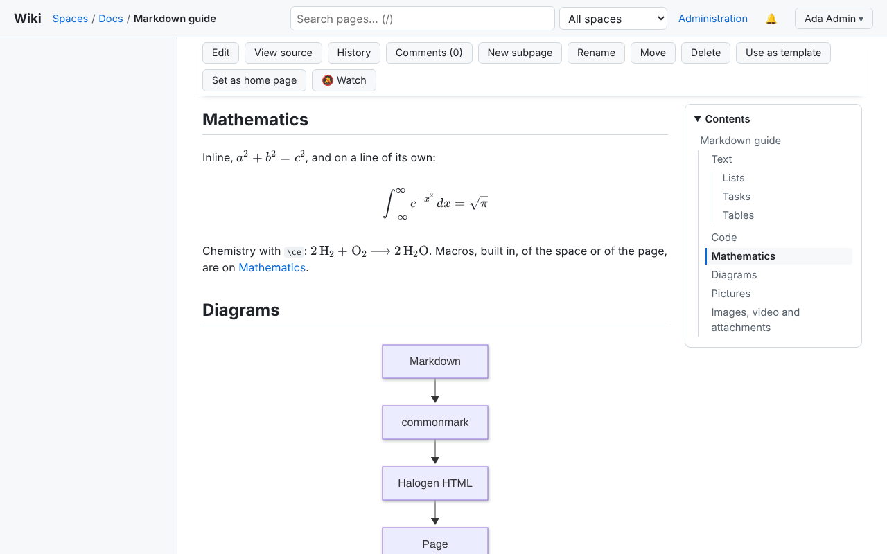
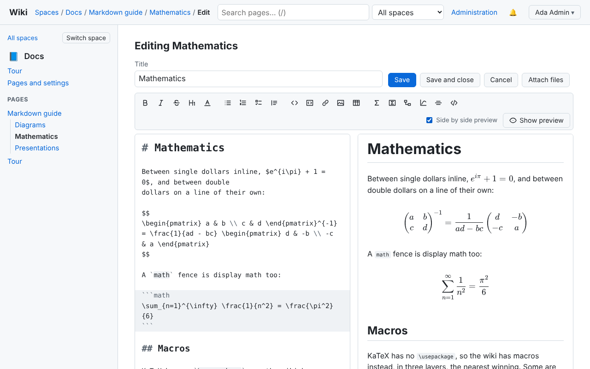
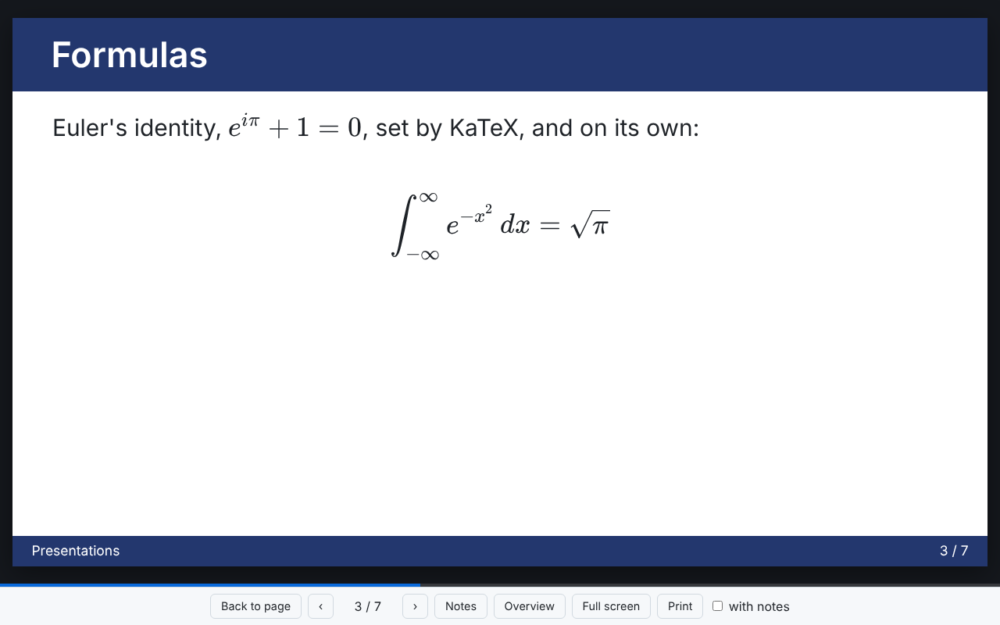
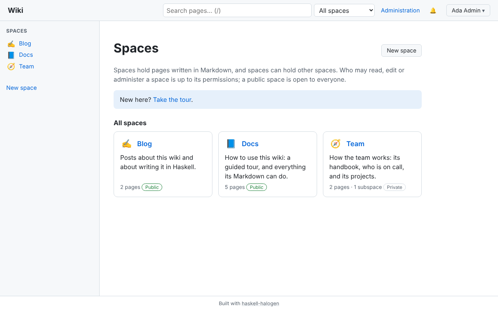
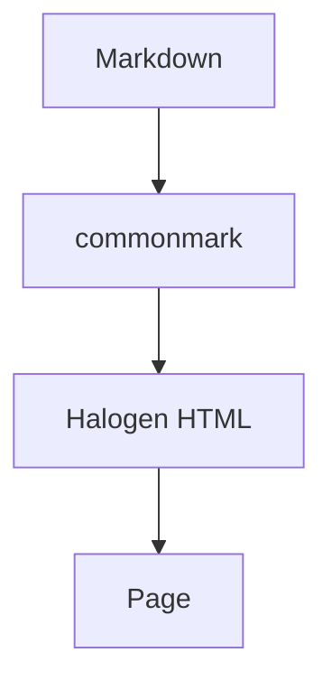
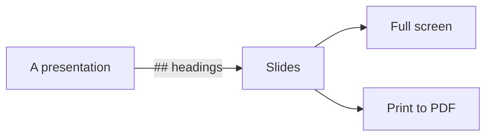
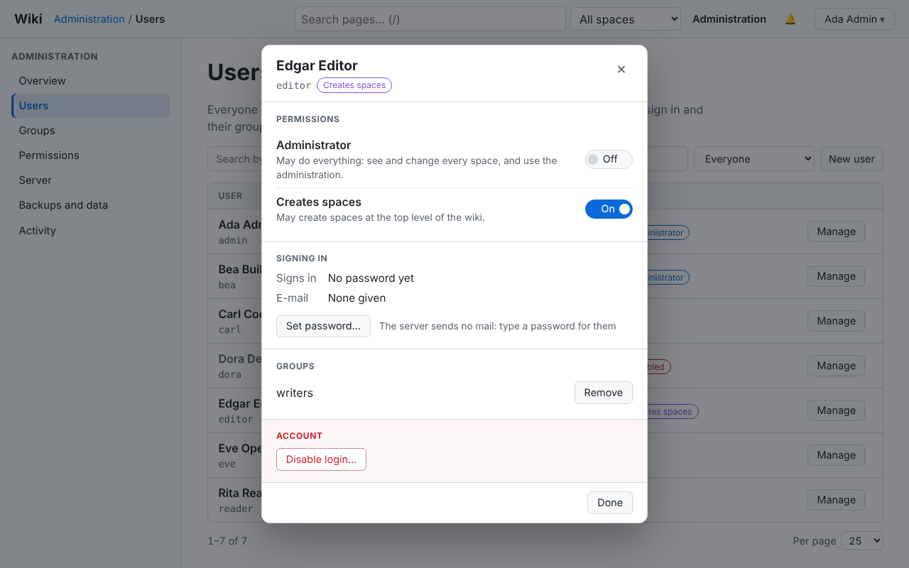
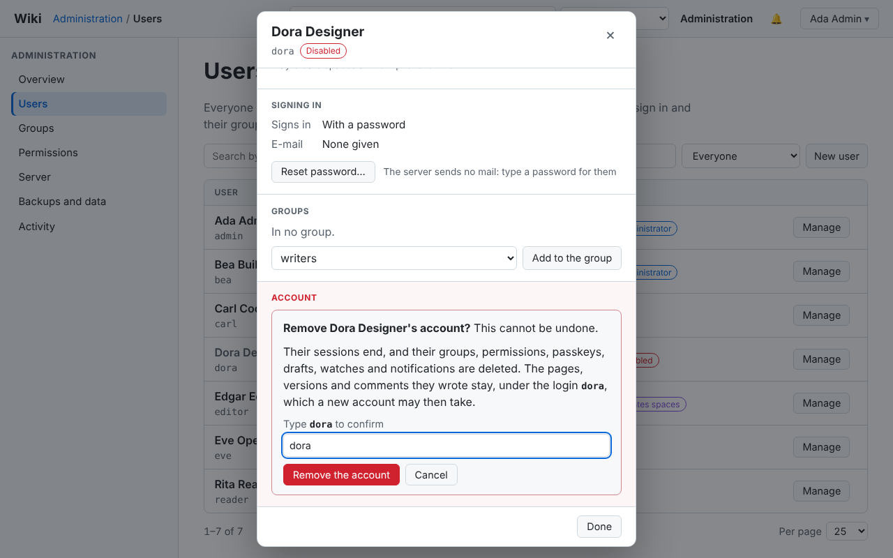

# blog

[](https://github.com/Swordlash/blog/actions/workflows/build.yml)

A wiki in the manner of Confluence, written in Haskell and running in the
browser: spaces and subspaces, each a tree of pages written in Markdown with
formulas, diagrams, TikZ pictures, highlighted code and attachments; an editor
with the page previewed beside it as you type; pages shown as slide decks;
comments, history, search; and users, groups and permissions on spaces, where a
public space makes the same wiki a blog. The browser application is
[haskell-halogen](https://github.com/Swordlash/haskell-halogen) components
compiled to WebAssembly, and it renders the Markdown itself, so the preview never
waits for a server. It runs as a serverless demo that keeps its wiki in the
browser, served as static files, or over its own server, `wiki-server`, which
keeps the wiki in PostgreSQL, or in SQLite where a second process is too much.

**The demo: <https://swordlash.github.io/blog/>.** It opens at a tour that says
what to try, and nothing written there leaves your browser.

It runs in browsers released within the last year: Chrome and Edge 140 or
later, Firefox 133 or later, Safari 18.2 or later.

| | |
| --- | --- |
|  |  |
| A page: formulas set by KaTeX, a diagram drawn by Mermaid. | The editor, the preview beside the Markdown. |
|  |  |
| A page presented as slides. | The front page: the directory of spaces. |

## Writing pages

Pages are Markdown, [CommonMark](https://commonmark.org) with GitHub's
extensions, and what the wiki adds to it is written in Markdown too. Each example
below is part of a page of the demo, as its author typed it, and the line under
it links to that page, where it renders. The complete reference for authors is
[docs/markdown.md](docs/markdown.md); the demo's
[Markdown guide](https://swordlash.github.io/blog/s/docs/p/markdown-guide/) is
the same, written in what it describes (open any page's "Source" to see its
Markdown).

One thing differs from plain Markdown: a line break in the text is a line break
on the page, in quotations and boxes too, so a paragraph is written on one line,
however long, and a line is broken where a break is meant. A line that ends
with a backslash (`\`) goes on in the next one instead: the page shows the two
as one line, with a space between them (two spaces at the end of a line do the
same, as CommonMark's other way of writing that break).

### Mathematics, with KaTeX

Formulas are set in the browser by [KaTeX](https://katex.org), between dollars
or between LaTeX's own delimiters (`\(…\)` inline, `\[…\]` on a line of their
own), or in a `math` fence:

```markdown
Between single dollars inline, $e^{i\pi} + 1 = 0$, and between double dollars on a line of their own:

$$
\begin{pmatrix} a & b \\ c & d \end{pmatrix}^{-1}
= \frac{1}{ad - bc} \begin{pmatrix} d & -b \\ -c & a \end{pmatrix}
$$
```

Euler's identity in the line, and a matrix's inverse set on its own:
[Mathematics](https://swordlash.github.io/blog/s/docs/p/markdown-guide/mathematics/).

KaTeX has no `\usepackage`; macros take its place, in three layers. Some are
built in for every page (`\abs`, `\norm`, `\dv`, `\E`, `\Var` and more), which
an administrator may change in the administration's Editor section. Whoever may
edit a space gives it its own, one `\newcommand` a line, under "Math macros" in its
settings or from the editor's "Math macros" button, which also edits the page's
own; these are the demo's `Docs` space's:

```tex
\newcommand{\vect}[1]{\boldsymbol{#1}}
\newcommand{\Hom}{\operatorname{Hom}}
\newcommand{\eps}{\epsilon}
```

They are on [Docs' pages and settings](https://swordlash.github.io/blog/s/docs/pages/),
and every page of the space and of its subspaces may use them:

```markdown
This space has its own, in its settings, which its pages and its subspaces' pages may use: $\vect{v} \in V$, $f \in \Hom(V, W)$; and here $\eps$ is $\epsilon$, where the built-in one is $\varepsilon$.
```

A bold vector, an upright Hom, and the space's `\eps` set over the built-in one:
[Mathematics](https://swordlash.github.io/blog/s/docs/p/markdown-guide/mathematics/#macros).
And a formula may define its own, which then holds in every formula after it on
the page, as in a LaTeX document:

```markdown
$$
\newcommand{\dist}[2]{d\left(#1, #2\right)}
\dist{x}{z} \le \dist{x}{y} + \dist{y}{z}
$$

so that from here on $\dist{x}{x} = 0$.
```

The triangle inequality, and the macro used again further down:
[Mathematics](https://swordlash.github.io/blog/s/docs/p/markdown-guide/mathematics/#macros).
Chemistry is mhchem's `\ce`, which KaTeX comes with:

```markdown
`\ce` writes chemical formulas and equations (mhchem): $\ce{H2O}$, $\ce{SO4^2-}$, and

$$\ce{CO2 + C -> 2 CO}$$
```

Formulas and a reaction, with sub- and superscripts in their places:
[Mathematics](https://swordlash.github.io/blog/s/docs/p/markdown-guide/mathematics/#chemistry).

### Diagrams, with Mermaid

A `mermaid` fence is drawn by [Mermaid](https://mermaid.js.org), in the browser:

````markdown

````

A flowchart of how a page is rendered:
[Markdown guide](https://swordlash.github.io/blog/s/docs/p/markdown-guide/#diagrams);
a class diagram and a pie chart are on
[Diagrams](https://swordlash.github.io/blog/s/docs/p/markdown-guide/diagrams/).

### Pictures, with TikZ

A `tikz` fence is drawn by TikZ, real TeX run in the browser by
[TikZJax](https://github.com/drgrice1/tikzjax), for a figure whose every point
you place. It holds a picture's commands, a whole `tikzpicture` or a `tikzcd`
diagram, and the lines at its top that load a library or a package:

````markdown
```tikz
\usetikzlibrary{positioning, arrows.meta}
\begin{tikzpicture}[node distance=2cm, box/.style={draw, rounded corners}, >={Stealth[length=3mm]}]
  \node[box] (md) {Markdown};
  \node[box, right=of md] (html) {Halogen HTML};
  \node[box, right=of html] (page) {the page};
  \draw[->] (md) -- node[above] {parse} (html);
  \draw[->] (html) -- node[above] {render} (page);
\end{tikzpicture}
```
````

Three boxes in a row, placed by `positioning`, joined by `arrows.meta`'s arrows:
[Diagrams](https://swordlash.github.io/blog/s/docs/p/markdown-guide/diagrams/),
beside a commutative diagram and a plot drawn with pgfplots. Which libraries and
packages TeX has is in [docs/markdown.md](docs/markdown.md#pictures).

### Highlighted code

A fence with a language is highlighted by [highlight.js](https://highlightjs.org):

````markdown
```haskell
main :: IO ()
main = putStrLn "Hello, world"
```
````

Haskell, coloured by its syntax:
[Markdown guide](https://swordlash.github.io/blog/s/docs/p/markdown-guide/#code).
The names a fence may give each of some seventy languages are listed in
[docs/markdown.md](docs/markdown.md#code).

Every code block has a **Copy** button in its top right corner, shown when
the pointer is over the block or the button has the keyboard's focus. It
copies the code exactly as written, and says "Copied" for a moment. It works
on a page the server prerendered before the application has loaded, and
nothing of it is in the page's text, its search, its exports or the feeds.

A long listing can show a few lines at a time: `rows=N` in braces after the
language makes the block N lines high:

````markdown
```haskell {rows=3}
-- Scroll this block for the rest.
fibs :: [Integer]
fibs = 0 : 1 : zipWith (+) fibs (tail fibs)

main :: IO ()
main = print (take 20 fibs)
```
````

Three lines of it show, and the rest scrolls inside the block:
[Markdown guide](https://swordlash.github.io/blog/s/docs/p/markdown-guide/#code).
` ```{.haskell rows=3} ` says the same, and a value that is not a whole number
above zero is ignored.

The class `numbered` puts a number before each line, beside `rows` or
without it: ` ```haskell {.numbered} `, ` ```haskell {.numbered rows=3} `.
The numbers are in a dimmed margin that is not part of the code: neither
selected nor copied with it, and not searched. A PDF export numbers the same
listings.

### Alerts

GitHub's alerts make a box of their kind (`NOTE`, `TIP`, `IMPORTANT`,
`WARNING`, `CAUTION`):

```markdown
> [!NOTE]
> Your edits are kept in this browser, so a reload finds them. On the **Administration** page, linked at the top right for an administrator, under **Backups and data**, **Export the wiki** saves all of it as a zip file, **Import a wiki** brings such a file back, and **Reset the demo content** puts back the pages you see now.
```

A note, marked as one, at the top of the
[Tour](https://swordlash.github.io/blog/s/docs/p/tour/). Any other word makes
a box too, `> [!EXERCISE]`, titled with the word, with a title of its own after
it on the line if you like (`> [!EXERCISE] Area of $\pi r^2$`, math and all);
an administrator gives a kind a title, a colour (the theme's or any other) and
an icon under "Boxes" in the administration's Editor section, and the demo
defines `exercise` this way. Boxes are numbered, each kind on its own (Tip 1,
Tip 2, Exercise 1), within the page, after the page's number (`Tip 2.3`) or
after the section's too (`Tip 2.1.3`), as the space's settings say; a star,
`> [!TIP*]`, makes a box without one. The editor's **Box** button writes the
marker for you. See the Markdown guide's
[Notes and boxes](https://swordlash.github.io/blog/s/docs/p/markdown-guide/#notes-and-boxes).

### Spoilers

Two bars on each side, `||the butler||`, hide a few words: they are blurred
until the reader clicks them (or presses Enter or Space on them), and a second
click hides them again. A block spoiler hides whole blocks, between two marker
lines of their own, and spoilers nest:

````markdown
[[!spoiler]]{hint}(A hint, if you are *stuck*)
Think of what six times seven is.

[[!spoiler]]{answer}(The answer)
Forty-two, as this program prints:

```python
print(6 * 7)
```
[[/spoiler]]{answer}
[[/spoiler]]{hint}
````

Two spoilers, one inside the other, each closed until it is clicked:
[Markdown guide](https://swordlash.github.io/blog/s/docs/p/markdown-guide/#spoilers).
The name in braces is one word of letters, digits, `-` and `_`; the
description in parentheses, which may hold Markdown, is what the reader clicks
to open it. Any blocks go between the markers, with no prefix on their lines:
code, lists, tables, boxes and other spoilers, since an end marker ends the
innermost open spoiler, and, when it repeats a name, only the spoiler of that
name; `[[/spoiler]]` alone ends the innermost one. A spoiler lies within one
section, or wraps a whole one: its heading first, up to the next heading of the
same or a higher level; the section stays in the page's contents, and following
its entry, or a link to its heading, opens it.

A heading can also hide its own section, with no end marker, which suits a FAQ:

```markdown
### [[!spoiler]] Does a heading spoiler need an end marker?

No: its section ends where the next heading of its level, or a higher one, starts.

### [[!spoiler]]{faq-nesting} Can heading spoilers nest?

Yes. The question below is a spoiler inside this one.

#### [[!spoiler]] How deep can they go?

As deep as headings go, down to `######`.
```

Three questions, the third inside the second, each closed under its heading:
[Markdown guide](https://swordlash.github.io/blog/s/docs/p/markdown-guide/#spoilers).
The heading shows, with its anchor and its entry in the contents, and a click
on it opens the section, up to the next heading of the same or a higher level
or the end of the quotation, box or spoiler the heading is in. A name in braces
after the marker keys what the browser remembers; without one, the heading's
anchor does. Only `[[!spoiler]]` at the very start of a heading's text is a
marker; anywhere else it is a link that leads nowhere. A document exported,
and a feed, show the section as written.

Mistakes show in red where they are, on the page and in the editor's preview as
they are typed: a start marker without its name or description, an end marker
that names no open spoiler, a spoiler never closed or one that cuts a section
(its blocks in red below its marker, with the reason). The reader's browser
remembers which spoilers they left open, per reader, page and name, and opens
them again; another browser or device starts with them closed. The start
marker's exclamation mark keeps it apart from a wiki link: `[[spoiler]]`
without it is a link to a page named `spoiler`. The other blocks of the wiki's
own are written the same way, `[[!notes]]`, `[[!incremental]]` and
`[[!div]]{.summary}` … `[[/name]]`, with `[[!style]]`, `[[!pause]]` and
`[[!toc]]` one line each (see [Presentations](#presentations) and
[docs/markdown.md](docs/markdown.md)). The toolbar's **Inline
spoiler** and **Block spoiler** buttons write both kinds. Exported, a document
shows everything: a block spoiler is a box titled with its description, an
inline one its text.

### A table of contents

Every heading gets an `id` to link to. A page with three headings or more has a
"Contents" panel beside it; `[[!toc]]` on a line of its own puts the list in
the page instead. Without the exclamation mark, `[[toc]]` is a wiki link to a
page named `toc`, like any `[[page]]`:

```markdown
# Team handbook

Private to the team: only people granted a permission on this space, or on the wiki as a whole, can read it.

[[!toc]]

## The week
```

The page's headings, listed where `[[!toc]]` is, each a link to its section:
[Team handbook](https://swordlash.github.io/blog/s/team/p/team-handbook/) (in
the private `Team` space, which the demo's `admin`, whom it starts as, may read).

### Images and attachments

An image is Markdown's, from the web:

```markdown
An image from the web:


```

The photograph, under the guide's
[Images, video and attachments](https://swordlash.github.io/blog/s/docs/p/markdown-guide/#images-video-and-attachments),
beside a video from the web written the same way. A file attached to the page
is named with `attachment:`, and shows as what it is: an image, a video or audio
player, or else a link that downloads it.

```markdown
And a file attached to this page, by its name:


```

The attached image, under the photograph and the video:
[Markdown guide](https://swordlash.github.io/blog/s/docs/p/markdown-guide/#images-video-and-attachments).
The editor writes these for you when a file is dropped or pasted into it.

### Links between pages

A link to another page is its path, from this page or (with a leading `/`)
from the wiki's root, or the page's own address in the wiki
(`/s/docs/p/markdown-guide/diagrams/`), and a wiki link is shorter still:

```markdown
Paragraphs, *emphasis*, **strong emphasis**, ~~strikethrough~~, `inline code` and links, to the web (<https://commonmark.org>) or to other pages by their path from this one: [diagrams](markdown-guide/diagrams), or the [tour](tour) next to this page, or [[tour|the same, as a wiki link]].[^paths]
```

Links to the guide's subpage and to the tour, a wiki link with a label of its
own, and a footnote: [Markdown guide](https://swordlash.github.io/blog/s/docs/p/markdown-guide/#text).
A link to a page that is not there is shown as broken.

The editor writes these links for you. **Link to a page** (Ctrl+Shift+K), next
to **Link**, opens the search box in a dialog: pick a page by its title or its
text, and the link goes around the selected text, or with the page's title as
its text, as `[Mathematics](/s/docs/p/markdown-guide/mathematics/)`, the
page's own address without the server's part, which names that page even where
a subspace has its name. With **Link a section** ticked, the dialog then lists
the page's headings and boxes, and the link goes to the one chosen
(`/s/docs/p/markdown-guide/mathematics/#macros`). Every heading and every box
has a `#` that shows when the pointer is on it: a click copies the address
of that section, and a box's address has its kind and number, `#box-tip-2`.
**Copy permanent link** among a page's buttons copies a link to the page as
it is at that moment, by the page's id and the version's time
(`/l/<page id>/?version=…`): it keeps showing that version after the page is
edited, and keeps working after the page is moved. The page it opens says
which version it is, and links to the page as it is now. The wiki's front
page, which has no address of a version, does not offer it.
Each page lists the pages that link to it under **Linked from**, in the
sidebar below the space's pages: a link counts as the page shows it and a
click follows it (a path, a wiki link, a permanent link, an embed of a page,
a link in a page's HTML), each page once and never a page's link to itself,
and only the pages the reader may read are listed. A link in an `html`
block is not counted: it is in the block's frame, which opens it in a new
tab, not on the page. An encrypted space's
pages have no list and are in none, since the server cannot read them.
Text selected in a page gets **Copy link** beside **Comment**: its address
ends in the browser's own text fragment (`#:~:text=…`), and Chrome, Edge,
Safari and Firefox open it scrolled to that text, highlighted.

Tables, task lists, footnotes, `@` mentions, the HTML a page may hold and its
colours are in [docs/markdown.md](docs/markdown.md), with everything above in
full.

## Presentations

A presentation is a kind of page, chosen under **New page** beside a
document, and its text is Markdown all the same. This is the
demo's [Presentations](https://swordlash.github.io/blog/s/docs/p/markdown-guide/presentations/),
whole:

````markdown
# Presentations

[[!style]]{theme=beamer aspect=16:9}

A presentation is a kind of page: **New page** offers it beside a document. Press **Present** above the page: this one is a presentation, and its slides tell you how it is written.

[[!notes]]
These are the speaker's notes: on the page they are a box like this one; on the slides they are hidden until you press **n**.
[[/notes]]

## Slides

- A `##` heading starts the next slide, and is its title; a `#` heading makes a title slide, like this deck's first.
- A `###` heading is a heading on its slide, and `---` a rule.
- `[[!notes]]`, the notes, then `[[/notes]]` hold what only the speaker sees.
- Everything a page shows, a slide shows: tables, code, formulas, diagrams.

[[!notes]]
Mention that a presentation with no `##` heading is one slide.
[[/notes]]

## Formulas

Euler's identity, $e^{i\pi} + 1 = 0$, set by KaTeX, and on its own:

$$
\int_{-\infty}^{\infty} e^{-x^2}\,dx = \sqrt{\pi}
$$

[[!notes]]
The macros a page defines hold on every slide after the one that defines them.
[[/notes]]

## A diagram



## Code

```haskell
-- A deck is a presentation's Markdown, cut at its headings.
deckOf :: [Block] -> Deck
```

## Presenting

| Key | What it does |
| --- | --- |
| → Space PageDown | the next step, then the next slide |
| ← PageUp | back a step, or to the slide before |
| Home End | the first and the last |
| f | full screen (Escape leaves it) |
| n | the speaker's notes |
| o | every slide, to pick one |

On a touch screen, swipe. **Print** puts one slide on each page: choose "Save as PDF" to keep the deck as a file.

## Steps

A slide can show its content a step at a time. `[[!pause]]`, on a line of its own, is a pause: what follows waits for the next press of → or Space.

[[!pause]]

Like this line, which waited for you. ← hides it again.

[[!pause]]

On the page itself a pause shows nothing. Printed, each slide is whole, unless you tick "each step on its own page"; a Beamer PDF has a page for each step.

[[!notes]]
A pause is pandoc's in an export, so the Beamer export shows the same steps.
[[/notes]]

## One item at a time

A list between `[[!incremental]]` and `[[/incremental]]`, or after a line `{.incremental}`, shows its items one by one:

[[!incremental]]
- each press of → or Space shows the next item;
- the items of nested lists come in their turn;
- off the slides, it is an ordinary list.
[[/incremental]]

## Themes

A `[[!style]]` line at the top level of the page says how the slides look:

```markdown
[[!style]]{theme=dark aspect=4:3}
```

Themes are `beamer` (the default), `light` and `dark`; slides are `16:9` (the default) or `4:3`.
````

It is [these nine slides](https://swordlash.github.io/blog/s/docs/p/markdown-guide/presentations/slides/)
(`Wiki.Core.Slides` cuts them):

- **What makes it a deck.** Its kind: a presentation is made with **New
  page**, or made one with **Presentation** among a page's actions, and
  nothing in its text makes it one. A `[[!style]]` line says how the deck
  looks and shows nothing itself: `theme=beamer` (the default: a title bar,
  and a footer with the page's title and the slide's number), `light` or
  `dark`, and `aspect=16:9` (the default) or `4:3`.
- **Slides.** Each `##` heading of the page's top level starts a slide and is
  its title, and each `#` heading a title slide; a heading inside a list, a
  quotation or a box, and a `###` heading, is a heading on its slide, and a
  `---` a rule. Formulas, diagrams, pictures, code, tables and images are on a
  slide as on a page, with the macros defined on the slides before.
- **Notes.** `[[!notes]]` … `[[/notes]]` holds the speaker's notes of its
  slide: a box on the page, hidden on the slide until **n** shows them under
  it.
- **Steps.** `[[!pause]]`, a line of its own, is a pause: the slide shows what
  comes after it one press later. A list between `[[!incremental]]` and
  `[[/incremental]]`, or after a line `{.incremental}`, shows one item at a
  time. On the page, a pause shows
  nothing and the list is an ordinary one. The Beamer export makes the same
  steps, one PDF page each.
- **Showing it.** "Present", above a presentation, opens it full screen:
  the arrow keys, Space, PageUp and PageDown move, Home and End go to the ends,
  **f** fills the screen, **o** shows every slide to pick one, and on a touch
  screen a swipe moves; the next key shows a slide's next step before the next
  slide. The slide and its step are in the address (`?slide=3&step=2`), so a
  link or a reload comes back to them. "Print" puts one slide on each page, of
  the slide's shape, so the browser's "Save as PDF" keeps the deck as a file;
  "with notes" prints each slide on an A4 page above its notes, and "each step
  on its own page" prints a page for each step.
- **Exporting it.** On a wiki served by `wiki-server` (the demo has no server,
  so no "Export"), "Export" above a presentation downloads it as PowerPoint, as Beamer
  LaTeX, or as a Beamer PDF where the server's `xelatex` works: its slides cut as
  "Present" cuts them, a first title slide made the title page, the notes as
  Beamer's notes or PowerPoint's speaker notes, `beamer` as Beamer's Madrid
  theme, `light` its plain look and `dark` light on dark, the aspect carried
  over (PowerPoint gets 16:9), the steps as Beamer's overlays (PowerPoint
  shows an incremental list one item at a time, but has no pauses). Every page, deck or not, also exports as Word, a
  web page, an e-book or a PDF; see
  [docs/markdown.md](docs/markdown.md#exported-as-documents).

## What it does

- **Spaces** in a tree, public or private, each a tree of pages, shown one at a
  time as Confluence shows them; the front page is a directory of spaces, and a
  space has a description, an icon and a home page of its own. The home page
  is the top of the space's pages: every other page is under it, it is at the
  space's own address (`/s/docs/`, its editor at `/s/docs/edit/`), and a page
  under it has no part of its address for it (`/s/docs/p/markdown-guide/`).
  "New page" with no page to put it under, and a move to a space's top level,
  put the page under the home page. An encrypted space has no home page, and
  its pages may be several at its top. Pages are listed
  by name, by date or in an order put by hand. A space's icon is the browser
  tab's icon on its pages, and the wiki's own icon, which an administrator sets
  on the front page, is the tab's icon everywhere else.
- **Pages in Markdown** ([above](#writing-pages), and
  [docs/markdown.md](docs/markdown.md)), with templates to start one from. A
  footnote's number shows its note when the pointer rests on it; following it
  goes to the note, and the browser's Back returns to the number.
- **An editor** that shows the Markdown as it will look while it is typed
  (CodeMirror), with the preview beside it (**Side by side**) or in its place
  (**Show preview**, which opens at the block being edited and which the
  browser's Back closes), files dropped or pasted in as attachments, drafts
  kept a few seconds after the typing stops, and a conflict shown in place when
  someone else saved first. The title, Save and Cancel stay at the top while
  the text scrolls. A page's title is its first line, `# Title`, which the
  editor keeps there. Inline math left open on its line, a `$` or a `\(` that
  nothing closes there, is underlined in red to the line's end.
  What does not render is marked in the text as well (@codemirror/lint): a
  spoiler's broken marker, a spoiler not closed or cutting a section, a
  quotation that starts like a box's marker but is not one (`> [!]`), all
  found as the text is parsed; and a formula KaTeX cannot parse, a Mermaid
  diagram or a TikZ picture that fails, once the preview has drawn it. Their
  lines are underlined in red, with a mark in a gutter and the message on
  hover, and a count beside the buttons (**2 problems**) goes to the next one
  at each click. A problem goes as the source is fixed.
  The preview beside the text scrolls to the block being written; **Detach
  preview** opens it in a window of its own (on another monitor, say), which
  follows the editor as it is typed. **A−** and **A+** set the size of the
  Markdown's font, and **«** at the bottom left folds the sidebar away; the
  browser keeps both.
- **A writing assistant** in the editor, with your own API key for Anthropic's
  Claude or OpenAI, or any service that speaks either's API (an organisation's
  gateway in front of Anthropic, GitHub Models, OpenRouter, Ollama on your own
  machine; [below](#the-assistant-at-another-address)): a chat beside the Markdown, whose
  model edits the page through tools, each edit shown as a change you accept or
  reject (**Agent** mode), or only answers and changes nothing (**Ask** mode),
  with the models the provider lists for your key. The mode, the model and the
  effort are chosen at the top of the chat, and the text selected stays shown
  while you write to it. The key stays in
  your browser, sealed, and goes to its provider only; every request sends
  [docs/markdown.md](docs/markdown.md) first, cached by the provider, so the
  model writes this wiki's Markdown. Over `wiki-server`, the keys follow you
  to your other devices, unlocked by a passkey ([below](#keys-across-devices)).
- **Slides** made of any page, presented, printed and exported
  ([above](#presentations)).
- **History**: every save a version, its changes shown word by word, and any
  version restored.
- **Comments** on a quote of the page or on the whole page, in threads, with
  replies and resolving, arriving live in every tab over `wiki-server`, each
  with its author's avatar.
- **Avatars**: each user may upload a picture of themselves from the account
  panel, cropped to a circle in the browser; it shows beside their name in the
  header, at their comments, under a page's title ("Created by …, last edited
  by … on …") and, over `wiki-server`, in the stack of who else is reading a
  page beside its title (with a count of the visitors not signed in). A user
  without one is shown by the first letter of their name on a colour of
  their own. A personal
  space without an icon of its own shows its owner's avatar.
- **Mentions and notifications**: `@login` tells someone, under a bell in the
  header, as do comments on and changes to the pages they watch; over
  `wiki-server`, by mail too, and as a private Atom feed whose address the
  account panel gives.
- **Search** by title and text (`/` to focus it), in every space or one.
- **Stars**: a page's **Star** keeps it under **Starred** in the header, one
  click away from every page, for each user (kept by `wiki-server`, or in the
  browser by the demo).
- **Help** at hand: the red **?** in the corner of every page shows, in short,
  what a page can hold (lists, tables, emoji, code, formulas, Mermaid, TikZ and
  the kinds of box, the wiki's own too), each rendered with its Markdown, from the
  in-app guide.
- **Blogs**: a space shown as a blog lists its pages as posts, newest first,
  with an Atom and an RSS feed over `wiki-server`.
- **Users, groups and permissions** to view, edit or administer a space. A
  subspace inherits the grants and the public flag of the spaces above it,
  unless it is made private from its parent ("Make private" in its
  permissions), when only its own grants count. Each user may turn on a
  **personal space** from the account menu: "Space of" and their name,
  public, administered by them, listed under "User subspaces"; turned off,
  it is hidden from everyone and kept. "User subspaces" opens a finder of
  the personal spaces: the starred ones first, then any by login or name. Over
  `wiki-server`, accounts with passwords, a second factor, passkeys
  ([below](#passkeys)), sign-in with Google, GitHub, Apple or any OpenID
  Connect provider, and invitations.
- **Export** of a page or a space as Word, a web page, an e-book, a PDF, a deck
  as PowerPoint or Beamer (over `wiki-server`), and of the whole wiki as a zip
  file, which another wiki, the demo's or a server's, imports. The application
  fetches each document and saves it from a `blob:` URL it makes, which a
  Chromium browser does not block on a wiki served over plain HTTP; a PDF opens
  in a tab instead. An export the server refuses says why, in the corner of the
  window, and saves nothing.
- **Compact or full width**: a switch at the end of a page's bar lays pages out
  at a reading width in the middle of a wide window, or as wide as it, as this
  browser remembers.
- **Every route at an address of its own**, prerendered for the demo and
  rendered per request by `wiki-server`, so a page arrives complete and the
  program adopts it rather than draw it again.
- **Offline reading and installing**: a service worker keeps the application and
  the last pages read, and the wiki installs as an application.
- **For the operator** of `wiki-server`: backups (before every deploy, on a
  schedule, copied off the machine), an administration panel, health and
  Prometheus metrics ([below](#the-wikis-server)).

### Passkeys

Over `wiki-server`, a passkey signs you in without your password or a code.
Add one under **Passkeys** in your account panel (click your name), with a
name for the device and your current password (a passkey signs you in, so
someone at a browser you left signed in cannot add one); the list says when each was added and last used, and
removes one. Then **Sign in with a passkey** under the sign-in form opens
the browser's dialog, and browsers that can also offer your passkey in the
login field as you focus it. The authenticator verifies you (fingerprint,
face, PIN), so a passkey counts as both factors and no code is asked for.
After a password, the second factor's form offers **Use a passkey instead**.
The passkeys the assistant's syncing uses below are the same ones. Like
syncing, passkeys need HTTPS (or the machine's own address).

### Keys across devices

The assistant's API keys stay out of the server's sight. In the browser they
are sealed (AES-GCM, with WebCrypto) under a vault key the browser keeps and
cannot export, so even this browser's storage holds no key as text, in the
demo too. Over `wiki-server` the assistant's settings page offers **Sync
across devices**:

- **Turn on with a passkey.** The browser asks you to make a passkey for the
  wiki (Touch ID, Windows Hello, your phone, a security key, or the passkeys
  of Google Password Manager or iCloud Keychain, which follow you). The
  passkey's PRF extension gives the browser a secret no one else can compute;
  the vault key is encrypted with a key derived from it, and the server keeps
  the sealed settings and that encrypted vault key, neither of which it can
  open. A passkey without the PRF extension is said to be one; it cannot
  sync the keys, and is kept to sign in with.
- **Unlock with passkey**, on another device: one touch, and the keys are
  there. A key typed there before unlocking stays there, and joins the
  synced keys once you unlock; it never replaces a synced one.
- **A changed key** is sealed and sent again; your other devices fetch it
  the next time the wiki opens there, with no touch.
- **Add passkey** (on a device where the keys are unlocked: one touch of a
  passkey you have, then the new one), **Remove**, and **Ask for the
  passkey each time the wiki opens**, which keeps no key on the device, only
  the sealed vault.
- **Turn off** deletes the vault on the server and needs no passkey, which
  is the way back after losing every one; the keys stay in your browsers,
  and the passkeys stay, to sign in with.

Passkeys need HTTPS (or the machine's own address), so over plain HTTP the
page says so instead. A browser offers no encryption to such a page either:
there the keys are kept in the browser as text, as the settings page warns. Behind a proxy that serves the wiki over HTTPS, set the
wiki's public address in the administration, or have the proxy send
`X-Forwarded-Proto: https`: the server checks that a passkey was used on the
wiki's own origin. They need a browser with the PRF extension, which the
browsers the wiki runs in have: Chrome and Edge 140 or later, Firefox 133 or
later, Safari 18.2 or later. A passkey here does
not sign you in; it only unlocks the assistant's keys.

### Your keys

Over `wiki-server`, every user has a key pair (X25519), which encrypted
spaces will use to share their keys with you: a space's key is sealed to
your public key (HPKE, RFC 9180), and only your private key opens it. The
key pair is made in your browser the first time you sign in with your
password, and its private half is sealed in your vault, the same vault the
assistant's keys sync in; the server keeps the vault and your public key,
and cannot open the vault. **Keys**, in your account panel's security,
shows:

- **Your key's fingerprint**, in groups of four. Another member's wiki
  shows the fingerprint of the key it seals to for you: compare the two,
  by a way you trust, to be sure the server gave them your key.
- **Whether this browser holds your private key**, and, where it does not,
  **Unlock with a passkey** or **Unlock with your password**.
- **What unlocks your keys**: your passkeys, and your password if you chose
  it. Signing in with your password unlocks them on a new device by itself
  when your password is among them. A user whose vault a passkey unlocks
  already (the assistant's syncing) is asked once, at a sign-in with the
  password, whether the password should unlock it too; the answer is no
  unless you say yes, and the panel adds or takes it away later.
- **Ask for a passkey or your password each time the wiki opens**, which
  keeps no key in this browser between visits.

Changing your password keeps your keys: your browser carries them over to
the new password in the same request. A password reset cannot, since your
old password is gone: if a passkey of yours unlocks your keys, nothing is
lost, and the panel lets the new password unlock them too; if your password
was the only way, the reset deletes them (your key pair, and the
assistant's synced settings and API keys), says so before it is done, and
your next sign-in makes a new key pair. If you sign in with a provider
instead of a password, a passkey makes your keys, under **Keys**.

What this protects against, and what it does not:

- The server never sees what is sealed in your vault, your private key, or
  the vault's key, in the clear. What it sees is that a vault exists, the
  names of what it holds, and your public key.
- Your keys are as safe as the weakest way that unlocks them: with your
  password among them, your password; without it, your passkeys.
- The server is trusted to tell the truth about who is a member and which
  public key is whose: comparing fingerprints is how you check it.
- A server, or an administrator, that changes the program it sends your
  browser reads whatever your browser opens. That is not defended against.
- The browser holds every key as a WebCrypto key it cannot export, except
  one: the password's secret (OPAQUE's export key), which the OPAQUE
  library gives the page as text. The OPAQUE client turns it into a
  WebCrypto key at once, before the application sees it, and drops the
  text.

Your keys need HTTPS (or the machine's own address): the browser offers no
encryption to a page served over plain HTTP, and the panel says so there.

### Encrypted spaces

Over `wiki-server`, a private space can be **encrypted**: the titles and
texts of its pages, their histories, their comments (with the text each
quotes) and their attachments (names, types and bytes) are encrypted in
its members' browsers, and the server keeps only ciphertext it cannot
read. In the
space's settings, under **Permissions**, **Encrypt this space…** turns a
space encrypted. A space with nothing written in it yet is encrypted at
once: its untouched home page is replaced by one your browser writes and
encrypts, with the same starter text (an encrypted space has a home page,
as every space does, and its address shows it). **Turn encryption off…**
makes an encrypted space plain again.

A space that has pages is encrypted page by page in the browser of the
administrator who asks, with the plain spaces below it, each with a key
of its own: every version of each page, its comments with the text they
quote, and its attachments, encrypted in that browser, sent, read back
from the server and opened again before the page is committed, all of it
in one step. Turning encryption off is the same, the other way, and
deletes the spaces' keys at the end. Meanwhile each page reads the way it
did until its turn, and nothing else can be written in these spaces; a
conversion that stops (the tab closed, a refusal) is continued from the
space's permissions by an administrator of the space who holds its key
("Continue", with the pages left), or turned back ("Stop and turn
back"): the pages converted so far are converted back, the others stay as
they are, and the space ends as it began. A page that stops a conversion
is named, with why, so that it can be mended (shortened, an attachment
deleted) before it continues. While a conversion is paused halfway, the
space's tree holds pages of both kinds: a browser holding the key shows
every title, decrypted or plain; one without it shows the plain pages and,
in their places, the encrypted ones as "an encrypted page" (the server
lists them to any reader, with their places but no title), so that a plain
page under an encrypted one keeps its address. A search finds the encrypted
pages, decrypted in the browser, and not the plain ones until the
conversion ends: the server's search leaves out a space with a key. One browser converts at a time: the one
that holds the conversion's lease, which each page staged or committed
renews for two minutes. Another administrator's browser can continue
only once it has stopped that long; the same user can take it over from
another of their browsers at once ("Take over here"), and the browser it
was taken from writes nothing more, not even a request it had already
sent. A tab left open while another browser started, ended or turned
back a conversion learns of it at its next request the server refuses
for that reason (each such refusal carries a code, `Stale` in
`docs/api.md`): it reads the spaces again, lets go of the keys and pages
of a space plain now, and sends a read once more by the route the space
now takes; a write is not sent again, and the author is told to reload
the page. A tab that believed the space encrypted lists its pages after
asking the server whether it is being converted, so the pages a
conversion made plain since are in its list; one that believed it plain
lists the plain pages until a request of it is refused, or the spaces are
read again. Before a page is committed, its attachments' bytes as the server
staged them are compared, by hash and size, with what the browser sent,
read back, and opened with the page's key as stored. A page encrypted gets a new address
made of random letters, since its old one spelled its title; its link by
id (`/l/<id>`) keeps working, and it keeps that address if the
encryption is turned back. What cannot be converted is said before
anything starts: templates, a blog, a public space, the wiki's front page,
an attachment on the web, someone else's draft of a page, a version whose
title is longer than 6,128 bytes or whose text is longer than 6,291,440
bytes (what an encrypted page's ciphertext holds; a plain page has no such
limit), and, to turn it off, a parent space that is encrypted too. Afterwards the plain text is
gone from the wiki's database: SQLite's files are written over where it
was, and its log emptied; on PostgreSQL old rows stay in the database's
files until it is vacuumed (the wiki does not vacuum it: its
administrator's maintenance does). SQLite's log is emptied by a
checkpoint after the conversion's last commit, which a reader of the
database (a backup being taken, a tool with the file open) can hold
back: the space's permissions then say that the old text is still being
cleared, and the checkpoint runs again after each write to the wiki, and
at the server's start, until it has run. **Backups made before keep the plain text**,
and the attachments' plain files they name stay in the data directory,
until those backups are pruned: nothing deletes a backup.

What can be done, and what cannot, in one place:

- Added in the second part (#213): an export decrypted in your browser;
  encrypting a space that has pages, and turning encryption off, page by
  page, which can be stopped and turned back; asking for a passkey or your
  password each time a space is opened; your keys deleted from the device
  at a sign-out; titles of encrypted pages under the bell and in your
  stars, decrypted in your browser; and the controls the server refuses in
  an encrypted space, or while a space is converted, not offered. One rule
  in `wiki-core` (`Wiki.Core.Offered`) decides both what the server takes
  and what the interface draws.
- Not possible in an encrypted space: templates, a blog and its feeds,
  making it public, moving a page to or from another space, drafts kept on
  the server, restoring a version on the server (your browser restores it
  by saving it again), the server's exports (PDF, Markdown, the whole
  wiki's, which leaves encrypted spaces out), importing into it, and the
  server's search (your browser searches it).
- Limits: the gate of a space that asks each time is the page's own, not
  the encryption's (see above); the writing assistant sends the text you
  ask it about, decrypted, to the provider you chose, as in any space, and
  its panel says so in an encrypted space; a version older than one your
  browser read is caught only in a browser that read the newer one.
- A mention in an encrypted page or comment is named from the space's
  readers, which the browser asks for by the space alone: no login found
  in the decrypted text, nor letters typed after an @, reach the server.
  A login that is not a reader's is shown as written.
- The whole wiki's export leaves encrypted spaces out, and says which,
  next to its button. "Export, decrypted here" is not offered while a
  space is being converted, which would miss pages.

How it works:

- The space has a key of its own, made in the browser that encrypts it.
  Each member gets the key sealed to their public key (see **Your keys**).
  Who is a member is decided by the server's permissions, as for any
  space: a reader granted on the space waits for the key until another
  member's browser opens the space, which seals the key to them at once,
  without asking (the owner's decision, 2026-11-09). So a space's
  administrator, and a global administrator who grants themselves the
  space in its permissions, receive the key the next time a member opens
  the space. Checking a member's key by its fingerprint, and confirming
  each new member before the key is shared, are planned. A reader without
  a key pair yet (who has not signed in since keys came) waits until their
  first sign-in makes one.
- Each page has a key of its own, encrypted with the space's key, so that
  a single page can be shared later.
- **New subspace** in an encrypted space makes the subspace encrypted, with
  a key of its own and its home page, made in your browser. Its readers are
  the parent's, unless it is private from its parent, and those its own
  permissions add: each gets its key as for any encrypted space, so a
  reader granted the subspace alone reads it and not its parent. The rule
  the server keeps: every space below an encrypted space is encrypted, and
  an encrypted space shares its readers only with encrypted spaces, none of
  them public. So a plain space is not moved into an encrypted one, a
  subspace open to a plain parent is not encrypted (make it private from
  its parent first), an encrypted subspace is not moved under a plain
  space unless it is private from it, and no space whose readers an
  encrypted space shares is made public. Removing a reader of a space makes
  a renewal of the key due in it and in each subspace open to it, and not
  in a subspace private from it. A subspace's name is plain, as every
  space's; its pages are not. A space encrypted before subspaces and home
  pages came gets its home page when one of its administrators next opens
  it: its pages go under it, and keep their addresses.
- On a device that does not hold your keys, the space shows as locked and
  offers to unlock them there, with a passkey or your password.
- **Ask for a passkey or your password each time this space is opened**,
  a switch in the space's permissions for its administrators, guards
  against someone using your unlocked computer: nothing of the space, or
  of the spaces below it, is decrypted until you open it with a passkey
  (where your vault has one and the browser can use it) or your password.
  Leaving it, for a page outside it or the front page, forgets its key,
  its pages decrypted for the search, its attachments' addresses and your
  confirmation in that tab; a reload asks again too. Outside it, its
  starred pages and its pages under the bell are named "an encrypted
  page", a search finds nothing of it, and its pages' tabs and history
  entries are titled by the space alone. While its encryption is being
  turned off, the pages made plain already are behind the gate too, by
  every route (the page, its link by id, the list of pages, its history
  and comments): once you open the space, you read the pages not
  converted yet decrypted and the others plain; the setting goes with the
  encryption at the end. It is a gate in the wiki's own
  page, not in its encryption: someone who opens the browser's developer
  tools on a device where your keys are unlocked gets past it. Someone
  who signs in only with a provider, and has no passkey on the device,
  cannot open such a space there.
- Signing out, or a tab finding that your session ended or is someone
  else's now, deletes your vault's key and your private key from the
  device, in every tab of the wiki and in the browser's storage; the
  assistant's own key stays, unless it is the vault's key. The other tabs
  let go at once of every encrypted space they hold open (its keys, its
  pages, its attachments' addresses) and ask the server who is signed in.
  A page that opens and hears from the server that nobody is signed in
  deletes every user's keys on the device the same way, so that a session
  that ended with no tab open (expired, or signed out from another
  device) leaves no key behind either. The preview of a page detached
  from its editor keeps nothing of a page of an encrypted space once its
  editor closes. Signing in with
  your password unlocks them again by itself. Signing in with a provider
  does not: your keys are then locked, and a passkey unlocks them before
  you read an encrypted space.
- Slugs in an encrypted space are random, since a title's slug would show
  the title.
- Each version of a page names its number and the version before it, in
  what its encryption binds, so the server cannot change either. Your
  browser remembers the latest version it read of each page, only ever
  moving forward. When the server later sends an older one, a different
  one under the same number, a later one that its history does not join,
  version by version, to the one your browser read, or a history with a
  version missing or out of order (within a page of the history or
  between two pages of it), or a whole history that does not begin with
  the chain's first version (its oldest versions left out), the page is
  shown under a banner that says so, and cannot be edited in that tab
  until it is reloaded. Turning a space's encryption off checks each
  page's whole history so before it makes it plain. What this
  does not catch: an older version sent to a browser that never read the
  page; versions from before versions were numbered left out below the
  first numbered one; a page the server hides or deletes altogether, or
  leaves out of a list of pages (a space's pages, the pages a conversion
  has left, which the server alone counts, so a page left out of a
  decryption is not made plain, and its key goes with the space's at the
  end; the pages and spaces of an export decrypted here); and comments or
  attachments the server leaves out, reorders or sends as they were
  before (each one opens only as itself, on its own page, but has no
  version number). What your browser remembers is
  in its storage for this site, and nothing in it is secret: clearing the
  browser's data for the wiki forgets it, and with it the protection
  against an older version on that device. Versions written before this
  check came (WP5.74b3) are not numbered; their order is the server's
  word.
- A page encrypted again, after its space's encryption was turned off,
  starts a new chain of versions under the same page: each chain has an
  origin, a random id the browser that starts it picks and every version
  of it binds in its encryption. Your browser keeps what it read of each
  chain of a page; a new chain it takes as the page encrypted again, and
  a chain it read before the latest one, shown again, as the page as it
  was (the banner says so). What this rests on: only a browser that holds
  the space's key can start a chain. Nothing proves who sealed a grant of
  the key to you, so a server that seals a key of its own making to your
  public key could show you a space, and chains, of its own: the checks
  hold for the keys the space's members made, as everything here does
  (see "Your keys": the server is trusted to say which public key is
  whose).
- Search runs in your browser: the first search after the page opens
  fetches every page of each encrypted space whose key you hold and
  decrypts it in memory, until a change: one you make, a save the page
  hears of, or a list of the space's pages that shows pages added or saved
  since. A search limited to an encrypted space is not sent to the server
  at all. That suits small spaces, the kind encrypted spaces are for; a
  space of thousands of pages makes that first search slow.
- Comments and attachments are encrypted with the page's key, each bound
  to its page and its own id, which the browser chooses. A comment shows
  for the people it is shown to on any page; those told of it under the
  bell are told by the page's id, with no title and no excerpt (the bell
  shows the title, decrypted in your browser where it holds the space's
  key and the space does not ask first; the mail and the feed say "an
  encrypted page"), and a
  mention in it notifies nobody, since the server cannot read it. Editing
  a comment tells nobody. An attachment's bytes are fetched encrypted
  and decrypted in your browser into an address of its own, which the
  view showing the page holds and lets go when it shows another page or
  closes (or you sign out): an hour of reading keeps only the attachments
  of the pages open. An interactive SVG is shown as an image there, as on
  a copy kept offline. A link to an attachment follows the server's rule
  for plain ones: images, video, sound and plain text may open in the
  browser; anything else, an SVG among them, is downloaded, never opened
  as a page. Each upload is encrypted afresh, so the server
  cannot tell one file uploaded twice from two files of one size. The
  server sees how many comments a thread has, who wrote each and when,
  whether a thread quotes the page and is resolved, and each
  attachment's size.
- The writing assistant works in encrypted pages as in any other (the
  owner's decision, 2026-11-09): what you ask it about, the page or the
  selection, is sent to the assistant's provider, as in any page. It is
  not sent to the wiki's server.

What the server does with a page's text cannot be done in an encrypted
space, and is refused there with the reason: the server's search, PDF and
Word exports, feeds and link previews, drafts, templates, moving a page in
or out (a page moves within the space as usual), importing an archive into
it, and making it public. The page does not offer exports
there, and your browser sends no page's text, comment or attachment by
the plain routes, even to be refused. No draft is kept, on the server or in
your browser: **Cancel** with unsaved changes offers to discard them or
to go on editing. A whole-wiki export leaves encrypted spaces out, and a
whole-wiki archive is imported with every space plain. Notifications of
a change in an encrypted space carry no title and no excerpt.

**Export, decrypted here**, in an encrypted space's list of pages, is the
export your browser makes, for anyone who holds the space's key: it reads
the space and each of its subspaces whose key it holds, decrypts them, and
saves one file in the wiki's own archive format, with the latest title and
text of each page, their attachments, and their comments with their
authors' names. The file holds no older versions, drafts, users, groups or
grants; a subspace whose key the browser does not hold is left out, with
the subspaces under it, and the export says which. Anything else that does
not decrypt refuses the whole export, naming the page, so that the file
never lacks something silently, and the browser reads the file back before
it saves it. The plain text exists only in your browser and in the file:
nothing of it is sent to the server. A wiki imports the file as plain
spaces, through its administration's import (not into the encrypted space
it came from, which the import refuses). Make one before a password reset
that would delete your keys.

What the server still sees: the space's name (shown in the list of
spaces), the shape of its tree of pages, how large each page is, when and
by whom pages are saved and commented on, how many comments and
attachments a page has and their sizes, who the members are, and their
public keys. Not the titles, texts, histories, comments or attachments.
The words searched for reach the server too: the search page's address
carries them, and the server searches the plain spaces with them. It
never sees the encrypted pages, nor which of them matched.

Not there yet, and to come: an option of an encrypted space to ask for a
passkey or the password before each opening, with signing out removing
your keys from the device; and the titles of encrypted pages under the
bell (they show as "an encrypted page" there for now).

Removing a reader gives the space a new key (WP5.74b3). A reader stops
being one when their grant, their group's grant or their membership of the
group goes, when their account is disabled or removed, or when a password
reset retires their key pair. Until the key is renewed, nothing more can
be written in the space: the server refuses it, saying why, and the
space's administrators are told once, under the bell. The browser of an
administrator of the space who holds the key renews it whenever it opens
the space, at once when that administrator made the change: a new key,
sealed to every reader, every page's key wrapped again with it, and a new
key for each page, which what is written next is encrypted with. The
browser opens all of it before it sends it, and sends nothing if any of
it does not open. Someone removed who kept the old key can still read,
with a copy of what the server stores, what was written before, and
nothing written after. A comment or an attachment names the key of its
page's it was encrypted with, and the renewal keeps every older key of a
page, wrapped again, so what was written before is read with the key it
names. One renewal carries at most 20,000 keys of pages
and 5,000 readers; a larger space is refused with a message. A password reset that
deletes your keys takes away your access to encrypted spaces until another
member opens them and shares the key with your new key pair; a space no
other member can read is lost. What you read is decrypted in your browser,
which keeps what any page leaves on the device (the titles of the pages you
visited last, for one): encryption protects the pages from the server, not
from someone at your device. Encrypted spaces need the wiki's HTTPS
address, as your keys do.

### The assistant at another address

Each provider's settings choose a **Service**: the provider's own, or one of
the services that speak its API which the wiki's administrator lists in the
administration's "Server" section, "The assistant's services" (WP5.60). For
Anthropic's API that is typically an organisation's gateway in front of
Anthropic (what Claude Code takes as `ANTHROPIC_BASE_URL`), which gives each
user a key or token of their own (the one Claude Code's `apiKeyHelper`
prints); for OpenAI's, GitHub Models, OpenRouter, or Ollama or LM Studio,
which needs no key. The model list is then the service's own, fetched
there, and the assistant names the service by its host.

To add one, an administrator opens Administration, Server, "The assistant's
services", chooses "Add a service", and gives its name (what users see), its
base URL as the provider's SDK takes it (`https://gateway.example.org/v1`,
`http://localhost:11434/v1`) and the API it speaks. Every session carries
the list, so the next page a user opens offers it. Nobody types an address
in the assistant's settings: one the administrator has not listed would be
refused by the page anyway. An address a user kept from before, which no
service offers any more, is shown as no longer offered until another is
chosen.

- **The key goes as a bearer token.** Both providers' SDKs send the key as
  `Authorization: Bearer <key>`, which is what such a gateway takes, so
  there is nothing to choose. The browser also sends Anthropic's
  `anthropic-dangerous-direct-browser-access: true`, and the service has to
  answer the browser's CORS preflight with `authorization` among the
  allowed headers.
- **The address is allowed with the service.** Every page's Content
  Security Policy lets the browser reach Anthropic's and OpenAI's APIs and
  the origins of the administrator's services, and no other address. The
  server's `--assistant-hosts` allows more origins, for the policy only:
  they are not offered to users. A service that cannot be reached at all is
  said to be unreachable, with CORS named as a likely cause.
- **An expired key is pasted again.** Nothing renews a key or a token. When
  the service refuses one (a 401), the chat and the settings say that it
  has probably expired or been revoked, and the chat links to the settings
  to paste a new one.

## How it is built

The browser application is Halogen components over a backend interface,
implemented once in memory (the serverless demo) and once over HTTP to the
Haskell server. Markdown is parsed (`commonmark-hs`) and rendered to Halogen
HTML in the browser, by the same `wiki-core` the server renders pages with;
KaTeX, Mermaid, TikZJax and highlight.js fill the elements Halogen leaves to
them.

There are two ways to run it, from the same `app.wasm`: the serverless demo,
the whole reading and writing experience over a wiki seeded with demo content
and kept in the browser, deployable as static files; and the wiki's server,
`wiki-server` (servant over PostgreSQL or SQLite), which keeps the wiki and serves the
application, which then reads and writes the wiki over HTTP. The page says which
(`<meta name="wiki-backend" content="demo">` or `"server"`), so the build decides
by the pages it writes: `npm run build-wasm` writes the demo's (what GitHub Pages
serves), `WIKI_BACKEND=server npm run build-wasm` the server's, and
`toolchain/deploy-local.sh` deploys the server with those (and, with `--static`,
the demo).

## Running the demo

The demo runs at **<https://swordlash.github.io/blog/>**, deployed from `main` by
CI (below): everything you write there stays in your browser.

Or build it and serve it on <http://127.0.0.1:8080>, with the toolchain below:

```sh
npm ci
npm run serve-wasm      # runs build-wasm first; or build-wasm alone, to build only
```

Or, without a toolchain, take the page a CI run built: download the `app`
artifact of a run of the `CI` workflow on GitHub (the run's page, under
*Artifacts*, kept for three days), unzip it, and serve the directory under
`/blog/`, the path it is built for, with any static server that answers an
address with no file of its own with the directory's `404.html`, as GitHub
Pages does. `npx http-server` does, from a directory holding it as `blog/`
(then open <http://127.0.0.1:8080/blog/>):

```sh
mkdir site && unzip app.zip -d site/blog && cp site/blog/404.html site/ && npx http-server site -p 8080
```

Or, with Node alone, deploy the demo's page CI keeps for main's newest commits and
for each tag as a service on this machine, served at <http://127.0.0.1:8080/>:
`sh toolchain/deploy-local.sh --static --http --bind 127.0.0.1 --port 8080 --backend-only`
(see [Without a browser build](#without-a-browser-build)).

An administrator can choose **Edit home page** to use the ordinary page editor:
the full formatting toolbar and shortcuts, previews, uploads and pasted or dropped
attachments, automatic drafts, the writing assistant, tracked changes and save
conflicts. **Save** stays in the editor; **Save and close** returns to the root.
The home page also has source, history and restore, contents, presentation and
server document exports. Comments are disabled on the home page alone.

**Spaces** and **Recently visited** below the page are switched on and off in
the home page's editor, under **Home page** above the text, with the wiki's
icon: the switches are saved with the page by **Save**, and **Cancel** drops
them (the icon is saved as soon as it is set).
The sidebar keeps the spaces the reader may open even when the directory is hidden.
Recently visited belongs to each browser. Wiki links in the home page start at
the wiki root, for example `[[/docs]]`; attachments belong to its real page and
persist on the server or in the demo's IndexedDB.

Only global administrators and the loopback operator can edit the shared root.
In a closed wiki, **Show to signed-out visitors** is off by default. Turning it
on shares this home page, its attachments, source and history, including older
versions. Other wiki pages still require sign-in. Turning it off revokes these
anonymous reads. The root is a singleton, so its space and page cannot be moved,
deleted, used as a template or given children. Existing home content and section
switches upgrade automatically without a reset. Full exports include the home
page, its attachments and versions; older and space-only archives preserve it.

The front page invites you to the tour, which says what to try. Nothing you do is
sent anywhere, and a reload starts the demo over.

## Deploying on your own machine

The easiest way in is the wizard, `toolchain/configure.sh`: a terminal application
that asks for the deploy's options in a few screens (what to deploy, where the page
comes from, the database and the TeX of the PDF exports, how it is reached, the
address, the rest), each with what it does, and hides what does not apply to the
choices before it. It starts from the
deployment's last run, read from its state file, so a redeploy is Enter through every
screen. The last screen shows the command line, `sh toolchain/deploy-local.sh …`:
Enter runs it, with the deploy's output in the terminal, and `q` quits and prints it
to copy. The first screen also offers `--status` and `--stop` for a deployment.

```sh
sh toolchain/configure.sh
```

The wizard is the deploy screen of the maker's terminal interface, `maker-tui deploy`,
a Haskell program with [brick](https://hackage.haskell.org/package/brick), compiled on
your machine with the maker's own cabal project. So the wrapper first checks the C
compiler and libraries (`toolchain/check-native.sh --with-wizard`, which adds terminfo,
below), installs GHC and cabal (`toolchain/bootstrap.sh native --with-wizard`), and then
runs it, through `sh toolchain/maker.sh tui deploy`. The first run compiles brick and
vty, which takes a few minutes; cabal keeps them, and later runs start at once.
Everything the wizard does can be done with the options below, which it only writes
out.

On a machine that installs nothing from the internet (see
[A machine that installs nothing from the internet](#a-machine-that-installs-nothing-from-the-internet)),
give the wrapper the deploy's options for it. `--system-tools`, `--hackage-mirror`
and `--libsodium-source` reach the bootstrap that installs the wizard's compiler, so the
wizard is compiled with the machine's own GHC and cabal, brick and vty come from the
mirror, and libsodium is built from the tarball given (the bootstrap's `native` mode
builds it). All four start the wizard's screens with those answers, so the deploy it
runs takes them too.
The mirror is written into the toolchain's own cabal configuration, so name the
deployment's toolchain directory:

```sh
WIKI_TOOLCHAIN_HOME=/srv/wiki/toolchain sh toolchain/configure.sh --system-tools \
  --hackage-mirror https://hackage.example.org/ --npm-registry https://npm.example.org/ \
  --libsodium-source /srv/incoming/libsodium-1.0.22.tar.gz
```

`toolchain/deploy-local.sh` builds the wiki's server (see
[The wiki's server](#the-wikis-server)), or with `--static` the demo, and serves it
from a Linux machine of your own (x86_64 Debian or Ubuntu) as a systemd user
service, for you and your devices on its Tailscale network, over HTTPS at the
machine's name there, `https://<machine>.<tailnet>.ts.net/`; or over HTTPS with a
certificate of your own, or behind a reverse proxy (below). Run it from the
checkout, as the user the service should run as (not root):

```sh
sh toolchain/deploy-local.sh --port 8080    # or: npm run deploy-local -- --port 8080
```

The first run deploys the server, since the demo's home is GitHub Pages and a
machine of your own is for a wiki that keeps what is written in it; `--static`
deploys the demo instead, as static files. Later runs deploy what the previous one
did until told otherwise (`--server`, `--static`), so a deployment keeps its kind
across redeploys, the demo deployments of earlier versions included.

It runs the bootstrap (`toolchain/bootstrap.sh build`: the compilers, the wasm
sysroot and Node, with neither Chromium nor fourmolu, so no root for Chromium's
libraries), `npm ci` and
`npm run build-wasm-opt`, the `-O2` production build, and stops on any failure
before touching what is running. The first `-O2` build compiles every dependency
again and can take over an hour; later ones take minutes. What follows is the
demo's deployment (`--static`); the server's installs `bin/wiki-server` in place of
`server.mjs`, beside its data, and adds its admin listener (below). It stops the
running service, empties `~/wiki-demo` (or `--dir`) and copies into it the built page
(`app/`, with a brotli'd copy of each compressible file for browsers that accept it)
and `server.mjs`, a static server with no dependencies that serves the page as
GitHub Pages does, `404.html` included. It writes and enables
`~/.config/systemd/user/wiki-demo.service`, which runs that server with the Node the
bootstrap installed, by absolute path, so the service depends on neither the checkout
nor its `node_modules`; starts it on `127.0.0.1:8080`, checks that it answers, puts
it behind `tailscale serve`, checks that the HTTPS address answers, and prints it
first among the addresses to open.

### HTTPS, through `tailscale serve`

The server listens on 127.0.0.1 only, and Tailscale serves it to your tailnet:
the deploy runs, as you,

```sh
tailscale serve --bg http://127.0.0.1:8080
```

after which tailscaled answers `https://<machine>.<tailnet>.ts.net/` on port 443,
terminating TLS with a Let's Encrypt certificate it fetches and renews itself, and
proxies to the server. It is reachable from your tailnet only: the script never
turns on Funnel, which would publish it on the internet. tailscaled keeps that
configuration across restarts, so it is set once; every later deploy reads
`tailscale serve status` and leaves it as it is when it already proxies to the
port (a serve you set by hand for that port counts as the deployment's), moves it
when the port changed, and leaves alone, saying so, anything else served at that
address. The wiki's server runs with `--secure-cookies` behind it.

Before the first deploy, once for the tailnet:

- Turn on **MagicDNS** and **HTTPS Certificates** in the
  [DNS settings](https://login.tailscale.com/admin/dns) of Tailscale's admin
  console. Without them the deploy says which is off and serves plain HTTP, as
  `--http` does, until a later run finds them on. The machine's name, as with any
  publicly trusted certificate, is then written into the public Certificate
  Transparency logs: `<machine>.<tailnet>.ts.net` is visible to anyone who looks,
  though nothing behind it is reachable from outside the tailnet.
- Let your user change Tailscale's configuration without sudo, once:
  `sudo tailscale set --operator=$USER`. Otherwise the deploy cannot set the serve
  itself; it prints the command to run as root
  (`sudo tailscale serve --bg http://127.0.0.1:8080`) and the operator command, and
  goes on, the wiki answering on 127.0.0.1 meanwhile. Run either, and the next
  deploy finds the serve set. A Tailscale older than 1.52, whose `serve` command
  had another form, gets that form printed instead (`tailscale serve https:443 /
  http://127.0.0.1:8080`); upgrading is better.

The first request to the address fetches the certificate, which can take a
minute: the deploy tries for that long, then warns rather than fails (try
`curl https://<machine>.<tailnet>.ts.net/` a little later). The service worker
and "Install" (reading offline, above) need HTTPS, as a browser lets them in only
on a secure page.

`--http` serves plain HTTP instead, for a tailnet without HTTPS certificates: the
server listens on the machine's Tailscale address (`tailscale ip -4`), without
`--secure-cookies`, and is opened at `http://<tailscale address or MagicDNS
name>:8080/`; a serve an earlier deploy set is turned off (`tailscale serve
--https=443 off`). It is remembered like the other options, and `--https` goes
back. Behind `tailscale serve`, `--bind` with any other address than 127.0.0.1
implies `--http`; `--bind 0.0.0.0` listens everywhere.

### HTTPS with a certificate of your own

Where a certificate comes from elsewhere, as at work from the company's
certificate authority, the server serves HTTPS itself, without Tailscale:

```sh
sh toolchain/deploy-local.sh --tls-cert wiki.crt --tls-key wiki.key --bind 0.0.0.0 --port 8443
```

The files are PEM, as authorities hand them out: the certificate file holds the
server's certificate with its chain after it (the intermediate certificates), the
key file its private key, and a `.pem` holding both is given as both
(`--tls-cert wiki.pem --tls-key wiki.pem`). `wiki-server` terminates TLS on its
public listener with `warp-tls` (TLS 1.2 and 1.3; the admin listener stays plain
HTTP on 127.0.0.1), marks the session cookie `Secure`, and gives its own address as
`https://` where no public address is set. It reads the files as it starts, and
refuses to start, naming the file, when one cannot be read, holds no certificate or
no key, or the key is not the certificate's. The unit names them by absolute path
where they are, so they must stay there, readable by your user, and outside the
deployment's directory, which installing empties, or under its `data/` (as
`~/wiki-demo/data/tls/`; the deploy refuses them anywhere else in it); a renewed
certificate takes a restart, `systemctl --user restart wiki-demo.service`. The
files are remembered, and a renewed certificate in a new file is given alone
(`--tls-cert new.crt`).

Any `--bind` will do, `0.0.0.0` included (without `--bind`, the Tailscale address,
as with `--http`); ufw is opened for the port as with `--http`. The deploy checks
that the server answers over HTTPS with `curl --insecure`, the certificate left
unchecked; `--tls-ca company-ca.crt` then checks it as a browser that trusts that
authority would, for the name the certificate is issued for (read with `openssl`),
and warns when it does not verify: most often, a chain missing from the
certificate file. To try the way with a certificate of your own making, which
browsers warn about:

```sh
openssl req -x509 -newkey rsa:2048 -nodes -days 365 -subj /CN=wiki.example \
  -addext subjectAltName=DNS:wiki.example -keyout wiki.key -out wiki.crt
```

### HTTPS behind a reverse proxy

For a wiki on the internet, a reverse proxy on the same machine (Caddy, nginx)
can serve HTTPS with a certificate it fetches and renews itself:

```sh
sh toolchain/deploy-local.sh --behind-proxy --port 8080
```

The server then listens on `127.0.0.1` only, over plain HTTP, with `Secure`
cookies, and no firewall rule is opened; the deploy prints what the proxy must do.
It must pass WebSocket upgrades on (comments and notifications arrive live at
`api/v1/events`), and send `X-Forwarded-Proto` and `X-Forwarded-Host` (or keep the
`Host` the browser asked for), from which the server tells its public address and
the origin passkeys are checked against. Caddy's `reverse_proxy` does all of it;
a whole Caddyfile, with the certificate from Let's Encrypt:

```
wiki.example.org {
    reverse_proxy 127.0.0.1:8080
}
```

`--https` (through `tailscale serve`), `--tls-cert`, `--behind-proxy` and `--http`
exclude each other: the deploy refuses two together. The one given is remembered,
and giving another moves the deployment over (the serve or the firewall rule of
the way before is turned off). `--status` says which way a deployment serves.

### Everything under one directory

On a machine where the home directory is not the place for it (a company's server,
on a user without sudo), `--prefix DIR` puts the deployment and everything it needs
under one directory:

```sh
sh toolchain/deploy-local.sh --server --sqlite --prefix /srv/wiki --bind 0.0.0.0 --port 8080 --no-firewall
```

`/srv/wiki/bin/`, `app/` and `data/` as below, the deployment's state in
`/srv/wiki/state/` (with the PostgreSQL files, on PostgreSQL), and the toolchain the
build needs in `/srv/wiki/toolchain/`: ghcup's compilers, the wasm sysroot, Node, the
cabal store and npm's cache, several gigabytes, once (`--toolchain DIR` puts it
elsewhere, remembered for the next run; two deployments share one by naming the same
directory). The home directory holds nothing of it but
`~/.config/systemd/user/wiki-demo.service`, which systemd reads from there alone.
Since nothing in the home directory remembers the deployment, every later run names
it: `--status --prefix /srv/wiki`, `undeploy-local.sh --prefix /srv/wiki` (whose
`--purge` then deletes the toolchain too, and keeps `data/`). The directory can be
anywhere but `/`, the home directory and the ones above it, and the checkout must be
outside it; a directory that is not empty is used only when this script made it. A
deployment made without `--prefix` (in `~/wiki-demo`, its state in
`~/.config/wiki-demo`) is adopted when a deploy names its directory with `--prefix`:
once the build has succeeded its state moves under it (the PostgreSQL files are
copied, and the old ones go once the new unit names the copies), and the toolchain
stays in the home directory unless `--toolchain` says otherwise; `--status` reads
the state where it is. A `--toolchain` inside the prefix can only be
`<prefix>/toolchain`, since installing empties the rest. `--dir` is the old name of
`--prefix`.

`--bind 0.0.0.0` listens on every address and serves plain HTTP (`tailscale serve` and
the Secure cookies are for 127.0.0.1 behind it), over which signing in with a password
works and passkeys do not; `--no-firewall` leaves ufw alone, which without sudo the
script could not change anyway. Without sudo there is no lingering either: try
`loginctl enable-linger` from a session on the machine itself, or ask an
administrator for it, or the service stops when you log out.

### Without a browser build

On a machine that cannot build the page (no npm registry, so `npm ci` cannot run;
nothing new may be installed, so no Node or wasm toolchain either), `--backend-only`
downloads the page GitHub Actions built and builds `wiki-server` alone:

```sh
sh toolchain/deploy-local.sh --server --sqlite --prefix /srv/wiki --bind 0.0.0.0 --no-firewall --backend-only
```

The page is the one `npm run build-wasm-opt` makes for the server
(`WIKI_BACKEND=server HALOGEN_BASE_PATH=/`), built by
`.github/workflows/server-page.yml` and kept as a release asset of the repository
`origin` names, a zip of `dist-newstyle/wasm-opt/public/app`:
`app-server-<commit>.zip` (and the demo's page, `app-demo-<commit>.zip`, below) on
the pre-release `main-latest` for each of main's newest five commits (a push to main that changes Markdown alone builds none, unless it is
Markdown compiled into the programs: `wiki-core/templates/` and the Markdown
reference, `docs/markdown.md`, linked from `wiki-core/reference/`), and
`app-server-<tag>.zip` and `app-demo-<tag>.zip` on the release of each tag pushed,
for good. The repository
is public and so are its releases: no token is needed. `curl` lists them through
`api.github.com` (sixty requests an hour without a token; a deploy makes one or two)
and downloads the zip from `github.com`, through the proxy `https_proxy` names, if
any. `--backend-only=REF` says which page:

- nothing (`--backend-only` alone): this checkout's commit, `git rev-parse HEAD`,
  or, when that commit changes Markdown files alone, the newest commit before it
  that changes more, whose page is the same. A commit with no page stops the deploy:
  "no page was built for <hash> on GitHub; push it, or name main, a tag or another
  hash";
- `main`: the newest page of main;
- a tag: the page on that tag's release;
- a commit hash, or the start of one: that commit's page, if it is among the five.

The page and the server talk over the API, so they should be of one version: a
page of another commit than the checkout's (one that changes more than Markdown)
is deployed with a warning. The choice is remembered, and a run without the
option downloads again by it (a `git pull` and a rerun deploy the new commit's
page); `--no-build` redeploys what is there; `--no-backend-only` builds the page
on this machine again. With `--static` it deploys the demo's page instead (below).

A downloaded page is kept in a cache of the five newest, so a redeploy of the same
page downloads nothing: `<prefix>/toolchain/.wiki-toolchain/pages` (or under the
`--toolchain` directory), or `~/.cache/wiki-demo/pages` when the toolchain is in the
home directory. A commit's page is taken from there as it is; a tag's is downloaded
again when GitHub's asset changed, by its id and upload time. `--refresh-page`
downloads it again.

With `--server`, nothing in this mode runs Node, and it needs only GHC and cabal: the deploy runs
`toolchain/bootstrap.sh native` (`native --without-postgres` for a wiki in SQLite,
which asks Debian for no libpq-dev and whose check does not ask for libpq; the
full build's `bootstrap.sh build` takes the option too), which installs them through ghcup (under
`<prefix>/toolchain`) and updates cabal's index from hackage.haskell.org, without the
wasm sysroot, Node, Chromium or fourmolu. On Debian it installs the system packages
when it may; elsewhere (RHEL, say) it installs none. The bootstrap installs only GHC's
own (a C toolchain, GMP's headers, curl and xz) and builds the maker, once; the maker
then installs those of the C libraries and runs the same check as
`toolchain/check-native.sh` (below), as `maker check native`.
Reading GitHub's answers, Tailscale's status and the server's settings, and unpacking
the zip, take `python3` (or `jq` and `unzip`); the checks that the service answers
go through `curl`; the check that the port is free through `ss`, when there is one.
What Node did otherwise is done without it: the compressed copies of the page's
files are gzip copies that `wiki-server compress` writes, rather than brotli copies
(browsers take either, brotli's being a little smaller).

`wiki-server` links with C libraries whose development files the build needs. A
server deploy that builds `wiki-server` (with `--backend-only` or without) first runs
`toolchain/check-native.sh`, before it downloads or builds anything; the script
prints `ok` or `missing` for each command and library, names the packages of what is
missing, and can be run by hand (`sh toolchain/check-native.sh`). On Debian or Ubuntu
(`dpkg-query` on `PATH`) a missing package is only a warning, since the bootstrap
installs it next, and the check runs again after the bootstrap; elsewhere the deploy
stops there. SQLite is the system's: `wiki-server` links the machine's SQLite library
(direct-sqlite built with its flag `systemlib`, in `cabal.project`), not a copy of its
own, so the machine that builds it needs SQLite's development files and the one that
runs it the library, 3.32.0 or later. The check builds a one-line program with
`sqlite3.h` and `-lsqlite3` and refuses an older header; the server says at start which
SQLite it runs on (`event=sqlite version=…` in its log, and the first line of
`wiki-server check` on a wiki in SQLite), and refuses one older than 3.32.0, or built
without what it relies on (`THREADSAFE=0`, `OMIT_WAL`, `OMIT_FOREIGN_KEY`, or fewer
parameters than SQLite's default of 32766), saying why. libsodium needs nothing: the bootstrap builds the release `toolchain/pins.env` pins
(`LIBSODIUM_VERSION`) from source, with `toolchain/libsodium.sh`, as a static library
under the toolchain's directory (`~/.wiki-toolchain/libsodium`, or
`<prefix>/toolchain/.wiki-toolchain/libsodium`), and the build links it into
`wiki-server`. Building it takes a C compiler and `make`, and under a minute. So the
machine needs no libsodium package to build the server or to run it, and the check's
line for libsodium says so and is not counted. libpq is needed
only for a wiki in PostgreSQL: with `--sqlite` the deploy builds `wiki-server`
without PostgreSQL (the cabal flag `postgres` off), which needs neither libpq nor
`pg_config`, and the check, given `--without-postgres`, reports libpq as not
needed. That is the way on a machine whose libpq is too old for
`postgresql-libpq`. terminfo is the wizard's alone (`toolchain/configure.sh`, above):
the check counts it only with `--with-wizard`, which the deploy does not give.
After the commands the check also says whether the `xelatex` on your shell's `PATH`
typesets the PDF exports, through `toolchain/check-tex.sh` (20 seconds at most): `ok`
and `working at <path>`, or `no` and `failing at <path>` with the first line of the
reason, or `no` and `not-found`. That line is for information: it is not counted, never
makes the check fail (a wiki without PDFs works), and the summary then says that PDF
exports need `xelatex` and that the deploy offers TeX Live under the toolchain. The
service's `PATH` may differ from your shell's, so the deploy checks in its TeX step,
below, and gives the check `--without-tex`, which leaves `xelatex` to that step: the line
then reads `--` and "checked by the deploy's TeX step", and the check waits for no `xelatex`.

| Library                 | Debian, Ubuntu   | RHEL, Fedora                                                                     |
| ----------------------- | ---------------- | -------------------------------------------------------------------------------- |
| GMP                     | `libgmp-dev`     | `gmp-devel`                                                                      |
| libpq (PostgreSQL only) | `libpq-dev`      | `libpq-devel`, or PGDG's `postgresqlNN-devel` with `/usr/pgsql-NN/bin` on `PATH` |
| zlib                    | `zlib1g-dev`     | `zlib-devel`                                                                     |
| SQLite, 3.32.0 or later | `libsqlite3-dev` | `sqlite-devel`                                                                   |
| pkg-config              | `pkg-config`     | `pkgconf-pkg-config`                                                             |
| terminfo (wizard only)  | `libncurses-dev` | `ncurses-devel`                                                                  |

A library built from source into a directory of your own is found through the
environment the deploy is run in, which reaches cabal untouched: `LIBRARY_PATH`,
`C_INCLUDE_PATH`, `CPATH` and `PKG_CONFIG_PATH` at build time. zlib is found
through `PKG_CONFIG_PATH`, and libpq through `pg_config` on `PATH` alone: the build
runs `pg_config`, and pkg-config's `libpq.pc` is not enough. PGDG's packages put
`pg_config` in `/usr/pgsql-NN/bin`, off `PATH`, so run the deploy with
`PATH=/usr/pgsql-NN/bin:$PATH`; the check names a `pg_config` it finds there.

A systemd unit does not inherit the shell's environment, so when the deploy runs
with `LD_LIBRARY_PATH` set (a shared library in a directory of your own), it writes
it into the unit, `Environment="LD_LIBRARY_PATH=..."`, and says so; a static
library, as the bootstrap's libsodium is, needs none.

The demo deploys the same way, from a page of its own: `--static --backend-only`
downloads `app-demo-<commit>.zip` and builds nothing. On this machine alone, at
<http://127.0.0.1:8080/>:

```sh
sh toolchain/deploy-local.sh --static --http --bind 127.0.0.1 --port 8080 --backend-only
```

It needs Node, and GHC and cabal for the maker, which does the deploy's last part
(below); no wasm toolchain or npm, and nothing of the wiki is compiled. The static
server, `server.mjs`, runs on Node, and `compress.mjs` writes the brotli copies with
it. The deploy takes the Node under the toolchain directory, or a Node 24 or later
with npm on `PATH`; `toolchain/bootstrap.sh static` installs what is missing under
the toolchain directory, or with `--system-tools` checks the machine's own. The demo's page differs from the server's: it is
`WIKI_BACKEND=demo`, a prerendered page for each route of the demo's content, its
wiki kept in each visitor's browser rather than on this machine, and any static
server can serve it. The choice of REF, the warning for a page of another commit,
`--no-build`, `--stop` and `--no-backend-only` work as for the server. Commits and
tags that CI built before the demo's page was added have no `app-demo-` zip.

### A machine that installs nothing from the internet

A server whose software must come from vetted sources (a bank's, say) can have its
packages from the company's mirrors and its compilers from its administrators. Six
options of the deploy are for it, usable together or apart, each also on the
configuration wizard's screens. All but `--libsodium-source` are remembered for the
next run (`--status` shows them):

```sh
sh toolchain/deploy-local.sh --server --sqlite --prefix /srv/wiki --bind 0.0.0.0 --no-firewall \
  --system-tools \
  --npm-registry https://npm.example.org/ \
  --hackage-mirror https://hackage.example.org/ \
  --libsodium-source /srv/incoming/libsodium-1.0.22.tar.gz \
  --backend-only=main --bundle-locally
```

- `--system-tools`: nothing is downloaded for the toolchain. GHC, cabal and Node are
  the machine's own, on `PATH`, and ghcup is not needed. Before anything else (before
  the check of the C libraries and before any download) the deploy checks those it
  needs: GHC 9.10 or later and cabal 3.12 or later for the server, Node 24 or later
  with npm for the demo or `--bundle-locally`. GHC 9.10 is the oldest that
  haskell-halogen is tested with (its CI runs 9.10, 9.12 and 9.14, and
  haskell-halogen-th, which parses quotes with the compiler's own `ghc` library,
  asks for `ghc >= 9.10`); cabal 3.12 is the
  first that reads `cabal.project`'s `semaphore:` field. A tool that is missing or
  older stops the deploy, named with the version found and with a note that without
  `--system-tools` the bootstrap would install it. GHC 9.14.1 and cabal 3.16.1.0 are
  the tested versions: another one is used with a warning, and a build that then
  fails is not the deploy's to fix. The floors and the pins are lines of
  `toolchain/pins.env` (`GHC_MIN_VERSION`, `CABAL_MIN_VERSION`, `NODE_MIN_MAJOR`,
  `GHC_VERSION`, `CABAL_VERSION`), and `sh toolchain/bootstrap.sh system-tools`
  runs the same check by itself. It needs the page CI built (`--backend-only` or
  `--app-page`): building the page needs the wasm toolchain, which no machine has of
  its own. The page is still downloaded from GitHub with `--backend-only`, since it
  is not the toolchain. The Debian packages a build links with still come through
  apt, from the machine's own package sources. `--no-system-tools` lets the bootstrap
  install the toolchain again. libsodium is not a tool: the bootstrap still builds the
  pinned release from source (see above), downloading it from
  `download.libsodium.org` or GitHub unless `~/.wiki-toolchain/libsodium` (under the
  toolchain's directory) already holds it, or `--libsodium-source` gives its tarball
  (below).
- `--npm-registry URL`: the npm registry that `npm ci` and `npx` take every package
  from, as `NPM_CONFIG_REGISTRY` for every npm call of the deploy and of the
  bootstrap. `package-lock.json` names `https://registry.npmjs.org/` in each
  package's address, and npm rewrites those addresses to the registry given (npm's
  `replace-registry-host`, `npmjs` by default), so the mirror serves every package,
  esbuild's binaries included. `--npm-registry=` forgets it.
- `--hackage-mirror URL`: the mirror of Hackage that cabal takes its index and
  packages from. The bootstrap writes it, before `cabal update`, as the `url` of the
  `repository hackage.haskell.org` stanza in the toolchain's own cabal configuration,
  `<toolchain>/.cabal/config` (cabal writes the file first when there is none), and
  never in `~/.cabal`: so it needs a toolchain directory other than the home
  directory, which `--prefix` gives (or `--toolchain DIR`). The stanza keeps
  `secure: True`: cabal knows Hackage's root keys for the repository of that name,
  and checks the index against Hackage's own signatures whoever serves it. So the
  mirror must serve Hackage's signed metadata (`root.json`, `timestamp.json`,
  `snapshot.json`, `mirrors.json`) beside the index and the packages, as a full
  mirror does (one made with hackage-mirror-tool, or a proxy that passes Hackage
  through); the bootstrap fetches its `root.json` before writing anything, and
  refuses a mirror without one. The repository keeps its name, so the cabal store
  is the one Hackage's packages would fill. `--hackage-mirror=` forgets it, and the
  next build writes Hackage's own address back.
- `--libsodium-source FILE`: libsodium's release tarball from a file instead of
  `download.libsodium.org` or GitHub. The bootstrap builds libsodium from source
  whenever the deploy builds (with `--system-tools` too, see above), so without
  this option a machine that downloads nothing still downloads that one file. Fetch
  `libsodium-<version>.tar.gz` elsewhere, for the version `toolchain/pins.env` pins
  (`LIBSODIUM_VERSION`), from
  `https://download.libsodium.org/libsodium/releases/` or the GitHub release
  `<version>-RELEASE` of `jedisct1/libsodium`, and copy it over. The file must be there
  when the deploy starts. `toolchain/libsodium.sh` copies it and checks it against the
  pinned checksum (`LIBSODIUM_SHA256`) exactly as it checks a download: a file with
  another checksum stops the deploy before anything is built, saying so, and the file
  is left where it is. The option is needed only once: libsodium stays built under the
  toolchain's directory, a later run reuses it and says that the file was not used,
  and the deploy does not remember the file. The bootstrap takes it as
  `--libsodium-source=FILE` (`native` and `build`), and `toolchain/configure.sh` as
  `--libsodium-source FILE`.
- `--bundle-locally`, with `--backend-only` or `--app-page`: of the page CI built,
  only what needs the wasm toolchain is kept (`app.wasm`, its `ghc_wasm_jsffi.js`,
  the prerendered `index.html` and the page's other files from `web/`), and the
  JavaScript and CSS bundles are built on the machine: `npm ci`, then `web/bundle.sh`
  (`islands.js`, `islands/`, `islands.css`, `fonts/`, `tikzjax/`, `wasi-shim.js`,
  `licenses.txt`, `icon.svg`, `icons/` and `sw.js`), with the deploy's Node (the
  bootstrap's, or the machine's with `--system-tools`). Then the page is compared
  with CI's, file by file. With the lockfile's versions they should be identical,
  and the deploy says so ("the page with the bundles built here and the page CI built
  are identical: the same N files, byte for byte"), which is the evidence that CI's
  bundles hold nothing else; otherwise it warns, naming every file whose bytes
  differ and every file only one of them has. The page built here is the one
  deployed. `--no-bundle-locally` takes CI's bundles again.
- `--app-page FILE`: the page's zip from a file instead of GitHub's release, for a
  machine that cannot reach github.com. Download it elsewhere from the release (as
  `--backend-only` would: `app-server-<commit>.zip` from the pre-release
  `main-latest` or a tag's release, `app-demo-<commit>.zip` for `--static`) and copy
  it over:

  ```sh
  sh toolchain/deploy-local.sh --server --sqlite --prefix /srv/wiki --bind 0.0.0.0 --no-firewall \
    --system-tools \
    --npm-registry https://npm.example.org/ \
    --hackage-mirror https://hackage.example.org/ \
    --app-page /srv/incoming/app-server-0123456789abcdef0123456789abcdef01234567.zip --bundle-locally
  ```

  The file must be a zip with `app.wasm` at its root; it is unpacked, checked and kept
  in the page cache under a name of its own (`app-<kind>-file-<SHA-256>.zip`, with the
  file's path in the `.meta` file beside it), among the five newest pages. A later run
  that finds the file gone (the state still names it, or `--app-page` names it again,
  as the wizard does) deploys that copy, and says so; a changed file replaces it. The
  deploy says which page it is: the
  page of the commit in its name when it follows CI's naming, or else a page from the
  file. The commit is not checked against the checkout's, so take the page of the
  commit you deploy. `--backend-only` or `--no-backend-only` forgets the file.

### PDF exports: the TeX the service finds

The server makes PDFs with `xelatex` (see [The wiki's server](#the-wikis-server)), under
kpathsea's paranoid limits (`openin_any=p`, `openout_any=p`, `shell_escape=f`). Having
an `xelatex` is not enough: TeX Live 2020 and older refuse, under those limits, the table
`unicode-math` reads by its full path, and the engine loops until the export's minute
runs out, while a one-line document typesets fine. So with `--server` the deploy checks
the TeX after the toolchain and before the build, with `toolchain/check-tex.sh`: it
typesets a small document with `fontspec`, `unicode-math`, `lmodern` and a formula, as
pandoc's template does, under the same limits and within 20 seconds (a working engine
takes a second or two; `WIKI_TEX_TIMEOUT` sets another number of seconds), and says
working, failing (with the end of TeX's log) or not found.

The check runs in the environment the service will have, not the shell's. A systemd user
unit gets the `PATH` of your systemd user manager (`systemctl --user show-environment`,
usually `/usr/local/bin:/usr/bin:/bin` and little more) and nothing from your profile, so
a TeX your shell finds in `~/texlive` or `/opt` is not one the service finds; the deploy
says so when that is the case.

When the check fails or finds nothing, the deploy offers to install TeX Live under the
toolchain directory:

```
deploy-local: PDF exports need a TeX that works and none was found. Install TeX Live under ~/.wiki-toolchain/texlive from https://mirror.ctan.org, its installer cloned from https://github.com/TeX-Live/installer (about 250 MB, a few minutes)? [y/N]
```

On a machine without a Perl that has its standard modules, the same question also names
the Perl it builds first (below), so that one answer covers both:

```
deploy-local: PDF exports need a TeX that works and none was found. Install TeX Live under ~/.wiki-toolchain/texlive from https://mirror.ctan.org, its installer cloned from https://github.com/TeX-Live/installer (about 250 MB, a few minutes), building Perl 5.44.0 under ~/.wiki-toolchain/perl first, its source cloned from https://github.com/Perl/perl5 at v5.44.0, since this machine has no Perl with its standard modules (a few minutes with cc)? [y/N]
```

Yes first fetches the mirror's `systems/texlive/tlnet/tlpkg/texlive.tlpdb.sha512` with
`curl`, following redirects, and says which mirror answered; when none does, the TeX
install stops there and the deploy says to name a mirror this machine can reach with
`--texlive-mirror URL`, since `mirror.ctan.org` sends each request to another mirror and a
proxy may block some of them. Then it clones TeX Live's installer with `git clone --depth 1`
from its official mirror on GitHub, `https://github.com/TeX-Live/installer` (about 20 MB), and runs its `install-tl`,
which installs from the CTAN mirror's `systems/texlive/tlnet/` the scheme basic without
documentation or sources into `<toolchain>/.wiki-toolchain/texlive/<year>`, installs the
packages the exports need with `tlmgr` (the list is `toolchain/texlive-packages.txt`: XeTeX, `fontspec`,
`unicode-math`, Latin Modern, what pandoc's template and Beamer load, TikZ, `tikz-cd`,
`pgfplots` and `mhchem`), checks it, and writes `Environment="PATH=<its bin>:/usr/local/bin:/usr/bin:/bin"`
into the unit. The size is an estimate from TeX Live's package database: about 180 MB of files for
those packages, plus the formats `fmtutil` builds and the database itself, about 250 MB
in all, from a download of about 45 MB.
The install needs `git`, `curl`, `tar` and `gzip`, which the deploy checks first, and the
installer and `tlmgr` are Perl programs that use modules of Perl's standard library. When
the machine has no `perl` with those modules (none at all, or RHEL's `perl-interpreter`
without the whole `perl` package), the deploy builds Perl first: it clones the source of
one version, the tag `v5.44.0` of Perl's mirror on GitHub
(`git clone --depth 1 --branch v5.44.0 https://github.com/Perl/perl5`, about 25 MB to
download and 120 MB unpacked), and builds it under `<toolchain>/.wiki-toolchain/perl`
with `sh Configure -des -Dprefix=<toolchain>/.wiki-toolchain/perl -Duserelocatableinc`, `make` with as many jobs
as the machine has processors, and `make install` (not `make test`, which takes longer
than the build), a few minutes with `cc` and `make`, which the native build needs
anyway. That Perl serves the TeX install only: it is first on the `PATH` of `install-tl`
and `tlmgr`, never on the unit's, since neither the server nor `xelatex` runs Perl. The
state file keeps it (`perl_dir`), and a later install reuses it while it runs with those
modules. A clone or a build that fails stops the TeX install before it starts; the
deploy says what failed and goes on with the PDFs off. The downloads go through `git` and
the installer's own downloader, which both use the proxy `https_proxy` names, as the
toolchain's other downloads do. A proxy that refuses CPAN's and CTAN's `.tar.gz` files
(`perl-5.44.0.tar.gz`, `install-tl-unx.tar.gz`) does not stop the install: neither is
downloaded, since the installer and Perl's source come from GitHub, and the packages the
installer fetches from the mirror are `.tar.xz`. Their output, and the Perl build's, is
shown as it comes and kept in `<toolchain>/.wiki-toolchain/texlive/install.log`.

- `--texlive` answers yes without asking, and `--no-texlive` no: the server then offers
  no PDFs unless a TeX of the machine's works, and its administration's Server section
  says why. Without a terminal and without either option nothing is asked or installed,
  and the deploy says how to ask for it.
- Whenever the TeX step ends without an `xelatex` that works (the one the service finds
  fails or there is none, and nothing was installed; the install or its check failed;
  `--no-texlive`, or the answer no), the unit runs `wiki-server serve` with `--no-pdf`:
  the server then neither tries its TeX at each start (20 seconds for one that hangs)
  nor offers PDFs, and its administration's Server section says that the option is set
  and what sets it. A later run whose TeX step ends with an `xelatex` that works (a TeX
  installed on the machine meanwhile, or `--texlive`) takes the option out of the unit.
- `--texlive-mirror URL` names another CTAN mirror (the default,
  `https://mirror.ctan.org`, redirects to one near you).
- `--texlive-installer URL|DIR` and `--perl-source URL|DIR` name where the installer and
  Perl's source come from instead of their GitHub mirrors: another git repository's
  `http://` or `https://` URL, cloned the same way (Perl's at the tag `v5.44.0`), or a
  directory of this machine, such as a checkout, or CTAN's `install-tl-unx.tar.gz` or
  CPAN's `perl-5.44.0.tar.gz` fetched another way and unpacked. The installer's directory
  is used where it is; Perl's is copied under the toolchain and built there. They are for
  that run only, and not remembered: a later run that installs again clones from GitHub
  unless they are given again.
- The answer, the installation and the mirror are kept in the state file (`texlive`,
  `texlive_dir`, `texlive_mirror`). A later run checks the installation and installs
  nothing while it works; when it fails, it is installed again. One installation is
  kept: a newer year replaces the older one once it works. `--no-texlive` on a
  deployment that has one leaves it on disk and takes its `PATH` out of the unit;
  `--texlive` uses it again.
- Nothing about TeX stops the deploy: PDFs are optional. `--status` says whether the
  engine works, at which path, and whether it is the toolchain's TeX Live; for a unit
  with `--no-pdf` it says `PDF exports: off in the unit (--no-pdf)` instead.
- `undeploy-local.sh` leaves the toolchain's TeX Live, and the Perl built for it, where
  they are, as it leaves the toolchain; `--purge` of a deployment under a prefix deletes them with the prefix.

`sh toolchain/check-tex.sh [ENGINE]` runs the same check by hand. To check what the
service sees:

```sh
env -i HOME="$HOME" PATH="$(systemctl --user show-environment | sed -n 's/^PATH=//p')" sh toolchain/check-tex.sh
```

### What else it does

- When Tailscale does not answer at all, it listens on 127.0.0.1 and says so.
- With `--http`, if ufw is installed and active, it allows the port on `tailscale0`
  only (`ufw allow in on tailscale0 to any port 8080 proto tcp comment 'wiki-demo'`),
  through `sudo -n`; when sudo needs a password it prints the commands for you to
  run instead. Over HTTPS the port is on 127.0.0.1 and needs no rule, and the rule
  of an earlier plain-HTTP deploy is deleted. `--no-firewall` leaves the firewall
  alone. Without ufw it changes nothing: Tailscale's ACLs and the bind address
  already limit who can connect. With nftables instead, add the rule yourself, for
  example `sudo nft add rule inet filter input iifname "tailscale0" tcp dport 8080
  accept` (and the same in `/etc/nftables.conf` to keep it after a reboot).
- A user service stops when you log out and does not start at boot unless lingering
  is on for your user. It says whether it is; `sudo loginctl enable-linger $USER`
  (or `--enable-linger`) turns it on.
- Running it again rebuilds and replaces the deployment: the old service stops
  before its files are replaced, the serve stays as it is, and when the port
  changes the serve (or with `--http` the firewall rule) moves to the new one. Options not given are those of the previous run,
  kept in `~/.config/wiki-demo/wiki-demo.state` (or `<prefix>/state/`); `--no-build`
  redeploys the last build as it is, for a quick change of port.
- It only ever empties a directory it created (it leaves a `.wiki-demo-deployment`
  marker in it), an empty one or a new one; never `~`, `/` or above `~`.
- `--name NAME` (default `wiki-demo`) names the deployment and its unit, so that two
  can run side by side, each with its own `--prefix` (default `~/NAME`) and port.
- `--no-whats-new` (with `--server`) runs the server with `--no-whats-new`, so
  that the wiki shows no page "What's new?" and no link to it; it is remembered,
  `--status` says so, and `--whats-new` shows the page again. The build gives
  wiki-server the version that page shows: `WIKI_BUILD_VERSION` when it is set,
  else `git describe --tags --always --dirty` of the checkout; with each new
  version or changelog entry the server is compiled again
  (`toolchain/changelog-stamp.sh`).

`journalctl --user -u wiki-demo -f` shows the requests, one line each;
`sh toolchain/deploy-local.sh --status` the deployment, its serve and its service.
To take it down without deploying anything new:

```sh
sh toolchain/undeploy-local.sh              # or: npm run undeploy-local
```

which stops and disables the service, removes its unit, closes the port it
opened (as above, printing the commands when sudo needs a password), turns its
serve off (`tailscale serve --https=443 off`, when it still proxies to the
deployment's port; printed for you to run when you may not), and keeps the
files; `--purge` deletes them and the deployment's state as well (but for a server's
`data/`, which `--purge-data` deletes too), `--name` picks the deployment. It needs no toolchain, and with nothing deployed it says so and
succeeds. `sh toolchain/deploy-local.sh --stop` does the same.

### The wiki's server

On a first run, or with `--server` (which also moves a demo deployment over), the
script deploys the wiki's server, `wiki-server`: the wiki's pages, kept on this
machine, served to your tailnet.

```sh
sh toolchain/deploy-local.sh --server --port 8080
```

It builds the application as above and `wiki-server` natively with this
repository's packages at `-O2` (`cabal-native-opt.project`, into
`dist-newstyle/native-opt`; the first time compiles only those four packages, the
dependencies come from the cabal store), and installs into the deployment's
directory. Before the build, `toolchain/check-semaphore.sh` checks that GHC can
open a build semaphore made the way cabal makes one (on some machines it cannot),
and the build uses cabal's semaphore, which lets cabal and GHC share one budget
of jobs, only when it can. `--semaphore` and `--no-semaphore` decide instead of
the check, for that run. The server links pandoc, for exporting pages as
documents: the first build that needs it compiles pandoc and its dependencies
into the cabal store, which takes a while (twenty minutes or more), once.

```
~/wiki-demo/bin/wiki-server   the server
~/wiki-demo/bin/wiki          its console: wiki-server with the deployment's database
~/wiki-demo/app/              the application it serves
~/wiki-demo/data/             the wiki's files: attachments/, backups/ (and wiki.sqlite with --sqlite)
~/wiki-demo/previous/         the deployment the last upgrade replaced, for --rollback
```

**The database is PostgreSQL by default**, in Docker beside the server: the
`postgres` service of `docker-compose.yml` (`postgres:17`), run as the compose
project `wiki-demo` (the deployment's `--name`), its data in the named volume
`wiki-demo_wiki-db`, its port published on `127.0.0.1` only (`--db-port`, default
5433). The first deploy makes the container, with a password of its own in
`~/.config/wiki-demo/wiki-demo.postgres/db-password` (readable by you alone), and
waits for its health check before it goes on; a later deploy finds it and starts it
if it was stopped. The server is given the database's URL without the password and
the password's file (`--database postgres://wiki@127.0.0.1:5433/wiki
--database-password-file …`), so that the password is never on a command line.
Docker and its compose plugin must be installed, and your user allowed to use
them; without them the deploy stops before it builds anything and says so.

`--sqlite` keeps the database a file in `data/` instead, `wiki.sqlite`, with no
container and no second process: the deployment of before, for a small machine.
The choice is remembered for the next run. Changing it on a deployment that has a
wiki starts an empty one, so the deploy asks first, or takes `--fresh`: from
PostgreSQL to `--sqlite` it stops the container and keeps its volume, and
`--postgres --fresh` goes back to it (moving `data/wiki.sqlite` aside). From
SQLite to PostgreSQL, `--move-to-postgres` (below) moves the wiki itself
instead. The two hold
the same wiki and do the same, but for the search: on PostgreSQL it is
PostgreSQL's full-text search, which finds whole words, ranks the pages by how
well they match, and takes a phrase in quotes, `or` and `-word`; on SQLite it is
the demo's, which finds a part of a word too. `/api/v1/info` says which
(`capabilities`).

With `--sqlite`, `wiki-server` is built without PostgreSQL: the cabal flag
`postgres`, on by default, is off (`--constraint='wiki-server -postgres'`), so
neither libpq nor `pg_config` is needed. Such a server refuses a PostgreSQL
database at start, saying it was built without PostgreSQL, and
`wiki-server --version` names the databases it was built for (`backends:
sqlite`, or `backends: sqlite, postgresql`). Going back to `--postgres` builds it
with PostgreSQL again; cabal rebuilds `wiki-server` when the flag changes. By
hand: `cabal build --constraint='wiki-server -postgres' wiki-server:exe:wiki-server`.

A wiki in SQLite moves to PostgreSQL whole, accounts, sessions, permissions and
settings with it, with `wiki-server copy-database` (or `bin/wiki
copy-database …`), with the server stopped:

```sh
wiki-server copy-database --data ~/wiki-demo/data \
  --to-database postgres://wiki@127.0.0.1:5433/wiki \
  --to-database-password-file ~/.config/wiki-demo/wiki-demo.postgres/db-password
```

It copies every table of the database the data directory's options name (the
SQLite file by default) into an empty PostgreSQL database, in one transaction:
the schema made by the program's own migrations, then the rows, then a check
that each table reads back with the source's rows and that the copy reads
whole as `wiki-server check` reads a database; only then is it committed, and
anything that fails leaves the target empty. A row PostgreSQL refuses (a text
with the character NUL, a foreign key SQLite did not check) is named by its
table and its key. The SQLite file is not changed, and the attachments stay in
`--data`: serve the copy with the same `--data` and `--database`. It ends with
0 when copied, 4 when the SQLite database is not at the program's version of
the schema (run `wiki-server migrate` first), 5 when it does not read, 6 when
it was refused before anything was written (a server is running on the data
directory, a server or console has the target open, the target is not empty)
and 1 when the copy failed. `--to-sqlite FILE` copies the other way, into a new
SQLite file, which the command makes (a file that is there already is refused,
and a failed copy deletes only the file it made).

A deployment on SQLite moves itself, with `--move-to-postgres`, run from the
checkout it was deployed from (the move copies with that checkout's
`wiki-server`, which reads only its own version of the schema; deploy the
checkout first otherwise). It takes `--name`, `--prefix`, `--db-port` and
`--semaphore` or `--no-semaphore`, and nothing else: every other setting stays
as the last deploy left it. The wizard offers it beside `--rollback`.

```sh
sh toolchain/deploy-local.sh --move-to-postgres          # add --prefix DIR or --name NAME as deployed
```

In order, and what a failure at each step leaves:

| Step | A failure leaves |
| --- | --- |
| The checks: a server this script deployed, with its unit, on SQLite, at the checkout's commit, with its `data/wiki.sqlite`, and Docker | Nothing changed |
| `wiki-server` built with PostgreSQL (`toolchain/check-native.sh` and the bootstrap first, for libpq) | Nothing of the deployment changed |
| PostgreSQL looked at first: a container of the compose project `<name>` set up on another port than `--db-port` is refused untouched, and one that runs is asked whether its database `wiki` is empty before anything is written. Otherwise its files are written and it is started as a deploy on PostgreSQL starts it, and the database checked to be empty | The wiki untouched; PostgreSQL put back exactly as it was found (its files' bytes, a container stopped again or removed, a volume removed when the move made it); a database that holds a wiki is left as it is, and refused |
| The service stopped (it must stop), and the wiki backed up into `data/backups` | The service started again on SQLite, and PostgreSQL put back as it was found; so too for any other error in this and the next two steps |
| `wiki-server copy-database` into PostgreSQL | The service started again on SQLite; PostgreSQL empty, as the copy left it |
| `wiki-server rehearse --move-to-database`: the upgrade's checks (links, pages, accounts, home pages, roots, ways in, logins) with this program as old and new, the old on a copy in SQLite and the new on a copy of that in PostgreSQL | The service started again on SQLite; PostgreSQL emptied again |
| The switch: the deployment `previous/` held moved to `previous.before-move`, `data/wiki.sqlite` set aside into `data/replaced/<time>/`, the deployment on SQLite kept in `previous/`, the page copied back, the binary, the console `bin/wiki`, the unit and the state on PostgreSQL | Switched back, undoing only the steps this run did, the last first (a journal notes each once it is done): the files this run kept in `previous/`, the SQLite file into `data/`, the deployment `previous/` held before; then PostgreSQL emptied and put back as it was found, and the service started on SQLite. A deployment kept by an earlier deploy is never restored. The switch back puts back by copies first and deletes what the move saved only once all of it is back: a step that fails stops it there, the service stopped, everything saved is where the move says, and `--rollback --yes` finishes |
| The service started, and must answer | Switched back, as above |

After a move that did not succeed, either the service runs on exactly the
SQLite database the move began with (its `wiki.sqlite`, `-wal` and `-shm`,
compared by size and SHA-256 before the service starts on them), or it is
stopped and every copy is still there, the files set aside, the deployment
in `previous/` and PostgreSQL's copy, and `--rollback --yes` finishes. The
deploy's tests fail the move at each of its file operations and commands in
turn and check this. A switch back puts nothing back while systemd does not
say the service has stopped: a service that may still run on PostgreSQL
keeps every copy where it is, and the move says to stop it and run
`--rollback --yes`.

The comparison runs on copies because the checks write (a canary account, a
sign-in provider): the wiki the move fills is checked by `copy-database`
itself, table by table, and the copies show that the server reads the wiki
through PostgreSQL as it read it through SQLite. `data/wiki.sqlite` is only
read, and never deleted. Afterwards the state says `db=postgres`, so every
deploy builds and runs the server with PostgreSQL and rehearses its upgrades
there. The SQLite backups in `data/backups` are pruned with the PostgreSQL
ones, the oldest first, as backups are made; the file in `data/replaced/` is
not.
`--rollback` goes back to the wiki on SQLite, from the file set aside: what
was written in PostgreSQL since is not in it, and stays in the volume, which a
second move then refuses, saying how to delete it. A move killed during the
switch (a moment) leaves `previous.before-move` beside `previous/`, and the
next move refuses to start until it is put back or removed.

A wiki also moves between the two, and from a server of before PostgreSQL (whose
`wiki.sqlite` has a schema this one does not read), by an export and an import
(the administration's "Backups and data"). A deploy that
finds such a `data/wiki.sqlite` stops before it changes anything, says the state
is incompatible, and goes on only with `--fresh` (or `yes` at its question, on a
terminal), which moves the file aside into `data/replaced/<time>/` (it is never
deleted) and starts an empty wiki: export the old wiki with the running server
first, and import the archive into the new one after. The schema's version
starts again at 1 with this release, on either database: `/healthz` says
`schemaVersion` 1 where a server of before said 16, and a check that compares
the number with an earlier one must expect the drop once.

The application it serves is the server's build (`WIKI_BACKEND=server`): the same
`app.wasm` as the demo's, which reads and writes the wiki through the server's API
(`/api/v1/…`, see `docs/api.md`). The server renders every page itself, per
request, as whoever is asking sees it: the application at the address's route,
over the server's own API in the same process, written into the build's
`template.html`. So a page arrives complete, readable without JavaScript and by a
search engine; a private space's page says only that it is private (a 403), a
space or a page that is not there is a 404, and so is an address that is no
route. The page carries the data it was rendered from as JSON
(`<script type="application/json" id="wiki-preload">`), which the program starts
from, so it adopts the page as it is and asks the server nothing more until the
reader goes elsewhere. If a page cannot be rendered (the log says why, in a
`level=error event=render` line), the build's own page is sent instead: the application
before it has loaded anything, which then loads the route itself. The administration's "Backups and data" section exports the server's wiki and
imports another's into it, merging rather than replacing (below).

The unit runs `wiki-server serve --data ~/wiki-demo/data --static ~/wiki-demo/app
--listen 127.0.0.1:8080 --admin-listen 127.0.0.1:8081 --secure-cookies` and the
database's options (above) behind
`tailscale serve` (with `--http`, `--listen <tailscale address>:8080` and no
`--secure-cookies`; with `--tls-cert`, `--tls-cert` and `--tls-key` in its place;
behind a proxy, `--secure-cookies` too), and checks that both listeners and the
HTTPS address answer.
The admin listener is not served: it stays on this machine. When the
administration's Server section has no public address yet, the deploy says to
set it to the HTTPS one (and says so too when it holds another); it is a setting
of the panel, not of the script. The kind of deployment (`--server`, or `--static`) and
the ports are remembered for the next run, like the other options; `--static` goes over
to the demo, keeping `data/`.

- **PDFs, optionally.** Pages export as Word, HTML, EPUB, PowerPoint and Beamer
  LaTeX with nothing installed. The PDFs are typeset by `xelatex` (`sudo apt
  install texlive-xetex`, and `texlive-pictures` for TikZ pictures,
  `texlive-science` for `\ce` and `\pu` chemistry, `texlive-plain-generic` for
  struck-out and underlined text, which pandoc sets with `soul`; a missing
  package is named in the export's error). The server tries it when it starts:
  it looks for `xelatex` on its `PATH` and typesets a one-line document with it
  that loads what pandoc's documents load (fontspec, unicode-math, Latin Modern)
  and sets a formula, under the export's limits and for 20 seconds at most, and
  offers the PDFs only when that makes a PDF (the log's `tex-engine` event
  says what it found). The administration's "Server" section shows the outcome,
  with what `xelatex` printed when it failed, and "Check again" tries it anew,
  so a TeX installed or repaired later needs no restart. `wiki-server serve
  --no-pdf` makes no PDFs at all: the server does not look for `xelatex`, offers
  no PDF formats, refuses a PDF export ("PDF exports are off on this server (its
  --no-pdf option)."), logs `tex-engine` with `status=off`, and the Server
  section says that PDF exports are off by that option, with no "Check again".
  The deploy sets it when it finds no `xelatex` that works and installs none
  (below). A `xelatex` that is
  found but fails has usually lost its format file (`sudo fmtutil-sys --byfmt
  xelatex`, or `fmtutil-user --byfmt xelatex` as the server's user), or the
  server's service runs with a `PATH` or `HOME` other than your shell's, so that
  it finds another TeX tree or none (set them in the service with `systemctl
  edit`, or `systemctl --user edit` for a user's service). A TeX Live older
  than 2021 fails too: its kpathsea refuses, in the paranoid mode the wiki
  runs TeX in (`openin_any=p`, which keeps a page's formulas from reading the
  server's files), the files TeX reads by their full path, unicode-math's
  table among them ("Not reading from …"), and xelatex then runs until it is
  stopped. Install a newer TeX Live (a user install under the service's home is
  enough) and put its `bin` first on the service's `PATH`. The deploy checks the TeX the service finds, and offers to install TeX
  Live under the toolchain when it does not work: see
  [PDF exports: the TeX the service finds](#pdf-exports-the-tex-the-service-finds).
- **Where the data lives.** The database (in the volume `wiki-demo_wiki-db`, or
  `data/wiki.sqlite` with `--sqlite`) and `data/`: the attachments under their
  content hash, and the backups. No deploy ever deletes either: a redeploy
  replaces everything else in the directory, and so does going back to the demo.
  `sh toolchain/undeploy-local.sh` stops the PostgreSQL container with the
  service, keeping its volume; `--purge` deletes the deployment but keeps
  `data/` and the volume, for a later deploy into the same directory; only
  `--purge-data` deletes them. To move a deployment, move `data/` yourself with the service stopped; the
  script refuses to leave it behind.
- **Backups.** Before each deploy starts the new server (which brings the
  database's schema up to its own as it starts: the schema's steps are the
  numbered files of `wiki-server/migrations/` and the steps written in
  Haskell, numbered with them (`Wiki.Server.Storage.Migrate.Code`), applied in
  order, all of them or none), it stops the old one and runs `wiki-server backup`, which copies the
  database with its own means and keeps the last ten: on PostgreSQL with
  `pg_dump`, the container's own (a `pg_dump` older than the server refuses it),
  into `data/backups/<time>.pgdump`, with `<time>.pgdump.json` beside it (the
  schema's version and the attachments it names, read in the dump's snapshot);
  on SQLite with `VACUUM INTO`, into `data/backups/<time>.sqlite`. If the backup
  fails, the old server is started again and nothing changes. Take one at any
  time with `~/wiki-demo/bin/wiki backup --data ~/wiki-demo/data`, even with the
  server running; attachments are never deleted while a kept backup names them.
- **Scheduled backups.** The server backs itself up only once an administrator
  turns that on, in the administration's "Backups and data" section (off on a new
  server, and no option or environment variable turns it on). There you choose
  how often (every day at a time, in UTC, or every so many hours), how many to
  keep (the newest of each of the last so many days and weeks; the deploy's
  backups are in the same directory and count among them), and, if you like,
  where to copy each off the machine: a directory where another disk is mounted
  (it must be there, so that an unmounted disk is a failure rather than a copy
  onto the mount point), or an [rclone](https://rclone.org/) remote such as
  `b2:my-bucket/wiki`, with the remote's section of `rclone.conf` pasted in once
  (it is never shown again; left empty, rclone uses the server user's own
  configuration; the `rclone` program must be installed, or named with
  `--rclone PATH`). Each backup is checked (a dump by listing it with
  `pg_restore --list`, a SQLite copy with `PRAGMA integrity_check`; one that
  fails is deleted), and the destination receives it as `backups/<time>.pgdump`
  with its `.json`, or `backups/<time>.sqlite`, and the attachments' files under `attachments/`,
  the files it already has skipped; nothing is ever deleted there. The section
  shows the last backup's time, size and result, when the next is due, and has
  "Back up now". Both prune the same directory, each by its own rule: a
  scheduled backup deletes the deploy's backups that its days and weeks do not
  keep, and the deploy's `--keep` counts every file in `data/backups`, so a
  deploy keeps only the ten newest even when the panel asks for weeks more.
- **Restoring.** `wiki-server restore BACKUP --data DIR [--attachments DIR]`
  (with the database's options, or `bin/wiki restore …`, which has them) puts a
  backup back as the database of a data directory no server is running on: it
  checks the backup, refuses a directory whose server is running (the server
  holds `DIR/wiki.lock` while it runs), and on PostgreSQL a database that any
  server or console has open, from whatever directory (each holds an advisory
  lock on the database), keeps the database it replaces in
  `DIR/replaced/<time>/` (a SQLite file moved there as it is, a PostgreSQL
  database dumped there first with its facts, so that `wiki-server restore`
  takes it back as it takes a backup), restores the backup (`pg_restore` into
  the PostgreSQL database, in one transaction; or the file copied in), and
  brings from `--attachments` the attachments' files the directory lacks,
  saying how many it still lacks.
  The drill, which the server's tests run too (`wiki-server-test`, "restore"):

  ```sh
  systemctl --user stop wiki-demo
  ~/wiki-demo/bin/wiki restore ~/wiki-demo/data/backups/<time>.pgdump --data ~/wiki-demo/data
  systemctl --user start wiki-demo
  ```

  From a copy off the machine, into a fresh directory (to check the copy, or on
  a new machine):

  ```sh
  wiki-server restore /mnt/backup/wiki/backups/<time>.sqlite \
    --data /tmp/wiki-check --attachments /mnt/backup/wiki/attachments
  wiki-server serve --data /tmp/wiki-check --listen 127.0.0.1:8090 --admin-listen 127.0.0.1:8091

  # A PostgreSQL backup goes into a PostgreSQL database (an empty one, here),
  # which needs pg_restore of the server's major version or newer:
  WIKI_DATABASE_URL=postgres://wiki@127.0.0.1:5433/wiki_check \
    wiki-server restore /mnt/backup/wiki/backups/<time>.pgdump \
    --data /tmp/wiki-check --attachments /mnt/backup/wiki/attachments
  ```

  (For an rclone remote, `rclone copy <remote>/backups/<time>.sqlite .` and
  `rclone copy <remote>/attachments ./attachments` first.)
- **Migrating and checking by hand.** The server migrates its database to its
  own version of the schema when it starts. `wiki-server migrate --data DIR`
  (or `bin/wiki migrate …`) does that without serving, and says from which
  version, with a line for each thing a step has to tell. Step 15 renames each login made
  before the rule of a login (2026-11-06: only ASCII letters, digits and
  punctuation, at least one letter or digit, not `~` first, at most 64
  characters) that breaks it, to `user-` and the first eight letters and
  digits of the user's id, and says so. The administration's Activity lists
  each rename too ("Changed a user's login", from `migration`), and a server
  that migrates as it starts (the Docker image) writes the lines to its log.
  Nothing tells the person: pass the new login on. They sign in with the same
  password under it.

  ```text
  Migrated the database from version 14 to 15 of the schema.
  Renamed the login "łucja" of the user 1a2b3c4d-5e6f-4a7b-8c9d-0e1f2a3b4c5d to "user-1a2b3c4d", since a login is now ASCII letters, digits and punctuation, with a letter or digit, at most 64 characters and not ~ first. The user signs in with the same password under the new login.
  ```

  `migrate` also brings up to date what the wiki derives from each page's
  text, when this version reads it otherwise than the version that wrote it: the
  table of links the backlinks come from, and the text a search reads (each
  page is read once more; no page's text, version or date changes). The
  server does the same when it opens a database `migrate` did not bring up
  to date.

  `wiki-server check --data DIR` reads every row of every table, and the wiki's
  records built from them, as the program does, changes nothing, and lists the
  tables with their rows. It also says which records break a rule the wiki
  keeps: a space with a page beside its home page at the top of its pages, an
  account whose stored password no sign-in can use (an OPAQUE record
  without its stretch or the other way round, a record or a stretch that does
  not decode, a hash from before OPAQUE the server cannot read), and an account
  whose login breaks the rule of a login. When everything
  reads, it ends by saying how the enabled accounts sign in, and names those
  with no way in (the first twenty by login, then how many more); that is not a
  failure, since an account made without a password, an imported one and one
  whose provider was removed are all normal:

  ```text
  Every table and every record read.
  Accounts: 7 (6 enabled, 1 disabled). How the enabled ones sign in:
    with a password: 2, of which 1 with a hash from before OPAQUE until its next sign-in
    through a provider the settings name, with no password: 1
    with a passkey alone: 1
    no way in: 2
      finn: no password set
      gwen: only a provider the settings no longer name (gitlab)
  ```

  `wiki-server` writes UTF-8 whatever the locale, so names and logins beyond
  ASCII print under `LANG=C` too. The upgrade's rehearsal runs the old
  program's console and server with `LC_ALL=C.UTF-8` when the environment
  names no UTF-8 locale; on a machine that has none at all, the rehearsal
  says it cannot drive the old program, and the deploy goes on with
  `--no-rehearsal`. Both run on a directory no server is running on. The
  check ends with 4 when the database is not at the program's version of the
  schema (migrate it first), 5 when something does not read or breaks a rule (it says what), and
  1 when the database cannot be opened. The deploy runs both (see the next
  item); by hand, run them with a new `wiki-server` before starting it on an old
  database:

  ```sh
  systemctl --user stop wiki-demo
  ~/wiki-demo/bin/wiki backup --data ~/wiki-demo/data
  ~/wiki-demo/bin/wiki migrate --data ~/wiki-demo/data
  ~/wiki-demo/bin/wiki check --data ~/wiki-demo/data
  ```
- **Upgrades, and going back.** A deploy over a running server is an upgrade.
  After the backup, it moves the deployment it replaces (`bin/`, `app/`, a copy
  of the unit and of the state) into `~/wiki-demo/previous/`, with the commit
  it was built from and a copy of the backup just made (`previous/info`; a
  copy, since the server's own backups prune `data/backups`). A deployment
  records its commit in the state (`git_commit`, `unknown` when the checkout is
  not a git repository). `previous/info` also says whether the service was
  running and whether it had a unit (it has none after `--stop`). Then the new
  `wiki-server` runs `migrate` and `check` on the database before it is
  started. When either fails, or the new server does not answer, the deploy
  rolls back by itself. It stops the service, moves PostgreSQL back to its old
  port if the upgrade changed `--db-port`, and restores the backup with the old
  `wiki-server`. It puts the old files, unit and state back (or removes the
  new unit, when there was none), and puts the firewall rule and `tailscale
  serve` back on the old port if the upgrade changed `--port`. It starts the
  old server only if it was running before the deploy, and ends with the
  commit to go back to. If the restore itself fails, it stops there, with the
  service stopped and `previous/` as it was, and says so:

  ```text
  deploy-local: the migrated database does not read back (wiki-server check, above): rolled back to the previous deployment, of commit 3f2a…, its database restored from the backup made before the upgrade (20261106T101500Z.sqlite). Deploy that commit again (git checkout 3f2a…) until the cause is fixed
  ```

  A successful upgrade keeps `previous/` too, until the next one replaces it,
  because some faults show only later (signing in, say). `--rollback` goes back
  to it by hand: it says which commit comes back, and that the database goes
  back to the backup made before the upgrade, so that everything written since
  is lost (export first what must stay), and asks; without a terminal, `--yes`
  answers. The server's clean-up of attachment files looks only at
  `data/backups`, not at the copy in `previous/`: a rollback long after the
  upgrade, once that backup has been pruned, may miss the files of
  attachments deleted since, and the restore says how many. An upgrade that
  starts an empty wiki (a switch between SQLite and PostgreSQL, or `--fresh`)
  is kept too, without a backup: the backup it makes is of the new, empty
  wiki. The old wiki is set aside instead, a `data/wiki.sqlite` in
  `data/replaced/<time>/` (`aside=` in `previous/info`) and a PostgreSQL
  wiki in its container's volume, and a rollback brings it back: it stops
  the new container, or moves the new `wiki.sqlite` into
  `data/replaced/<time>/` and starts the old container on its port, and
  moves the files set aside back into `data/`. After a switch from SQLite to
  PostgreSQL and a rollback, the volume `<name>_wiki-db` keeps what the
  failed upgrade wrote. An adoption under `--prefix` is kept too: the old
  PostgreSQL directory goes into `previous/postgres` instead of being
  deleted, and a rollback moves it and the state back to the home directory,
  where the kept unit names them. A deploy into another directory than the
  deployment's keeps nothing: the old deployment is intact where it was. A
  deployment you change by hand is yours: the deploy keeps and restores only
  what it installed itself.

  ```sh
  sh toolchain/deploy-local.sh --rollback          # add --prefix DIR or --name NAME as deployed
  ```
- **Who is asking.** The public address serves whoever has signed in ("Sign in"
  at the top right, with a login and a password), and anyone else as an anonymous
  reader, who sees the public spaces and changes nothing. (Before there were
  accounts, `--trust-network` took everyone at that address for the
  administrator. It is gone: a deployment that had it loses it on its next run,
  and the script refuses it, pointing at the console below.)
- **Passwords never leave the browser.** Signing in with a password, and setting
  one, goes through OPAQUE (RFC 9807): the server's side is
  [opaque-hs](https://github.com/Swordlash/opaque-hs), a Haskell package over
  libsodium, tested in its own repository against the RFCs' test vectors,
  against `@serenity-kit/opaque` and against libopaque. The browser's side is
  opaque-hs's client, which there calls
  [`@serenity-kit/opaque`](https://github.com/serenity-kit/opaque) (opaque-ke
  compiled to WebAssembly, fetched the first time a password is used). It
  needs no WebCrypto, so signing in and setting a password work on a wiki
  served over plain HTTP too. The
  browser proves that it knows the password, and the server keeps a
  registration record made from it, never the password nor a hash of it. Neither
  the server nor anyone who reads the traffic learns the password, or anything
  that lets them test a guess of it without the server's secret. A thief of the
  database and that secret together still pays an Argon2id (128 MiB, four passes,
  about half a second in a browser) for every guess. The browser runs Argon2id
  when you sign in or set a password, so those take a moment longer than other
  clicks. The rules for a new password (eight characters or more) are checked by
  the browser, since the server never sees it. The session key OPAQUE agrees on
  does not encrypt the traffic: HTTPS (or Tailscale's WireGuard) does.

  An account made before this has an argon2id hash and no record. Its sign-in
  through OPAQUE fails as a wrong password's does, and the browser then sends
  the password once the old way; the server checks it against the hash, signs
  the user in, and the browser registers the record at once, after which the
  hash is deleted. So while accounts from before remain, two things cross the
  wire: such an account's correct password, once, at its first sign-in; and a
  wrong password typed at any login, since the browser cannot tell a wrong
  password from an old account (the old form sent every password it was given,
  so this is less, not more). The administration's Overview counts the accounts
  left ("Old passwords"); at none the old way is off, and the browser sends no
  password anywhere. A change that needs the current password (a second factor,
  a passkey, the e-mail address, the password itself) proves it the same way,
  through OPAQUE, before the request is sent.
- **The first administrator.** There is no administrator account in the
  configuration: make one on the machine itself, with the server running or not.
  The password is asked for (twice, not shown), or read as the first line of
  standard input:

  ```sh
  ~/wiki-demo/bin/wiki users add --data ~/wiki-demo/data you --display-name "Your Name" --admin
  ~/wiki-demo/bin/wiki users list --data ~/wiki-demo/data
  ```

  `bin/wiki` is `wiki-server` with the deployment's database (PostgreSQL in its
  container, or the SQLite file of `--sqlite`); `bin/wiki-server` alone would open
  `data/wiki.sqlite`, which a PostgreSQL deployment does not use.

  The same command gives a user a new password (`users password LOGIN`, which
  signs them out), makes or unmakes an administrator (`users admin LOGIN --on`,
  `--off`), disables a login (`users disable LOGIN --on`, which signs them out;
  `--off` enables it), takes away a second factor its user has lost
  (`users second-factor-remove LOGIN`) and removes the account of a disabled
  login (`users remove LOGIN`), keeping what the person wrote under the login. It is also how an installation whose
  administrators are all locked out is recovered. Sign in on the public address
  with that login. Sessions last two weeks without use. Behind HTTPS the server
  must run with `--secure-cookies`, which the deploy script passes behind
  `tailscale serve` and with `--behind-proxy`; a server with `--tls-cert` needs
  none, since it speaks HTTPS itself.
- **Keeping an account safe.** The panel under a signed-in user's name lists
  where they are signed in (when, from which address, this browser marked),
  with "Sign out" for each other session and "Sign out everywhere"; sets up a
  second factor (a code from an authenticator application, scanned from a QR
  code or typed, with ten recovery codes shown once), which signing in then
  asks for after the password (not after a provider's sign-in, which has the
  provider's own second factor, so an account without a password cannot turn
  one on); and takes an e-mail address, verified by a link mailed to it.
  "Forgot your password?" under the sign-in form mails a link that sets a new
  password, once, within thirty minutes, to a verified address only, and says
  the same whether or not the login exists.
  Both need the mail server of the "Server" section; without it the forms say
  so. An administrator removes a lost second factor from the Users table, and
  there sends a user that same link with "Send a password link…" rather than
  typing a password for them (mailed at once, at most one a minute); where the
  server sends no mail, or the user has no verified address, the table types one
  instead ("Set password…", "Reset password…") and says why under the button.
- **What a page may load and run.** Every page carries a Content Security
  Policy (`Wiki.Api.ContentPolicy`): scripts from the wiki only, no text
  evaluated as code, connections to the wiki and to Anthropic's and OpenAI's
  APIs only, no forms posted elsewhere, no frames of the wiki on other sites,
  and frames of the wiki's own addresses only. An `html` fence's frame runs
  no script; an interactive SVG's frame runs the SVG's own scripts in a
  sandbox without the wiki's origin, and the server sends that SVG, to a
  frame's load alone, with a policy that loads and connects nothing
  (`interactiveSvgPolicy`), so the scripts reach no cookie, no storage, no
  page and no fetch (Chromium still lets them open a WebRTC connection,
  which carries nothing of the wiki's). Opened in a tab, the same address is
  a download. It needs HTTPS or localhost; elsewhere the SVG is an image.
  The demo carries it in its pages; the server sends it as a header too, and
  turns off the camera, the microphone and the location. So a script slipped
  into a page, past the allowlist of its HTML, has nowhere to send an
  assistant's key. Another service the assistant may talk to (Ollama, LM
  Studio, OpenRouter, a gateway in front of Anthropic) is listed in the
  "Server" section's "The assistant's services", with its name, base URL and
  API: the policy allows its origin, and the assistant's settings offer it.
  `--assistant-hosts https://openrouter.ai,http://localhost:11434` allows
  more origins without offering them.
- **Open or closed.** The administration's "Permissions" section, "Who may come
  in", says whether the
  wiki is open (the default: anyone reads the public spaces, and "Create account"
  beside "Sign in" lets anyone make an account, which holds no grant until given
  one) or closed (anyone not
  signed in sees the way to sign in and nothing else, and accounts come by
  invitation). An invitation is for an e-mail address; its link makes one
  account, once, within a week. "Let every new account create spaces", in the
  same section, gives `create-spaces` to every account made from then on by the
  person it is for: by themself, by invitation, or by signing in with a provider
  for the first time (an administrator may also grant it per user, in the
  user's "Manage" dialog under "Users"; an administrator creates spaces anyway). The server mails invitations
  when it has a mail server (below); otherwise the panel shows each invitation's
  link once, as it is made, to pass on.
- **Accounts with a password only from the console.** "The administration may
  create accounts with a password", in "Who may come in" and on by default, lets
  an administrator make a user with a password under "Users" ("New user"). Turned
  off, the panel shows a note there instead, and the API refuses such a request:
  accounts with a password are then made on the machine only, with
  `wiki-server users add` (above). Invitations, "Create account" in an open wiki,
  sign-in providers, and a password or "Send a password link…" for a user who
  exists already work as before. A change of the setting is in "Activity".
- **What's new.** The page "What's new?", at `/whats-new/` and linked at
  the very bottom of the left sidebar, shows the server's version (what `git
  describe --tags --always --dirty` said where it was compiled, or the
  `WIKI_BUILD_VERSION` the build was given, or `unknown`), the date it was
  built, and the newest twelve changelog entries it was compiled with that
  are not technical ([Changelog entries](#changelog-entries)), newest
  first: each headed "#N
  Title", a link to its pull request, and rendered as a page is, so its
  examples are highlighted and its spoilers open and close. The link carries
  a dot while the server has an entry newer than the newest the reader has
  seen on the page, which this browser remembers. `GET api/v1/whats-new`
  answers the same to anyone. `wiki-server serve --no-whats-new` turns the page
  off: the endpoint answers 404, the sessions say the page is off, and no link
  shows; the deploy passes it with `--no-whats-new`, and the wizard asks on
  its "What to deploy" screen.
- **The guide.** A server that starts with no spaces makes one, Guide, at
  `/guide`: public, so everyone the wiki is open to reads it, and edited by
  administrators only. It holds the wiki's documentation, the demo's Docs but
  for its tour: a tour of the server's own (signing in, your spaces, editing,
  the assistant, where the administration is), the Markdown guide and its pages
  on diagrams, mathematics and presentations, with their attachments.
  `--no-guide` starts without it. `wiki-server guide install --data <dir>/data`
  puts it back once deleted, as the administration's "Overview" does with
  "Install the guide"; `wiki-server guide update --data <dir>/data` gives the
  running version's title and text to each of its pages that still has the
  title and text the guide last wrote there, as a new version (the page's
  history keeps what was there), adds a page a newer version brings, and leaves
  alone a page an administrator edited, renamed, moved or deleted, saying so. An attachment a newer version adds to a page the guide has already
  is not brought in, and the update says which. The guide is the space the server
  installed, recorded by its id: a space of the wiki's own put at `/guide` is
  never touched, and the update says so. `deploy-local.sh --server` runs the
  update after it starts a new server, so the guide follows the wiki's version.
- **The server's settings: the public address, mail and providers.** These are
  set in the administration's "Server" section and nowhere else: on the admin
  listener (`http://127.0.0.1:8081/admin/admin/`, below), which serves it before
  anyone can sign in, or by an administrator signed in on the public address. A
  change takes effect at once, with no deploy and no restart. The section has:

  - *the public address*, the wiki's address as people reach it
    (`https://your-machine.tailnet.ts.net/`, `https://wiki.example.org/`), which
    mailed links and the providers' redirect URIs start with; mail and providers need
    it;
  - *mail*: the SMTP server's host and port (587 is STARTTLS, 465 implicit TLS; "none"
    only for a relay on the same machine or network), the sender
    (`Wiki <wiki@example.org>`), the account and its password if it wants one; "Send a
    test mail" checks it;
  - *sign-in providers*, added, changed and removed one at a time (below), each with
    the redirect URI to register with it and a "Check" that asks the provider how to
    sign in.

  The administration's "Editor" section holds what every page's editor and every page
  share: *boxes*, the kinds of `> [!KIND]` box the wiki's pages may hold besides
  GitHub's five, each with the title its boxes show, a colour (one of the theme's, or a
  custom one from a colour picker) and an icon
  ([docs/markdown.md](docs/markdown.md#notes-and-boxes)); and the *built-in math
  macros*, copied from the ones the wiki ships with the first time the section is
  opened, then edited there, with KaTeX's check as they are typed and, before macros
  are taken out, the pages that use them.

  The mail password and the providers' client secrets are typed once, kept in the
  wiki's database (beside the password and session hashes it holds already, so as
  sensitive as `data/`, which is the operator's alone) and never shown or sent back
  again: the section says "set" or "not set", with "Replace…" to type a new one.
  `wiki-server oidc check --data <dir>/data [NAME]` asks the providers set there how
  to sign in, from the machine, and prints their redirect URIs. Earlier versions took
  these as options (`--smtp-*`, `--public-url`, `--oidc`, with `WIKI_SMTP_PASSWORD`
  and `WIKI_OIDC_<NAME>_SECRET`); both the server and `deploy-local.sh` now refuse
  them, and the first deploy over such a deployment deletes the file of their secrets
  (`~/.config/wiki-demo/<name>.env`) and lists what to set again in the panel.
- **Signing in with Google, GitHub, Apple or another provider.** Beside passwords,
  people may sign in with an account they have at a provider (OpenID Connect; GitHub
  through its OAuth apps). In the "Server" section, "Add a provider" asks for its
  name (lower-case letters, digits and dashes: it is in the redirect URI,
  `<public address>auth/<name>/callback`), its kind (Google, Apple, GitHub, or any
  OpenID Connect provider, with the issuer its discovery document is under, e.g. a
  Keycloak realm), the client ID and the client secret. Register the wiki with the
  provider first, with that redirect URI:

  - *Google*: Google Cloud console, APIs & Services, Credentials, "Create credentials",
    OAuth client ID of type "Web application"; add the redirect URI under "Authorized
    redirect URIs". The client ID and secret are shown there (configure the OAuth
    consent screen first, with the scopes `openid`, `email` and `profile`).
  - *GitHub*: Settings, Developer settings, OAuth Apps, "New OAuth App"; the
    "Authorization callback URL" is the redirect URI. The client ID is on the app's
    page, and "Generate a new client secret" makes the secret. (A GitHub Enterprise
    server: give its address as the fourth field.)
  - *Apple*: Apple Developer, Certificates, Identifiers & Profiles: a Services ID with
    "Sign in with Apple" enabled, whose return URL is the redirect URI (Apple takes
    only `https` addresses, so the wiki must be reached over HTTPS); the Services ID
    is the client ID. The client secret is a JWT you sign with a "Sign in with Apple"
    key (ES256, `iss` your team ID, `sub` the Services ID, `aud`
    `https://appleid.apple.com`, at most six months long); give that JWT as the secret,
    and make a new one before it expires.
  - *Any other provider* (Keycloak, Authentik, Microsoft Entra, GitLab…): register a
    confidential client with the redirect URI and the scopes `openid email profile`;
    its issuer is the address whose `/.well-known/openid-configuration` it serves.

  Then "Check" beside the provider asks it how to sign in and says what it found, and
  "Sign in with …" appears under the sign-in form at once.

  In an open wiki someone signing in with a provider for the first time gets an
  account (its login from their name there, which they may not choose); in a closed
  one they need an invitation, whose page offers the providers too. A user signed in
  connects a provider's account, or disconnects one, from the menu under their name
  (never the last way they have in); the administration shows who signs in with what
  and may disconnect an account. An account that signs in with a provider and has
  no password has none to set: neither its user nor an administrator gives it one,
  and "Forgot your password?" mails it nothing. Once its last provider is
  disconnected, or removed from the "Server" section, it has no way in, and the
  administration offers a password for it as for anyone else.
- **One's own password.** A user signed in changes their password from the menu
  under their name ("Change password…", giving the current one); their other
  sessions end, this one stays. Wrong current passwords count against the
  sign-in limit. A user who signs in with a provider and has no password is
  offered none to set: they sign in there. One left with no way in (no password,
  and their provider gone from the server) sets one there without a current one
  ("Set a password…").
- **The admin listener.** `http://127.0.0.1:8081/admin/` (`--admin-port` changes
  the port) serves the same application to whoever is on the machine, as the
  administrator, with no login; it listens on loopback only, and no firewall rule
  is opened for it. From another machine, through an SSH tunnel:

  ```sh
  ssh -L 8081:127.0.0.1:8081 you@your-machine
  # then open http://127.0.0.1:8081/admin/ there
  ```

  `curl http://127.0.0.1:8081/admin/api/v1/admin/status` says which version
  runs, where its data is and how much it holds. Its "Administration" is a
  page per section, listed down the left (a row of tabs on a phone), each at
  its own address (`/admin/users/`, `/admin/server/`, …; `/admin/` opens the
  first): "Overview" (the server's status: version, data, newest backup, the
  last twenty errors logged), "Users", "Groups" and their members,
  "Permissions" (who may come in, and invitations), "Server", "Backups and
  data", and "Activity" (every change made to the administration). "Users" is
  a table read from the server a page at a time, 25, 50 or 100 a page (the
  browser remembers which), searched by login and display name, filtered to
  the administrators or the disabled accounts, with the words and the page in
  the address so that a page can be shared; each row has the user's badges
  and one button, "Manage", which opens a dialog with everything about the
  user: administrator, creates spaces, how they sign in (a new password or a
  password link, a provider's account to disconnect), their address, their
  groups, and, apart and asked once, disabling their login and removing their
  second factor. Once a login is disabled, the dialog also offers to remove the
  account, confirmed by typing the login: the account goes with its sessions,
  groups, permissions, passkeys and drafts, while the pages, versions and
  comments the person wrote stay under their login, which is then free for a
  new account. Each change is saved as it is made. Who may read, edit and
  administer a space is in that space's "Space settings". `docs/api.md` says
  what each listener serves
  ([The two listeners](docs/api.md#the-two-listeners)).

  

  

- **Health and metrics.** `/healthz`, on either listener and with no login,
  says whether the server can read its database and how old its last backup is;
  `http://127.0.0.1:8081/metrics`, on the admin listener only, gives Prometheus
  its metrics. [docs/api.md](docs/api.md#health-and-metrics) lists them.
- **Logs.** `journalctl --user -u wiki-demo -f`: one `key=value` line per request
  (listener, who, method, path, route, status, milliseconds), and an error line
  with the exception for anything that fails, or answers with a 5xx.

#### Bringing the demo's pages into the server

What you wrote in the demo lives in your browser (IndexedDB, kept per address), and
the server's administration imports it from there, or from the demo's export:

1. Deploy the server with the demo's name and port (the defaults, as the demo was
   deployed), so that it serves the address the browser kept the demo's data for:
   `sh toolchain/deploy-local.sh --server`, and make yourself an administrator
   with the console (above). The address includes the scheme: a demo deployed
   over plain HTTP (before HTTPS was the default, or with `--http`) kept its data
   for `http://…:8080/`, which the HTTPS address does not reach, so deploy the
   server with `--http` for the import, or export the demo first (below).
2. In the browser you wrote the demo in, open the wiki at that address, sign in,
   then "Administration" in the header. Under "Backups and data", "Import this browser's demo
   data…" is offered when the demo left its wiki in this browser at this address.
   Anywhere else (another browser, another address), export the demo first: in the
   demo's own administration, "Export the wiki" downloads a zip file, which the
   server's "Import a zip export…" takes. (Deploying the server over the demo keeps
   the demo's data in the browser, but the demo itself is gone from that address,
   so export it before switching if you want the file.)
3. "What to migrate" lists the source's spaces as a tree with their pages, every
   box checked, each marked against the server's content: *New*, *Already here:
   merged* (a space at the same path: its pages are added to it and it keeps the
   server's settings), *Already here, the same*, or *In conflict* (a page at the
   same path that differs), where you choose "Keep the server's" (the default) or
   "Take the imported". Uncheck what you do not want: a space unchecked leaves out
   its pages and subspaces, a page the pages under it.
4. "Import" brings it in, in one transaction, and says what it did. Attachments
   come with their pages. Importing the same wiki again brings in only what is not
   there yet: nothing is ever there twice. The demo's users, groups and
   permissions are not imported.

### Testing the scripts

The regression tests run both scripts against fakes of systemctl, loginctl, ufw,
sudo, tailscale (with `tailscale serve`), curl, docker (whose PostgreSQL
container is a file saying whether it was made and runs) and cabal (whose
`wiki-server` is a script) in a temporary home,
start the installed server as the unit would (over HTTPS with certificates
`openssl` makes, for `--tls-cert`), test the static server over HTTP,
and run the same cases against the real `wiki-server` (`npm run build-native`
first, or name one with `WIKI_SERVER`), and that one over HTTPS too:

```sh
sh toolchain/test-deploy-local.sh
WIKI_TEST_WIZARD=1 sh toolchain/test-deploy-local.sh   # the wizard's test first
sh toolchain/test-configure.sh     # the wizard's test alone
sh toolchain/test-check-tex.sh     # the TeX check, against fake engines
```

The wizard's test (`toolchain/test-configure.sh`) builds the wizard, checks the
command line it builds for each set of answers, and drives its screens through
`script(1)`, skipping that last case on a machine without `script(1)`. Its first
run compiles brick and vty, minutes, so the deploy's test runs it only with
`WIKI_TEST_WIZARD=1`. CI runs the deploy's test with the wizard's in the `native`
job's `deploy` group, and the TeX check in its `unit` group; on CI a missing
`script(1)` fails the wizard's test instead of skipping the case.

## Running in Docker

For a machine that should not carry the toolchain (a VPS, say), the server and
its application come as one image: `Dockerfile` builds both as the deploy script
does (`wiki-server` natively at `-O2`, the application for the browser at `-O2`
in its server mode, with the `template.html` the server renders pages into), on
the pinned toolchain that `toolchain/bootstrap.sh build` installs in the builder,
and copies them into a Debian slim image with nothing else but `curl` and
PostgreSQL's client programs. `docker-compose.yml` runs it beside PostgreSQL
(`postgres:17`, its data in the volume `wiki_wiki-db`), which the wiki waits for
(a health check). The database's password is a file, `secrets/db-password`,
given to both containers as a compose secret; make it once:

```sh
mkdir -p secrets && openssl rand -hex 24 >secrets/db-password
docker compose up -d --build        # build the image and start the server on :8080
docker compose logs -f wiki         # the server's log
docker compose down                 # stop it; the data stays in its volume
```

The first build installs the toolchain (give Docker around 15 GB of free disk:
the builder's toolchain takes about 10, and ghcup unpacks each compiler before it
installs it) and compiles every dependency, those of the wasm build at `-O2`:
well over an hour. Later builds reuse those layers, and the build directories through a BuildKit cache mount, so a
change to the sources compiles only what it touches. The image itself is about
240 MB (60 MB compressed). Only x86_64 Linux is supported, as by the bootstrap.
The server exports pages as documents with the pandoc linked into it, but the
image has no TeX, so it offers no PDFs; `docker compose build --build-arg
WIKI_TEX=1` adds `xelatex` (with TikZ and mhchem), several hundred megabytes more.
On a small VPS, build the image elsewhere and carry it over:
`docker save wiki-server | ssh you@vps docker load`, then `docker compose up -d`
there with the compose file beside it.

- **Where the data lives.** The database in the named volume `wiki_wiki-db`,
  PostgreSQL's; the attachments and the backups in `wiki_wiki-data`, mounted at
  `/data`, as in a deployment's `data/`. They outlive the containers and every
  image; only `docker compose down --volumes` (or `docker volume rm`) deletes
  them. Without PostgreSQL, `docker compose run --no-deps --service-ports wiki
  serve --sqlite /data/wiki.sqlite --listen 0.0.0.0:8080 --admin-listen
  127.0.0.1:8081` keeps the database a file in `wiki_wiki-data` instead. The server runs as uid 10001,
  which owns the volume; to keep the data in a directory of the host's instead,
  bind it to `/data` and `chown 10001:10001` it first.
- **Backups.** Each start of the container backs the database up into
  `/data/backups/` (with `pg_dump`) before the server opens it, as a deploy does before it starts a
  new server, and the last ten are kept; if the copy fails, the server is not
  started. (A restart is a start too, so a container that keeps failing to start
  makes a backup each time; they are all the same database.) Another, whenever you
  like:

  ```sh
  docker compose exec wiki wiki-server backup --data /data   # while it runs
  docker compose run --rm backup                             # while it is stopped
  docker compose cp wiki:/data/backups ./backups             # copy them out
  ```

  To restore one, stop the server and run `wiki-server restore` in a one-off
  container on the same volume, then start it again (scheduled backups, from the
  administration, are as above):

  ```sh
  docker compose stop
  docker compose run --rm wiki restore /data/backups/<time>.pgdump --data /data
  docker compose start
  ```
- **Who is asking.** The published port serves whoever signs in there, and
  anyone else as an anonymous reader: public spaces only, nothing changed.
  Whether the wiki is open or closed, its public address, its mail server and
  the providers people sign in with are the administration's to set (see above):
  sign in on the published port as an administrator made with the console, and
  use the "Server" section there.
  `WIKI_PORT` changes the host's port and `WIKI_BIND` the
  host's address it is published on (`WIKI_BIND=127.0.0.1` behind a reverse proxy
  on the same machine). A proxy has to pass WebSocket upgrades on to
  `api/v1/events` (comments arrive live there: `Upgrade` and `Connection`
  forwarded) and keep the `Host` the browser asked for, or set
  `X-Forwarded-Host` to it, since the server refuses an upgrade whose `Origin`
  is not its own address.
- **The admin listener** listens on the container's own loopback,
  `127.0.0.1:8081`, which is not published and which nothing outside the container
  reaches; you reach it through the container:

  ```sh
  docker compose exec wiki curl -s http://127.0.0.1:8081/admin/api/v1/admin/status
  docker compose exec wiki curl -s http://127.0.0.1:8081/metrics
  ```

  The image's health check asks `http://127.0.0.1:8080/healthz` (`WIKI_HEALTH_URL`),
  which answers 503 when the database cannot be read.

  It is the API and the application as the administrator, as on the machine's own
  admin listener (the API is `docs/api.md`). Make the first administrator there
  too: `docker compose exec wiki wiki-server users add --data /data you --admin`
  (add `-T` and pipe the password in to give it on standard input).
- **An image from your own build.** `docker build --build-context
  release=<dir> -t wiki-server .` packages a `<dir>/bin/wiki-server` and
  `<dir>/app/` built on the host (the application with `WIKI_BACKEND=server`, the
  binary on a glibc no newer than Debian 13's 2.41) and skips the builder: seconds
  rather than an hour, for trying the image out.

## Working on it

The plan of work, with the decisions taken and the work packages it was cut
into, is [docs/PLAN.md](docs/PLAN.md). `AGENTS.md` describes how the work is
organised: one session cuts the plan into work packages and implements each
itself. Toolchain and conventions follow haskell-halogen's.

### Changelog entries

Every pull request adds one entry under `changelog/`: a Markdown file that
says what the pull request changed, for the wiki's users, in plain language.
The server shows the newest twelve that are not technical on its page "What's
new?" (it embeds them when it is compiled, so a malformed entry is a compile
error naming the file and the line), and CI's `changelog` job checks the
entry on every pull request. An entry looks like this:

````text
---
pr: 160
title: Section spoilers on the heading
---

## New features

- A heading that starts with `[[!spoiler]]` hides its whole section until the
  reader opens it, with the heading as what they click:

  ```markdown
  ### [[!spoiler]] What is X?

  X is the answer.
  ```

## Bug fixes

- A spoiler's marker no longer shows in the table of contents.

## Other changes

- Faster builds.
````

The grammar, which `toolchain/check-changelog.sh` and the reader wiki-server
and wiki-app are compiled with (`wiki-api/src/Wiki/Api/WhatsNew/Entry.hs`)
both enforce:

- **The file** is `changelog/<number>-<slug>.md`: the number is the entry's
  `pr` with zeros in front to five digits (`00000` before the pull request is
  opened), so that the files list in the order the pull requests were opened;
  the slug is lower-case letters and digits in words joined by single hyphens
  (`00160-heading-spoilers.md`, not `heading-spoilers.md` or
  `00160-Heading_Spoilers.md`). UTF-8 with Unix line ends. Nothing else belongs
  in `changelog/`.
- **The front matter** is the file's first four lines, exactly: `---`, then
  `pr: N`, then `title: T`, then `---`. N is the pull request's number,
  digits without a leading zero; `pr: 0` means "not numbered yet" (the page
  leaves such an entry out, and the check refuses it on a pull request). T is
  the title: short, not empty, at most 80 bytes (80 letters of English; a
  letter outside ASCII counts two or more). A technical entry has one more
  line before the last `---`, `technical: true` (below); `technical: false`
  is allowed too, and an entry without the line is not technical. Spaces
  around N, T and the value do not count. No two entries have the same
  number, but for 0.
- **The sections** come after the front matter and any blank lines: `## New
  features`, `## Bug fixes` and `## Other changes`, each line written exactly
  so (no other words, no trailing spaces), each at most once and in that
  order, at least one of them. A section runs to the next one or the end of
  the file and is not empty. No text comes before the first section.
- **No other heading of level one or two** (`#` or `##` and a space, after at
  most three spaces) outside a fenced code block; use `###` and deeper inside
  a section.
- **`## New features` holds at least one fenced code block**: every new
  feature comes with an example, a snippet of the wiki's Markdown, a command
  or what to type.
- **A fenced code block** opens with a line of three or more backticks or
  tildes, after any indentation (inside a list item too), and closes with a
  line of at least as many of the same character and nothing else. One left
  open at the end of the file is refused. To show a fence inside an example,
  open the example with four backticks, as above.

The body is the wiki's own Markdown, so the page highlights the examples and
everything a page can hold works in an entry. Write for the wiki's readers
and administrators: what they can now do and how, not how it was built.

The page "What's new?" holds what makes someone using the wiki in a browser
think "a new feature, I will try it" or "that bug is fixed now". An entry that
gives a user neither thought is **technical**, whatever it touched. To tell:
nothing of it is seen on the wiki's pages. CI, the tests, the build and deploy
scripts, the configuration wizard, the server's console commands and options,
backups and upgrades, the toolchain and the repository's own process are
technical; so is a change whose only trace on a page is one nobody would try
or notice, such as a refactoring with no change in behaviour or a speed-up
nobody could see. A fix of a bug a user could have met on a page is not
technical, however small. A technical entry says so in its front matter:

```text
---
pr: 247
title: CI installs its system packages without the mirror when it can
technical: true
---
```

The page "What's new?" leaves a technical entry out: it is not compiled into
the server or the demo, takes none of the twelve places, and does not make
the link's dot appear. It is still checked for its form, and it is still the
pull request's one entry. An entry that also changes something a reader, an
editor or an administrator sees or does in the browser, the administration's
pages included, is not technical.

`sh toolchain/check-changelog.sh changelog/my-entry.md` checks an entry's
form; on a pull request, CI runs `sh toolchain/check-changelog.sh --pr N
--base origin/main`, which also requires that the pull request adds exactly
one entry, that its `pr` is the pull request's number, and that every entry
it changes is well formed (a typo fixed in an old entry is fine). The entry
is written with the branch, with `pr: 0`, and the number is filled in by one
more commit once the pull request is open. A pull request labelled
`no-changelog` is exempt; the label is the owner's to put on.

## Toolchain

The toolchain is haskell-halogen's, at the same pins: GHC 9.14.1, cabal 3.16.1.0,
`wasm32-wasi-ghc` 9.14.1.20260731 from ghc-wasm-meta, Node 24 or later and Chromium
for Playwright. On x86_64 Linux one script checks what is available and installs
what is missing:

```sh
sh toolchain/bootstrap.sh
```

It reuses the pinned GHC, cabal and wasm compiler found on `PATH`, and any Node
24 or later with npm. When a compiler is missing, it installs ghcup into `~/.ghcup`
(unless one is already on `PATH`) and through it the pinned compiler, making it
ghcup's default. Missing tools go to: the wasm sysroot into `~/.ghc-wasm`; Node into
`~/.wiki-toolchain/node`; libsodium, which every native build links statically, built
from the release `toolchain/pins.env` pins (its checksum checked) into
`~/.wiki-toolchain/libsodium` by `toolchain/libsodium.sh`, since Debian's and Ubuntu's
is too old for the `opaque-hs` package; Chromium's headless shell where Playwright keeps its
browsers; and fourmolu, the formatter, into ghcup's bin directory (from its
release zip, checked against a pinned hash, or built from Hackage where GitHub's
downloads are refused, as in Claude Code's cloud sessions). Debian packages it needs (GMP's, libpq's, zlib's and SQLite's headers, `zstd`, `jq`
and a few more) it
installs with `apt-get` when it runs as root or with password-less `sudo`, and names
otherwise: the shell script those GHC needs (`build-essential curl libgmp-dev
xz-utils`), the maker the rest, first thing. Then it builds the dependencies of `cabal.project` and `cabal-wasm.project`
into the cabal store, so the first build compiles only this repository.

`~` above is the home directory, or the directory `WIKI_TOOLCHAIN_HOME` names
(`toolchain/deploy-local.sh --prefix` names `<prefix>/toolchain`): there ghcup,
cabal, npm and Playwright keep their files as well, through their own variables,
which that directory's `.wiki-toolchain/env` exports along with `PATH`, so the npm
commands and `. <that directory>/.wiki-toolchain/env` find everything with the
variable set, and nothing lands in the home directory. The same file puts
libsodium's directories first in `PKG_CONFIG_PATH`, `LIBRARY_PATH` and
`C_INCLUDE_PATH`, where the build finds it.

What it downloads, and from where, for a network that allows hosts one by one:
ghcup from `downloads.haskell.org`, and through it the compilers and cabal from
there and from `github.com` (the wasm compiler's bindist is a release of
`haskell-wasm/ghc-wasm-bindists`); ghc-wasm-meta from `gitlab.haskell.org`, or,
where that host is refused (a proxy that answers 403), the same commit from its
mirror `github.com/haskell-wasm/ghc-wasm-meta`, whose `setup.sh` then takes
wasi-sdk, binaryen, wasmtime and its Node from releases on `github.com`; Node from
`nodejs.org`; libsodium from `download.libsodium.org`, or the same release on
`github.com` (or from a file, with `--libsodium-source=FILE`); fourmolu from `github.com`, or Hackage; the package index and
packages from `hackage.haskell.org`; npm packages from `registry.npmjs.org`; and
Chromium from Playwright's CDN (`playwright.azureedge.net`, `cdn.playwright.dev`),
which only the browser tests need.

The wasm sysroot is reused when its `.paladyn-rev` matches the pinned ghc-wasm-meta
revision (or a previous bootstrap marked that revision) and its tools and libc are
present and working. An existing unrecognised or incomplete sysroot is refused before
any changes: inspect it and move it aside yourself if you want a fresh install.
The bootstrap reuses the project's installed Playwright when it matches the lockfile,
otherwise keeps its own installation under `~/.wiki-toolchain`. It reuses Chromium's
cache using the executable path reported by that Playwright's browser registry, and
checks that the browser launches on each install-mode run. The formatter must match
its exact pin.

Inspect the decisions without downloading tools, writing logs or changing installations:

```sh
sh toolchain/bootstrap.sh check
```

This lists tools to reuse or install and exits unsuccessfully for a blocked sysroot.
For a strict check of the current shell and the npm dependencies a command uses:

```sh
sh toolchain/bootstrap.sh ready build-wasm  # or build-native / serve-wasm / test-native / test-wasm
```

`npm run build`, `npm run serve`, `build-native`, `build-wasm`, `serve-wasm` and the
test commands (`test-native`, `test-wasm`, `test`, `dev-test`) automatically load an
existing `~/.wiki-toolchain/env`, then run this check before compiling, testing or
starting a server. No manual environment loading is needed for these npm
commands; if the file is missing, an already configured `PATH` still works.
Managed Node and ghcup directories take precedence even if they were already later
on `PATH`. npm also applies the current environment directives after loading an old
generated env file, so existing installations need no bootstrap reinstall for this fix.
`build` and `serve` are aliases
for the wasm commands and accept the same extra cabal arguments after `--`. The gate
checks what the selected command needs and no more: the native commands need the
pinned GHC and cabal only; the wasm builds need the wasm sysroot, the parser
generators, Node and the npm packages as well (the islands packages and esbuild, and
`http-server` for serve); the test commands that open a browser need the Chromium
cache on top (browser launch validation stays in install mode). The formatter is
checked by `check`, not by the gate: `npm run format` runs it directly. Nothing is
downloaded or written.
Missing tools or incompatible versions stop with instructions to run
`sh toolchain/bootstrap.sh toolchain`, then retry. Missing npm dependencies require
`npm ci` separately. A direct `bootstrap.sh ready` check uses the caller's `PATH`
without loading the environment; for direct tool commands in an unloaded shell,
run `. ~/.wiki-toolchain/env`. The wasm environment is checked in a subshell and is still
loaded automatically by the wasm scripts; do not export its wasm `CC` globally.

The bootstrap works in two stages. `toolchain/bootstrap.sh` itself, in POSIX sh,
does what must work before there is a GHC: the read-only modes above, the Debian
packages, ghcup with GHC and cabal, the Hackage mirror and cabal's index, and the
deploy's `native` and `node` modes in full. For `toolchain`, `build`, `all` and
`warm` it then hands over to the maker (`maker/`), a Haskell program on Shake that it
builds once with its own cabal project (`maker/cabal.project`, so it fetches nothing
of the wiki's) and keeps: the maker installs the wasm sysroot and compiler, Node,
Chromium and fourmolu, prints the summary, and warms the store. Its messages are the
bootstrap's own. The pins and floors are in `toolchain/pins.env`, which the
bootstrap sources and the maker parses. The maker also has a command line and a
terminal interface of its own, through `toolchain/maker.sh` (or `npm run maker --`):

```sh
sh toolchain/maker.sh status                      # each component, its version, ready or missing
sh toolchain/maker.sh toolchain install node      # one component (system-packages, wasm-sysroot,
                                                  # wasm-ghc, node, chromium, fourmolu, store), or all
                                                  # with none named
sh toolchain/maker.sh check native                # what the native build of wiki-server needs
sh toolchain/maker.sh tui                         # the same in a terminal interface, as ghcup tui
sh toolchain/maker.sh tui deploy                  # the deploy's wizard (toolchain/configure.sh runs it)
```

The interface links libtinfo (`libncurses-dev` on Debian, which
`sh toolchain/bootstrap.sh native --with-wizard` installs); the bootstrap never
builds it.

`sh toolchain/maker.sh check native [--without-postgres] [--with-wizard]
[--without-tex]` is the check of what the native build of `wiki-server` needs, the
same as `toolchain/check-native.sh`; `bootstrap.sh native` runs it after the
packages. The script stays for the deploy, which runs it before there is a GHC.

The builds and the tests are the maker's too. `npm run build-native`, `test-native`,
`build-wasm`, `build-wasm-opt`, `serve`, `test-wasm` and `test` check that the
toolchain is ready, then run `maker build native`, `maker test wasm` and so on, with
their arguments passed on to cabal. The maker keeps the native and the wasm build's
environments apart and skips what has not changed in the application's build:
wasm-opt runs again only when the compiled binary changes, and the islands' bundle
(`web/bundle.sh`) only when its sources, `package-lock.json` or the installed packages
change. The variables the build read before still apply (`WASM_PROJECT`,
`WASM_BUILDDIR`, `WIKI_PUBLIC_DIR`, `WIKI_BACKEND`, `HALOGEN_BASE_PATH`,
`WIKI_TEST_GROUP`):

```sh
sh toolchain/maker.sh build wasm -j2              # what npm run build-wasm -- -j2 runs
sh toolchain/maker.sh test native --test-options='--match "/Slug/"'
```

The deploy is the maker's too: `toolchain/deploy-local.sh` checks its options and
runs `maker deploy` with them, which reads them and the state again, checks the
machine, runs the bootstrap the deploy needs, and does the rest: the page, the TeX
step, the builds and the checks of what they made, the service's Node, HTTPS through
Tailscale, the ports, PostgreSQL's container, and everything that changes the running
deployment (the backup, the files, the unit, the restart, the checks that it answers,
`tailscale serve`, the firewall and the report at the end), `--rollback`, and
`--move-to-postgres` (`Maker.Deploy.Move`). On a
machine with no cabal yet, `toolchain/bootstrap.sh maker` first installs GHC and cabal
and builds the maker. `toolchain/undeploy-local.sh`, `--status` and `--stop` stay in
shell, as does `toolchain/check-native.sh`: they need no GHC.

Install modes also check system packages and the cabal index. Each step checks whether
its tool is already there and working, so running it again is quick and repairs missing
tools. Commands' output goes to
`~/.wiki-toolchain/bootstrap.log`. For direct `ghc` and `cabal` commands, put
`. ~/.wiki-toolchain/env` in your shell profile to load their `PATH`; npm build/serve
commands load it themselves. The build scripts source
`~/.ghc-wasm/env` for the wasm tools themselves. `sh toolchain/bootstrap.sh toolchain`
skips the store. `sh toolchain/bootstrap.sh build` installs what a build needs and
leaves out Chromium and fourmolu, which only the tests and the formatter use; the
Dockerfile's builder runs it.

The discovery and reuse regression tests run with fake tools and isolated temporary
homes, without downloads or changes to your installations:

```sh
sh toolchain/test-bootstrap.sh
```

Claude Code cloud sessions run it from the `SessionStart` hooks in `.claude/`: the
toolchain before the session starts, the store in the background. A command that needs
the store complete can wait for that with `sh toolchain/bootstrap.sh warm`.

## CI

`.github/workflows/build.yml` runs three build jobs on every pull request, whatever its
base branch, and every push to `main`, in parallel after a first job, `plan` (below): `native` (build and
test natively), `wasm` (build for wasm, run the test suites and the smoke test in
headless Chromium, and keep the built page as the run's `app` artifact) and `format`
(`npm run format-check`).

`native` runs as four jobs side by side. `unit`, `sqlite` and `postgres` run the
test groups of the same names (`WIKI_TEST_GROUP`, below); `unit` also builds and
tests the maker and wiki-server without PostgreSQL. `deploy` builds wiki-server
alone and tests the deploy scripts (`toolchain/test-deploy-local.sh`, with the
wizard's test, `WIKI_TEST_WIZARD=1`) and the plan job's scripts. The wizard's
brick comes from the native store, which `unit` fills with the maker's
dependencies and saves; `deploy` restores the copy of an earlier run, so brick
compiles there only once after the store starts empty or the maker's
dependencies change. On a pull request, `sqlite` also builds the base branch's wiki-server
and rehearses the upgrade from it (`toolchain/rehearse-ci.sh`) on SQLite and then
on a PostgreSQL it starts after its tests.

The rehearsal drives the base branch's program only through what that
program already has, so that much of it is stable: the options of
`wiki-server serve` and of the database (port 0 among them: the rehearsal
starts the old server on ports the system gives), the line `serve` logs for
each listener's address (`event=listening listener=admin
address=http://127.0.0.1:41377/admin/`), from which it reads those ports,
`wiki-server users add` with the
password on standard input, `wiki-server users list` and its table (the check
"ways in" reads SIGNS IN of each login before and after), the admin listener's API answered as the
administrator without a sign-in (`info`, the spaces, their pages and a page
at a path, and making a space and a page and setting a space's profile,
which `toolchain/rehearse-ci.sh` seeds the wiki with, and the check "links"
with a page that links to another), the sign-in through a
provider with its cookies, and `api/v1/session`. Each says so in its
documentation, and `Wiki.Server.Rehearsal` lists them. A change to one of them keeps what the
rehearsal sends working, since the next version's rehearsal drives this
version with it; a new check that drives something else marks it the same
way.

Besides them, on a pull request only, the job `changelog` checks the pull
request's changelog entry (`toolchain/check-changelog.sh`, [Changelog
entries](#changelog-entries)), in a few seconds and without waiting for any
build. It reads the pull request's labels as it runs, so after the label
`no-changelog` is added, re-running that job alone passes. A pull request that
changes only Markdown outside `changelog/` runs no CI, and so no check either.
Every build of a run is given `WIKI_BUILD_VERSION`, the commit (a pull
request's head), for the version the page "What's new?" shows.

The native job installs `libxml2-utils` and checks `xmllint` before testing, so
Atom and RSS schema checks run in CI. It also checks for XeLaTeX, Pandoc's Latin Modern style and the `mhchem`,
TikZ, `soul` and Beamer packages before testing. If any are missing, it installs
`texlive-xetex`, `lmodern`, `texlive-science`, `texlive-pictures`, `texlive-plain-generic` and
`texlive-latex-recommended`, then verifies the engine and required TeX files.
A complete setup skips that installation. PDF export and TeX file-access tests
therefore run in CI. The refusal test temporarily hides the engine from PATH,
so it also runs on a machine with XeLaTeX.

A fourth, `deploy`, publishes the demo on GitHub Pages, at
<https://swordlash.github.io/blog/>, on a push to `main` once the three have
passed, and on a run by hand from `main` (*Run workflow*) to redeploy. It takes the
`app` artifact the `wasm` job built (every run builds the page for Pages' base path,
`HALOGEN_BASE_PATH=/blog/`, and the smoke test serves it under that path); when
`plan` skips the build on a fast-forward, it downloads the page from the pull
request's run that `plan` found, which then must still have its artifact (kept
three days; without it the full CI runs and builds the page again). It checks that the
page was built for the path Pages serves it at (`configure-pages`), then uploads and
deploys it (`upload-pages-artifact`, `deploy-pages`, environment `github-pages`). It
runs only while the repository is public, since Pages refuses a private repository
on a free account; until then it is skipped, and so is uploading the page from the
self-hosted runner. Pages must be set to deploy from GitHub Actions (Settings, Pages,
Source).

Two things keep it from building the same tree twice. A change to Markdown files alone
runs nothing. And on a push to `main`, the first job, `plan`
(`toolchain/ci-already-tested.sh`), looks for a passing pull request run of the pushed
commit, or of a merge commit's second parent with the same tree, and when there is one
the three build jobs are skipped. Pull requests are rebased onto `main` and `main` is
fast-forwarded to their head, so the push to `main` is normally that very commit.

Pull requests stacked on one another's branches (`AGENTS.md`) are tested each merged
into the branch below it, the rehearsal's old program being that branch's wiki-server.
When the lower one merges, GitHub retargets the upper one to `main` without starting a
run. After a merge commit it keeps the checks its head passed and can be merged at once;
those checks tested the merged tree only if `main` took nothing else in between, so its
merge is not counted as tested on `main`, and the full CI runs there after it. After a
squash or a rebase, the session rebases it onto `main` (`AGENTS.md`), which starts a
new run.

### Which runner, and who may run on it

`native`, `format` and `deploy` always run on GitHub's hosted runners
(`ubuntu-latest`). Only `wasm` uses the runner the first job, `plan`, picks.
`plan` itself runs on GitHub's hosted runners for everyone (a few seconds, free on
a public repository). It chooses where `wasm` runs:

- **GitHub's hosted runners** (`ubuntu-latest`) for a run that is not trusted: a
  pull request from a fork (its head's repository is not this one), anything a
  bot started (an actor whose name ends in `[bot]`, such as Dependabot, whose
  branches are in this repository), and a run by hand with the input `runner` set
  to `hosted`. The weekly scheduled run also uses hosted runners to keep the wasm
  caches warm. The rule is one expression in the workflow, `plan`'s `TRUSTED`.
- For a trusted run (a push to `main`, a run by hand, a pull request whose head
  branch is in this repository, which only someone with write access pushes: the
  owner, and the Claude sessions working for them), **the self-hosted runner**
  registered for this repository, the owner's machine, **when it is free** (and the
  repository variable `WASM_RUNNER`, below, does not send the run elsewhere), and
  the hosted runners when it is busy. Busy means another run of the workflow, queued
  or in progress, has a job that asked for `self-hosted` and is queued or running;
  `toolchain/ci-pick-runner.sh` asks the Actions API with the run's own token
  (`actions: read`). A run that lists no jobs yet counts as busy, since where it
  will run cannot be known, and so does any doubt: an API error, or an answer the
  script cannot read, picks the hosted runners, which are always there.

GitHub has no "whichever is free" of its own (`runs-on` with several labels asks for
a runner that carries them all), hence the extra job. `plan` writes what it picked
and why in one line in the run's summary. Two runs that start within seconds of each
other can both find the machine free and queue their wasm jobs there one after
the other. What the token cannot see is whether the machine is on (that needs
`administration: read`, which a workflow's token cannot have): a run sent to it while
it is off waits in the queue until it is back. The way out is to cancel it and run the
workflow by hand with `runner: hosted` (*Run workflow*; the input is `self-hosted`,
the owner's machine when it is free, by default), which is also how the hosted path is
exercised on demand.

A free machine is not always a fast one. When Claude sessions build on the owner's
machine, the wasm job there slows down: measured on 2026-11-10, it took 6m28s to
9m04s with the machine to itself and 11m38s to 13m54s while sessions were building
on it, against 12m26s on the hosted runners. For such times the repository variable
`WASM_RUNNER` sends the wasm job of every push and pull request to the hosted
runners, whatever the machine is doing, without a commit:

```sh
gh variable set WASM_RUNNER --body hosted   # every push and pull request: hosted
gh variable delete WASM_RUNNER              # back to the owner's machine when it is free
```

(or Settings, Secrets and variables, Actions, Variables). Unset, empty or any other
value changes nothing. A run by hand follows its own `runner` input whatever the
variable says, and the weekly run is hosted anyway. `plan`'s line in the summary
names the variable when it is why the run went hosted. The variable is not part of
the trust rule: it can only send a run to the hosted runners, never to the owner's
machine.

The second layer is a repository setting, which the owner sets once: Settings,
Actions, General, "Fork pull request workflows from outside collaborators",
**Require approval for all external contributors**. A fork's pull request then
runs nothing until the owner approves the run, and the run it gets goes to the
hosted runners.

GitHub [advises against self-hosted runners on public
repositories](https://docs.github.com/en/actions/security-for-github-actions/security-guides/security-hardening-for-github-actions#hardening-for-self-hosted-runners),
because a job runs whatever code the pull request brings on the runner's machine,
and a self-hosted runner, unlike a hosted one, is not thrown away after the job.
What limits the exposure here: code from outside (a fork, a bot) is sent to the
hosted runners, and a fork's only once the owner has approved its run; the runner runs as a
user of its own, without `sudo` (as set up below), so a job reaches what that
user can and no more; and the workflow uses no secret but the run's own token,
which may only read the repository (and its Actions runs, in `plan`), except
that `prune-caches` may also delete the repository's Actions caches
(`actions: write`), to prune the older copies of the caches `native` and
`wasm` save (see below). It runs on a hosted runner after them, and deleting
a cache costs a cold build at worst.

What remains:

- **The rule is in the workflow and its script, and a pull request can change
  both.** A pull request's run uses the workflow file and the scripts of the pull
  request's own tree, so a fork could set `runs-on: self-hosted` in its copy, or
  make `toolchain/ci-pick-runner.sh` answer `self-hosted`. The approval is what
  stops that: before approving a fork's run, read what it changes under
  `.github/` and in `toolchain/` (and in the build's other scripts), and approve
  only a change you would run on your own machine.
- Whatever is on `main` or on a branch of this repository runs on the owner's
  machine as the runner's user, build-time code included (Template Haskell,
  `Setup.hs`, cabal's and npm's dependencies at their pinned versions): write
  access to the repository is access to that user, and a dependency that turned
  malicious would run there too.
- `pull_request_target`, which runs with the repository's rights whatever the
  pull request's origin, is not used, and must not be without the same care.

The pure core/API suites and their native HTML/API checks use Hspec `parallel`.
Native pure suites use the available runtime capabilities (`-N`). Server tests remain sequential:
they include tests of process-wide environment variables. Browser tests also
keep their existing ordering.

### The toolchain on each runner

On a hosted
runner the toolchain comes from `haskell-actions/setup`, `setup-node`, ghc-wasm-meta
and caches of the cabal store and the wasm tools, as in haskell-halogen. On a
self-hosted runner the wasm job runs `sh toolchain/bootstrap.sh toolchain` instead,
which installs the toolchain into the runner user's home the first time (a while:
GHC, the wasm compiler, Node, Chromium, fourmolu) and only checks it afterwards, and
puts it on
`PATH` with `sh toolchain/bootstrap.sh path`. The toolchain and cabal store stay on
the machine instead of being cached to GitHub; the built page is uploaded as the
`app` artifact while the repository is public. Only wasm can queue on this runner;
`native` and `format` run in parallel on hosted runners. When another run has a job
on the machine, `plan` sends wasm to the hosted runners too (see above).

Two cabal stores are cached, one per cabal version whatever the compilers (cabal keeps
each compiler's packages apart inside it): the native one, saved only by the `unit` job,
and the wasm one, saved only by the wasm job. `server-page.yml` keeps a third, its
own, since it compiles every dependency at `-O2` and those have unit ids of their
own: it starts from the wasm one the first time, and its job `prune-caches` deletes
its older copies as build.yml's does. Every job that builds natively also caches
libsodium, which `toolchain/libsodium.sh` builds from source into
`~/.wiki-toolchain/libsodium-<version>`, under a key made of the pinned version, its
checksum and the script's hash, and writes the variables that find it
(`sh toolchain/libsodium.sh env`) into `$GITHUB_ENV`; a self-hosted runner's
bootstrap builds it, and the same step writes the variables there. The build directories are cached apart, per
compiler. When a store
has grown too large, the workflow "Delete a cabal store" (Actions, Run workflow) deletes
it, and the next run builds it again.

`native (GHC 9.10.3)` builds the wiki's packages and the maker with the oldest GHC the
native build supports, on every run, with its dependencies from the native store (the
`unit` job installs them there); the weekly run and a run by hand also build with GHC
9.12.4. It runs no tests: the native jobs run them with the pinned GHC.

Native CI has three independent hosted jobs: `unit`, `sqlite` and `postgres`.
The unit job runs every other native suite and the server's database-free
examples. The database jobs run only their own server backing. A dry-run
compares the groups' full spec paths, including duplicate descriptions, against
the unsplit suite. Only PostgreSQL starts a container; unit installs the small
system dependencies and xmllint, while the database jobs also install TeX.
All three restore the same dependency and build caches; unit saves the Cabal
store and complete build snapshot (`prune-caches` deletes their older copies,
see below), and postgres saves the apt archives.

The database jobs cache downloaded apt `.deb` archives, by Ubuntu
release, architecture, runner image and package list. Apt still installs and
configures them normally, including TeX's format generation. A warm cache
avoids downloading the TeX packages again; it does not skip package setup.
Every native job restores these archives, and only postgres saves them. When
they hold every archive the runner image's own package index names, as on an
exact hit, the install runs at once, with no `apt-get update` and no network;
otherwise the update runs first, with no retries and for at most 45 seconds,
since apt waits on a name that does not resolve as long as the resolver does
(`toolchain/ci-native-deps.sh`). When the runners cannot reach their Ubuntu
mirror and the cache lacks a version the index names, the job fails, as it
always has: installing older cached versions instead would mean resolving
dependencies by hand against apt.

Hosted builds cache `dist-newstyle` as well as the dependency store. The native
job has a snapshot of `dist-newstyle/native`; wasm has a separate snapshot of its
`dist-newstyle/native-fast` helpers and its wasm objects, interfaces and Cabal
metadata. Each of the four caches (the native and the wasm store, the native and
the wasm snapshot) works the same way:

- **Restored whatever the sources say.** A cache's key names only the compiler
  pins, the runner's kind, OS and architecture, and a version tag (`v1`, `v2`)
  bumped by hand to start afresh, then the run's id and attempt, since a key
  cannot be overwritten. The restore takes the newest copy under that prefix: a
  new dependency is one more directory in the store, and Cabal and GHC check which
  objects in a snapshot remain valid and rebuild the rest. Every build and test
  still runs.
- **Saved by every hosted run, and one copy kept.** The stores are saved once
  their dependencies have built (before the build, so a failure in the wiki's own
  code still keeps them), the native snapshot once the build has passed, and the
  wasm snapshot at the end of a job that passed. Once every job of the run that
  restores a cache has ended, the job `prune-caches` runs
  `toolchain/ci-prune-caches.sh`, which deletes the older copies under each prefix
  on the same ref, so a ref holds one copy per cache. It runs after the jobs, not
  beside them: a copy deleted while another job was still looking it up left that
  job with no store and every dependency to build again. Before, every run added a copy
  of each, and the repository's 10 GB limit evicted the older ones, `main`'s among
  them. The script deletes nothing when the copy just saved is not listed (its
  save failed), and never fails the job: a fork's pull request has a read-only
  token, so its older copies stay until GitHub evicts them.
- **Visible to pull requests from `main`.** A run restores the caches of its own
  ref, then those of `main`. So only copies on the same ref are pruned: a pull
  request that deleted `main`'s copy would leave every other pull request without
  one. `main`'s hosted copies come from its hosted runs. Every push to `main` whose
  page was not built on a hosted runner (it went to the owner's machine, or the plan
  skipped it as tested by its pull request) runs the job `wasm-warm` ("wasm (hosted
  cache)"), the wasm job's steps through a YAML anchor, on a hosted runner: it
  builds the page without testing it, only to save the hosted wasm store and build
  directories; its failure fails nothing, and the Pages deploy does not wait for
  it. Before, the owner's machine built `main`'s page and saved no cache to
  GitHub, so a pull request whose page went to the hosted runners found nothing and
  compiled every dependency. The native caches come from every push to `main` whose
  build jobs run.

On the owner's runner, checkout retains `dist-newstyle/native`, `dist-newstyle/native-fast` and
`dist-newstyle/wasm`, and an explicit `git clean` removes all other untracked and
ignored workspace files. Those build directories stay with the same local cabal
store; they are never shared with hosted runners. The generated `wasm/public`
site is removed, never cached, and rebuilt before the tests and upload. Both build
jobs report their incremental directory sizes in the run's summary.

To run CI on a machine of your own (x86_64 Linux, Debian or Ubuntu):

1. Register a runner for this repository (Settings, Actions, Runners, New self-hosted
   runner, Linux x64), running as an ordinary user. Its own user is best: the
   bootstrap makes the pinned GHC and cabal ghcup's defaults for whoever runs it.
2. Install, once, the Debian packages the bootstrap and Chromium need, since the
   runner cannot `sudo`. The bootstrap's own are `build-essential curl git jq unzip
   xz-utils zstd libgmp-dev libpq-dev libsqlite3-dev pkg-config zlib1g-dev` (libsodium it builds from
   source). Chromium's are those `npx playwright install-deps
   --dry-run chromium` names in a checkout after `npm ci` (and that the bootstrap
   prints when Chromium does not start); on Ubuntu 24.04 they are `libasound2t64
   libatk-bridge2.0-0t64 libatk1.0-0t64 libatspi2.0-0t64 libcairo2 libcups2t64
   libdbus-1-3 libdrm2 libgbm1 libglib2.0-0t64 libnspr4 libnss3 libpango-1.0-0
   libx11-6 libxcb1 libxcomposite1 libxdamage1 libxext6 libxfixes3 libxkbcommon0
   libxrandr2`; on Ubuntu 22.04 and Debian 12 they are the same without the `t64`
   suffixes, and 22.04 adds `libwayland-client0`. Add `libxml2-utils`: the server's
   tests validate a blog's Atom and RSS feeds against their schemas with its `xmllint`,
   and without it those checks are only pending.
3. Re-run the workflow.

## Layout

| Directory | Package | What it is |
| --- | --- | --- |
| [wiki-core/](wiki-core/) | `wiki-core` | The domain: types, Markdown rendering, permission rules. Native and wasm. |
| [wiki-api/](wiki-api/) | `wiki-api` | Request and response types (aeson), shared by the client and the server. |
| [wiki-app/](wiki-app/) | `wiki-app` | The Halogen application: `wiki-app` (the wasm program) and `wiki-app-prerender` (native: writes the page with the application already rendered into it). |
| [wiki-server/](wiki-server/) | `wiki-server` | The server, native only: servant over PostgreSQL or SQLite (Beam), rendering each page per request, with pandoc for the exports. |
| [docs/](docs/) | | The authors' Markdown reference (`markdown.md`), the HTTP API (`api.md`), the export format (`export.md`), the plan of work (`PLAN.md`), and the README's screenshots. |
| [web/](web/) | | The page around the application: `index.html`, `index.js` (loads `app.wasm`), CSS, and `bundle.sh`, which bundles the islands' libraries from `web/src/`; `licenses/`, the texts of TikZJax's licence and its fonts', which the bundle serves beside them. |
| [toolchain/](toolchain/) | | Build, test and deploy scripts, adapted from haskell-halogen's, and `screenshots.mjs`, which takes the README's screenshots. |

At the top, `Dockerfile` and `docker-compose.yml` run the server in Docker
(above); `.dockerignore` keeps everything but the sources
out of the build.

haskell-halogen's packages come from one `source-repository-package` stanza in
`cabal.project`, pinned to a commit, and so does opaque-hs (OPAQUE: the server's
side, and the browser's client), from a stanza of its own. `cabal.project` builds every package natively;
`cabal-wasm.project` imports it and builds for wasm with the pinned cross compiler.

## Commands

```sh
npm ci                          # once: Playwright, http-server, esbuild, KaTeX, Mermaid, TikZJax, highlight.js, CodeMirror, the providers' SDKs
npm run build-native            # every package, host GHC, into dist-newstyle/native
npm run test-native             # the test suites, natively
npm run build-wasm              # wiki-app to wasm, a prerendered page per route, the islands bundle, into dist-newstyle/wasm/public/app
npm run build-wasm-opt          # the same with every package at -O2 (cabal-wasm-opt.project), into dist-newstyle/wasm-opt/public/app
npm run serve-wasm              # build-wasm, then serve it on http://127.0.0.1:8080
npm run test-wasm               # the test suites on wasm, under Node; wiki-app-browser-test in Chromium
npm run test                    # test-native, then test-wasm
npm run smoke-test              # the built page in headless Chromium: the demo (every prerendered route, a walk with back, forward and reload, dark and phone), and the server's build against a real wiki-server, in parallel
npm run screenshots             # the README's screenshots, from the built demo in headless Chromium, into docs/screenshots
npm run dev-test                # wiki-app-browser-test in browser GHCi, rerun on save (needs ghciwatch)
npm run format                  # fourmolu over every package
npm run format-check            # the same, failing on what it would change (as CI does)
npm run clean                   # remove dist-newstyle/wasm/public
```

The server's tests (`wiki-server-test`) run once on SQLite and once on
PostgreSQL. For PostgreSQL they take the server `WIKI_TEST_DATABASE_URL` names
(a database of a server on which they may make and drop databases of their
own, as CI's container, `toolchain/ci-postgres.sh`), with the `pg_dump` and
`pg_restore` `WIKI_TEST_PG_DUMP` and `WIKI_TEST_PG_RESTORE` name. `sh
toolchain/ci-postgres.sh start` prints these variables: it starts the
container `wiki-ci-postgres` (or `$WIKI_CI_POSTGRES_NAME`) on a port Docker
chooses, or, when the container already runs and answers, leaves it as it is
and prints the port it has; `env` prints them without starting anything,
`restart` makes a new container, and `stop` removes it. Runs that share the
server do not meet: each names its databases `wiki_test_<time>_<random>_…`,
drops them when it ends, and drops those of a run killed six hours ago or
more. Without
`WIKI_TEST_DATABASE_URL` the tests start a cluster of their own in a temporary
directory when `initdb` and
`pg_ctl` are installed (on the `PATH`, or under `/usr/lib/postgresql/*/bin`,
as Debian's `postgresql` package puts them), and stop it at the end; without
either, the PostgreSQL half is reported as pending, not passed. The smoke test
runs its server on PostgreSQL too when `WIKI_TEST_DATABASE_URL` is set
(`toolchain/smoke-test.sh`). `wiki-server-bench` times the storage on SQLite,
or with `postgres URL` on an empty PostgreSQL database.

`npm run screenshots` (`toolchain/screenshots.mjs`) takes the four screenshots at
the top of this README from the page `npm run build-wasm` built, in headless
Chromium at 1280 by 800, once KaTeX, Mermaid and highlight.js have drawn; take
them again when the look changes, and commit them. Each has to stay under 300 KB,
which the script and `wiki-app-test` check; the same test checks that every
example under [Writing pages](#writing-pages) and [Presentations](#presentations)
is, word for word, on the demo's page it links to.

The islands bundle is `web/bundle.sh <output-dir>`: esbuild bundles KaTeX and
highlight.js (with `web/src/islands.js`) into `islands.js`, which publishes
`globalThis.wikiIslands`; Mermaid into `islands/` as ES modules that `islands.js`
imports the first time it draws a diagram; `web/src/tikz.js` into
`islands/tikz.js`, which it imports the first time it draws a TikZ picture, with
TikZJax's worker, TeX and fonts copied from npm's `@drgrice1/tikzjax` into
`tikzjax/` (its gzip files, `tex.wasm.gz`, `core.dump.gz` and `tex_files/*.gz`,
rewrapped by `web/src/tikz-files.mjs` as zlib streams named `.bin`, which every
server here and GitHub Pages send as `application/octet-stream`, since a
corporate proxy may refuse to download a gzip archive from a site it does not
know; the worker `web/src/tikz-worker.js` asks for the `.bin` names); `web/src/editor.js`, CodeMirror for the editor's text, into
`islands/editor.js`, which it imports the first time the editor opens, so that a
reader's page never fetches it; `web/src/assistant.js`, the writing assistant's
providers with Anthropic's and OpenAI's SDKs, into `islands/assistant.js`, which
it imports the first time the assistant is opened (`toolchain/test-assistant.mjs`,
run by the smoke test, tests it against the SDKs with a fetch that answers as the
providers do); and KaTeX's stylesheet and fonts into `islands.css` and `fonts/`. `build-wasm` runs it into the page it builds, and
the browser suite's `wiki-app/test/web/bundle.sh` into the test page. npm 11
runs esbuild's install script only because `package.json`'s `allowScripts`
approves it (`npm install-scripts approve esbuild`).

The browser suite, `wiki-app-browser-test`, is a wasm reactor built with
hspec-halogen: `toolchain/wasm-test-wrapper.sh` recognises it and hands it to
the `hspec-halogen` executable (built natively by `toolchain/build-hspec-halogen.sh`),
which loads it into headless Chromium. Natively it builds and reports that it
skipped. `npm run dev-test` runs it in browser GHCi under ghciwatch;
`sh toolchain/dev-test.sh --repl` and `--open-browser` (from another terminal)
do the same by hand, with `:main` typed into GHCi.

The application routes by path (`/s/<space path>/p/<page path>/`, see
`Wiki.App.Route`) under the page's `<base href>`, which `wiki-app-prerender` writes
from `HALOGEN_BASE_PATH` (default `/`), so the built directory can be served from a
sub-path: `HALOGEN_BASE_PATH=/wiki/ npm run build-wasm`. It writes an `index.html` for
every route the demo starts with and a `404.html` for the rest, which GitHub Pages and
http-server serve for an address with no file.

`WIKI_BACKEND=server npm run build-wasm` (or `build-wasm-opt`) builds for
`wiki-server` instead: the same `app.wasm`, with the page's
`<meta name="wiki-backend">` saying `server`, which `Main.hs` reads to run the
application over the server's API (`Wiki.App.Backend.Http`) rather than the demo's
wiki in the browser (`Wiki.App.Backend.Mem`). The server's content is not known
at build time, so `wiki-app-prerender --server` writes `template.html`, the page
with its mount point empty, which the server renders each route's page into per
request, and one page besides, the application as it shows before it has loaded
anything, as `index.html` and `404.html`, which the server sends when it cannot
render a page.
`WIKI_PUBLIC_DIR` writes the build somewhere other than
`dist-newstyle/wasm/public/app`. The smoke test's server mode
(`toolchain/smoke-test-server.mjs`) makes that build from the demo's in a temporary
directory, so one `npm run build-wasm` serves both.

`build-wasm-opt` is the production build, the one `toolchain/deploy-local.sh`
deploys (see [Deploying on your own machine](#deploying-on-your-own-machine)):
`cabal-wasm-opt.project` imports `cabal-wasm.project`, so it has the same pins, and
compiles every package at `-O2`, dependencies included, into its own build directory
`dist-newstyle/wasm-opt`, so that it and the everyday build never invalidate each
other. Its first run compiles every dependency again at `-O2`, and can take over
an hour; later runs rebuild only what changed. CI
and `build-wasm` keep the default optimisation.

The native helpers used by wasm builds and smoke tests use
`cabal-native-fast.project`: the wiki packages compile at `-O0`, while external
dependencies keep their usual optimisation and can reuse the store. These
objects live in `dist-newstyle/native-fast`; the normal native server build
keeps `dist-newstyle/native` and its optimisation. `NATIVE_PROJECT` and
`NATIVE_BUILDDIR` can select another helper build. The wasm build reports stage
timings and no longer compresses assets merely to print their sizes; deployment
still creates the `.br` files it serves.

Browser specs mark the whole tree `parallel`, and CI sets
`HSPEC_HALOGEN_JOBS=2` to use isolated Chromium contexts. The Content Security
Policy check runs after each context's examples. Smoke programs use Node's
test runner with two isolated processes (`SMOKE_JOBS` changes that limit).
Demo, SQLite, PostgreSQL and passkeys have separate browser contexts, servers
and data; dependent editing/history steps remain sequential within a program.
The PostgreSQL run creates and drops its own databases, and reports a skip when
`WIKI_TEST_DATABASE_URL` is absent.

`serve-wasm` opens the page in a browser; set `PORT` for another port, `NO_OPEN=1` to
not open one. Builds go to `dist-newstyle/native` and `dist-newstyle/wasm`; always
build for wasm through the `toolchain/` scripts, which pass the cross compiler to
cabal explicitly and keep the wasm tools' `CC` away from native builds.

Local `npm run test-native` still runs every native test on both databases.
`WIKI_TEST_GROUP` selects the same groups CI uses:

```sh
WIKI_TEST_GROUP=unit npm run test-native     # other suites and database-free server tests
WIKI_TEST_GROUP=sqlite npm run test-native   # server tests on SQLite only
WIKI_TEST_GROUP=postgres npm run test-native # server tests on PostgreSQL only
```

The postgres group requires `WIKI_TEST_DATABASE_URL`; a missing server URL or
unknown group fails rather than silently skipping tests. The default `all`
keeps local PostgreSQL discovery and the usual explicit pending results when
PostgreSQL is unavailable.

Native application and server specs mark the whole tree `parallel` and run four
examples at a time by default. Their threaded RTS uses all cores (`-N`) and
a 16 MiB allocation area per capability (`-A16m`) to reduce GC during large
JSON, DOM and SQL fixtures. Hspec's `--jobs` changes the number of concurrent
examples. Each server fixture has its own database, directory and ports. PDF and password-environment checks take
exclusive access to the process environment; the application's stored page-size
and assistant settings checks have exclusive access to the native stores.
IndexedDB contract fixtures delete their database after each example.
Hspec's `sequential` alone would not keep other parallel examples away from these global settings.

The test suites are hspec, each `main-is: Test.hs` aggregating `Test.*` modules; a
new test module goes into the suite's `other-modules` and `test/Test.hs`. Run one
suite, or one test, with hspec's `--match`:

```sh
cabal test wiki-core:test:wiki-core-test --builddir=dist-newstyle/native \
  --test-options='--match "/Slug/"'
npm run test-wasm -- --test-options='--match "/Slug/"'      # extra args go to cabal
```

`npm run format` needs fourmolu 0.21.0.0 on `PATH`; `toolchain/bootstrap.sh` installs it.

## License

MIT; see [`LICENSE`](LICENSE). Each package carries a copy of it, as cabal wants
the licence file inside the package.

The code was written with Claude (Claude Code, Anthropic's coding agent) under
the owner's direction: the owner decided what to build and how, and reviewed it;
Claude wrote it.

The libraries it is built with keep their own licences. All are permissive but
three, which only the server links:

| Where | Library | Licence |
| --- | --- | --- |
| `wiki-server` | [pandoc](https://github.com/jgm/pandoc) | GPL-2.0-or-later |
| `wiki-server` | [texmath](https://github.com/jgm/texmath) | GPL-2.0-or-later (its cabal file says GPL-2; its file notices and README say "or any later version") |
| `wiki-server` | [skylighting](https://github.com/jgm/skylighting) | GPL-2.0-or-later (likewise) |
| the server and the page (`app.wasm`) | [haskell-halogen](https://github.com/Swordlash/haskell-halogen) | Apache-2.0 |
| the server and the page (`app.wasm`) | [opaque-hs](https://github.com/Swordlash/opaque-hs) (OPAQUE: the server's side, and the browser's client) | MIT |
| the page | [KaTeX](https://katex.org/) | MIT |
| the page | [Mermaid](https://mermaid.js.org/), with the libraries it bundles (DOMPurify among them: MPL-2.0 or Apache-2.0) | MIT |
| the page | [highlight.js](https://highlightjs.org/) | BSD-3-Clause |
| the page (the editor) | [CodeMirror](https://codemirror.net/) and `@lezer/highlight` | MIT |
| the page (the editor's assistant) | [`@anthropic-ai/sdk`](https://github.com/anthropics/anthropic-sdk-typescript) and [`openai`](https://github.com/openai/openai-node), with `@opentelemetry/api`, which the first bundles | Apache-2.0 |
| the page (the assistant's buttons) | the Claude and OpenAI logos as [simple-icons](https://simpleicons.org) draws them (16.36.0 and 15.22.0); the logos are trademarks of their owners, shown to name the provider | CC0-1.0 (the drawings) |
| the page | [fflate](https://github.com/101arrowz/fflate) (the export's zip files) | MIT |
| the page (signing in with a password) | [`@serenity-kit/opaque`](https://github.com/serenity-kit/opaque) (opaque-ke compiled to WebAssembly), which opaque-hs's client calls | MIT |
| the page | [`@bjorn3/browser_wasi_shim`](https://github.com/bjorn3/browser_wasi_shim) (`wasi-shim.js`) | MIT or Apache-2.0 |
| the page | [TikZJax](https://github.com/drgrice1/tikzjax) (`tikzjax/`) | GPL-3.0-or-later |
| the page | the BaKoMa Computer Modern fonts TikZJax draws with (`tikzjax/fonts/`) | the BaKoMa Fonts Licence |

The versions are those `package-lock.json` and the cabal plan pin; the other
Haskell dependencies, some 280 of them, are under permissive licences (BSD, MIT,
ISC, Apache-2.0 and the like).

**The server's binary is GPL-governed when conveyed.** `wiki-server` links pandoc,
texmath and skylighting, so a binary of it is a work combined with GPL code, and
whoever conveys one (hands it to someone else, or publishes it, in an image or a
release) conveys it under the GPL, version 3, which is the version that also
admits haskell-halogen's Apache-2.0: with its source, under the same terms. This
repository conveys no binary: the deploy script and the `Dockerfile` build from
source on the machine that runs the server, and no release or image is
published. The repository's own code stays MIT either way.

**TikZJax** is served as it is published on npm (`@drgrice1/tikzjax`),
unmodified, as a worker and files of its own, which the page talks to by
messages; only its gzip files (`tex.wasm.gz`, `core.dump.gz`, `tex_files/*.gz`)
are served as zlib streams of the same bytes, named `.bin`, so that a proxy
refusing gzip downloads lets them through, which `NOTICE.txt` says. `web/bundle.sh` writes beside it `tikzjax/NOTICE.txt`, saying where its
source is, and `tikzjax/LICENSE.txt`, the GPL's text, as conveying it (as the demo
does) requires; neither its npm package nor its repository has a licence file,
only `package.json`'s `GPL-3.0+`, so the text is the FSF's, kept in
`web/licenses/GPL-3.0.txt`.

**Its fonts** are the BaKoMa Computer Modern fonts (Copyright (C) 1994, 1995,
Basil K. Malyshev), from [CTAN](https://ctan.org/tex-archive/fonts/cm/ps-type1/bakoma),
which TikZJax's build converts to WOFF2. Their licence, the
[BaKoMa Fonts Licence](https://mirrors.ctan.org/fonts/cm/ps-type1/bakoma/LICENCE),
lets anyone copy and distribute them, and modify them and distribute what was
modified, for any purpose, without fee, provided that its copyright notice,
author statement and permission notice (and, for modified fonts, the original
fonts' location) appear with all copies; using them, embedded in an SVG for
instance, needs no notice at all. `web/bundle.sh` copies that licence from
`web/licenses/BaKoMa-LICENCE.txt` into `tikzjax/fonts/LICENCE.txt`, and the
notice names the original location.
