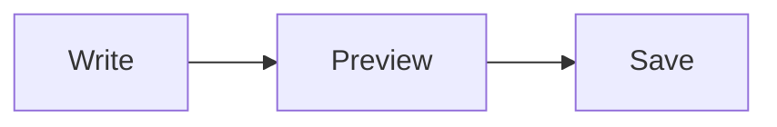

# Writing pages

Pages are written in Markdown: [CommonMark](https://commonmark.org) with
GitHub's extensions, math, Mermaid diagrams, attachments and links between
pages. The preview next to the editor shows a page as readers will see it.
This page is written in everything it describes, so its source shows how.

## Text

Paragraphs are separated by a blank line. *Emphasis*, **strong emphasis**,
~~strikethrough~~ and `inline code` work as usual, and so do emoji
shortcodes such as :tada: and :rocket:. A line that ends with two spaces
or a backslash\
breaks there.

> A block quote is a paragraph with `>` in front of it.

A line of three dashes is a thematic break:

---

## Headings

Every heading gets an `id` made from its text, so that a link can point at
it: this section is `#headings`, and a link to it is
[Headings](#headings). Two headings with the same text get `-1`, `-2`
added. To choose the `id` yourself, put it in braces after the heading:
`## Setup {#install}`.

## Lists

- Bulleted lists use `-`, `*` or `+`.
- Items can hold
  - nested lists, and
  - more paragraphs.

1. Numbered lists use `1.` or `1)`.
2. They may start from any number.

Task lists show a checkbox:

- [x] write the page
- [ ] review it

## Links

A link to a page of the wiki is a path, relative to the current page or,
starting with `/`, to the wiki: [the guide](guide), [setup](../setup),
[a team's page](/engineering/onboarding). A wiki link is shorter:
[[onboarding]] links to the page `onboarding`, and
[[onboarding|our onboarding]] does too, with another label.

A link to the web is a URL: <https://example.com>, or
[with a label](https://example.com "and a title"). A bare URL such as
https://example.com is a link too. Links that leave the wiki get
`rel="noopener"`. A `javascript:` link is shown as its text.

A link that names nothing the wiki knows is shown as broken, as its text.

## Images, video and attachments

An image is ``: 

Attachments of the page are named with `attachment:`. Embedded with `!`,
an attachment shows as what it is: an image as an image, a video as a video
player, audio as an audio player, and anything else as a link that
downloads it. The media type the wiki recorded when the file was uploaded
decides; failing that, the file name's extension does.


Without `!` an attachment is a download link: [the specification](attachment:spec.pdf).
A name with spaces goes in angle brackets, `[notes](<attachment:meeting notes.txt>)`,
or with `%20` in place of each space.

A video on the web is embedded the same way, by its extension:
`` shows a video player. A URL whose
extension is not a known image, video or audio format is shown as an image.

Width and height in pixels can follow an image or a video in braces:
`{width=120}`.

## Code

Inline code is in backticks: `git status`. A block of code is fenced with
three backticks, with its language after them for highlighting:

```haskell
main :: IO ()
main = putStrLn "Hello, wiki"
```

Code indented by four spaces is a block too, without a language.

## Math

Inline math is between single dollars: $e^{i\pi} + 1 = 0$. The opening
dollar has no space after it and the closing one no space before it nor a
digit after it, so prices such as $5 and $10 stay text. Display math is
between double dollars, on its own or in a paragraph:

$$
\int_0^1 x^2 \, dx = \frac{1}{3}
$$

A `math` fence is display math too:

```math
\sum_{n=1}^{\infty} \frac{1}{n^2} = \frac{\pi^2}{6}
```

## Diagrams

A `mermaid` fence is drawn as a [Mermaid](https://mermaid.js.org) diagram:



## Tables

| Feature  | Syntax        | Aligned |
|----------|:-------------:|--------:|
| Bold     | `**bold**`    |   right |
| Math     | `$x$`         |      42 |

The colons in the line under the header align a column: on the left, on
both sides (centred) or on the right.

## Footnotes

A footnote is a reference in the text[^1] and the note anywhere after it,
which is shown at the end of the page[^why].

[^1]: Like this one.
[^why]: Notes are numbered in the order they are written, and each links
    back to where it was referenced.

## Notes and boxes

GitHub's alerts make a highlighted box:

> [!NOTE]
> Something worth knowing.

> [!WARNING]
> Something that may go wrong.

The kinds are `NOTE`, `TIP`, `IMPORTANT`, `WARNING` and `CAUTION`. A box of
any other kind is a fenced div with a class, which the wiki's style sheet
may give a look:

::: summary
Three colons, a class, the content, three colons.
:::

## HTML

HTML in a page is not rendered: it is shown as it is written, <b>like
this</b>, and an HTML comment is left out. <!-- Like this one. -->
