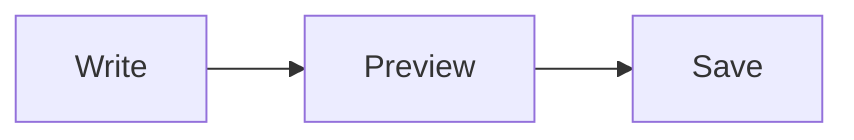

# Writing pages

Pages are written in Markdown: [CommonMark](https://commonmark.org) with
GitHub's extensions, math, Mermaid diagrams, TikZ pictures, attachments
and links between pages. The editor shows the Markdown as it will look
while you type it (bold and italics, larger headings, code on its own
background and highlighted by language, with the Markdown's own marks kept
but dimmed); its "Show preview" shows a page as readers will see it, and
its toolbar writes the Markdown for you: select some text and choose a
button, or choose one with nothing selected and type over what it puts in.
Each button's title names its shortcut (Ctrl+B bold, Ctrl+I italic, Ctrl+K
link, Ctrl+E code, Ctrl+Shift+8 and Ctrl+Shift+7 lists, Ctrl+Alt+P the
preview; Cmd for Ctrl on a Mac). This page is written in everything it
describes, so its source shows how.

## Text

Paragraphs are separated by a blank line. *Emphasis*, **strong emphasis**,
~~strikethrough~~ and `inline code` work as usual, and so do emoji
shortcodes such as :tada: and :rocket:. A line that ends with two spaces
or a backslash\
breaks there.

> A block quote is a paragraph with `>` in front of it.

A line of three dashes is a thematic break:

---

## Headings

Every heading gets an `id` made from its text, so that a link can point at
it: this section is `#headings`, and a link to it is
[Headings](#headings). Two headings with the same text get `-1`, `-2`
added. To choose the `id` yourself, put it in braces after the heading:
`## Setup {#install}`.

## Lists

- Bulleted lists use `-`, `*` or `+`.
- Items can hold
  - nested lists, and
  - more paragraphs.

1. Numbered lists use `1.` or `1)`.
2. They may start from any number.

Task lists show a checkbox:

- [x] write the page
- [ ] review it

## Links

A link to a page of the wiki is a path, relative to the current page or,
starting with `/`, to the wiki: [the guide](guide), [setup](../setup),
[a team's page](/engineering/onboarding). A wiki link is shorter:
[[onboarding]] links to the page `onboarding`, and
[[onboarding|our onboarding]] does too, with another label.

A link to the web is a URL: <https://example.com>, or
[with a label](https://example.com "and a title"). A bare URL such as
https://example.com is a link too. Links that leave the wiki get
`rel="noopener"`. A `javascript:` link is shown as its text.

A link that names nothing the wiki knows is shown as broken, as its text.

## Images, video and attachments

An image is ``: 

Attachments of the page are named with `attachment:`. Embedded with `!`,
an attachment shows as what it is: an image as an image, a video as a video
player, audio as an audio player, and anything else as a link that
downloads it. The media type the wiki recorded when the file was uploaded
decides; failing that, the file name's extension does.


Without `!` an attachment is a download link: [the specification](attachment:spec.pdf).
A name with spaces goes in angle brackets, `[notes](<attachment:meeting notes.txt>)`,
or with `%20` in place of each space.

A video on the web is embedded the same way, by its extension:
`` shows a video player. A URL whose
extension is not a known image, video or audio format is shown as an image.

Width and height in pixels can follow an image or a video in braces:
`{width=120}`.

The editor writes these references for you: a file dropped onto the editor
or pasted into it (a screenshot, an image copied in a browser, a file copied
in a file manager), or chosen with *Attach files*, is attached to the page
and its reference put in where the cursor is, embedded with `!` if it is
an image, a video or audio and a link otherwise, its name in angle brackets
if it has spaces. A new page takes files once it has been saved.

## Code

Inline code is in backticks: `git status`. A block of code is fenced with
three backticks, with its language after them for highlighting:

```haskell
main :: IO ()
main = putStrLn "Hello, wiki"
```

Code indented by four spaces is a block too, without a language.

These languages are highlighted, by the names a fence may give them (in
any case); code in any other language is shown as it is, unhighlighted:

| Language | Fence names |
|----------|-------------|
| Ada | `ada`, `adb`, `ads` |
| ARM assembly | `armasm`, `arm` |
| Awk | `awk` |
| Bash and other shells' scripts | `bash`, `sh`, `zsh`, `shell-script` |
| Batch files | `dos`, `bat`, `batch`, `cmd` |
| C | `c`, `h` |
| C++ | `cpp`, `c++`, `cc`, `cxx`, `hpp`, `h++`, `hh`, `hxx` |
| C# | `csharp`, `cs`, `c#` |
| Clojure | `clojure`, `clj`, `edn` |
| CMake | `cmake` |
| CSS, Less, SCSS | `css`, `less`, `scss` |
| Dart | `dart` |
| Delphi and Object Pascal | `delphi`, `pascal`, `pas`, `dpr` |
| diff | `diff`, `patch` |
| Dockerfile | `dockerfile`, `docker` |
| Elixir | `elixir`, `ex`, `exs` |
| Elm | `elm` |
| Erlang | `erlang`, `erl` |
| Fortran | `fortran`, `f90`, `f95`, `f`, `for`, `f77`, `f03`, `f08` |
| Go | `go`, `golang` |
| GraphQL | `graphql`, `gql` |
| Groovy | `groovy`, `gradle` |
| Haskell | `haskell`, `hs` |
| HTML and XML | `html`, `xml`, `svg`, `xhtml` |
| INI and TOML | `ini`, `toml` |
| Java | `java`, `jsp` |
| JavaScript | `javascript`, `js`, `jsx`, `mjs`, `cjs` |
| JSON | `json` |
| Julia | `julia`, `jl` |
| Kotlin | `kotlin`, `kt`, `kts` |
| LaTeX | `latex`, `tex` |
| Lisp | `lisp`, `cl`, `common-lisp`, `elisp`, `el` |
| Lua | `lua` |
| Makefile | `makefile`, `make`, `mk` |
| Markdown | `markdown`, `md` |
| MATLAB | `matlab`, `m`, `octave` |
| MIPS assembly | `mipsasm`, `mips` |
| Nginx configuration | `nginx` |
| Nix | `nix` |
| Objective-C | `objectivec`, `objc`, `mm` |
| OCaml | `ocaml`, `ml` |
| Perl | `perl`, `pl`, `pm` |
| PHP | `php` |
| PowerShell | `powershell`, `ps1`, `pwsh`, `ps` |
| Prolog | `prolog` |
| Protocol Buffers | `protobuf`, `proto` |
| Python, and its sessions | `python`, `py`, `gyp`; `python-repl`, `pycon` |
| R | `r` |
| Ruby | `ruby`, `rb`, `gemspec` |
| Rust | `rust`, `rs` |
| SAS | `sas` |
| Scala | `scala` |
| Scheme | `scheme`, `scm` |
| Shell sessions (commands and their output) | `shell`, `console`, `shellsession` |
| SQL | `sql` |
| Swift | `swift` |
| Tcl | `tcl`, `tk` |
| TypeScript | `typescript`, `ts`, `tsx`, `mts`, `cts` |
| VBScript and VBA | `vbscript`, `vbs`, `vba` |
| Visual Basic .NET | `vbnet`, `vb` |
| WebAssembly text | `wasm` |
| x86 assembly | `x86asm`, `asm`, `nasm`, `x86` |
| YAML | `yaml`, `yml` |

`m` is MATLAB; Objective-C is `objc`. COBOL, Fish, Zig and Scratch are not
highlighted: highlight.js, which the wiki highlights with, has no grammar
for them.

## Math

Inline math is between single dollars: $e^{i\pi} + 1 = 0$. The opening
dollar has no space after it and the closing one no space before it nor a
digit after it, so prices such as $5 and $10 stay text. Display math is
between double dollars, on its own or in a paragraph:

$$
\int_0^1 x^2 \, dx = \frac{1}{3}
$$

LaTeX's own delimiters work too, and mean the same: inline math is
between `\(` and `\)`, as in \(a^2 + b^2 = c^2\), and display math between
`\[` and `\]`, on its own or in a paragraph:

\[
\sum_{k=1}^{n} k = \frac{n(n+1)}{2}
\]

So `\(` and `\[` start math rather than escaping a parenthesis or a
bracket, as in pandoc. One that no `\)` or `\]` closes later in the same
paragraph stays the escape it was, and `\\[` (an escaped backslash, then
a bracket) is not math. A bracket needs no backslash in text, [like
this]; in a link's text, where brackets have to pair, write a lone one as
`&#91;` or `&#93;`.

A `math` fence is display math too:

```math
\sum_{n=1}^{\infty} \frac{1}{n^2} = \frac{\pi^2}{6}
```

### What KaTeX sets

Formulas are set by [KaTeX](https://katex.org), in the browser. It reads
the mathematics of LaTeX with `amsmath`, `amssymb` and much of
`mathtools`: fractions, roots, sums and integrals, matrices (`matrix`,
`pmatrix`, `bmatrix` and the rest), `cases`, `aligned`, `gathered`, `array`, and in
display math `align`, `gather`, `equation`, `split` and `CD`; accents,
arrows (`\xrightarrow{f}`), `\operatorname`, `\text`, `\textbf`, `\color`,
`\boxed`, `\cancel`, `\bm`, `\mathbb`, `\mathcal`, `\mathfrak`, `\mathscr`
and `\tag`. [KaTeX's list](https://katex.org/docs/supported) has all of it.

It has no `\usepackage`: what it supports is fixed. So it does not have:

- `siunitx` (`\SI`, `\si`, `\num`): write quantities with mhchem's `\pu`
  (below), or by hand, `3\,\mathrm{m/s}`;
- `physics` (`\qty`, `\dv`, `\pdv`, `\abs`, `\norm` with its own spacing):
  the built-in macros below have the common ones;
- `\DeclareMathOperator`: write `\operatorname{Tr}`, or a macro for it,
  `\newcommand{\Tr}{\operatorname{Tr}}`;
- `\label`, `\ref` and `\eqref`: each formula is set on its own, with no
  numbering across a page; `\tag{1}` labels one by hand;
- `\newenvironment`, and LaTeX's text mode: `\section`, `itemize`, a
  paragraph of text. Write those in Markdown around the formula;
- `\href` and `\includegraphics`, which a page could misuse, are off;
- TikZ, which has a fence of its own (see Pictures).

Chemistry is mhchem's `\ce`, which KaTeX comes with: $\ce{2 H2 + O2 -> 2 H2O}$,
$\ce{SO4^2-}$, $\ce{CO2 + C <=> 2 CO}$, and its quantities with units,
$\pu{123 kJ/mol}$.

### Macros

KaTeX extends with macros instead, in three layers; the nearest wins.

1. **Built in**, for every page (`web/src/katex-macros.tex`):

   | Macro | Is | Example |
   | --- | --- | --- |
   | `\C`, `\Q`, `\F` | $\C$, $\Q$, $\F$ | with KaTeX's own `\N`, `\Z`, `\R` |
   | `\abs{x}`, `\norm{x}` | $\abs{x}$, $\norm{x}$ | delimiters that grow with what they hold |
   | `\floor{x}`, `\ceil{x}` | $\floor{x}$, $\ceil{x}$ | |
   | `\inner{u}{v}` | $\inner{u}{v}$ | |
   | `\dd` | $\int f(x) \dd x$ | an upright d |
   | `\dv{f}{x}`, `\pdv{f}{x}` | $\dv{f}{x}$, $\pdv{f}{x}$ | `physics`' two-argument forms |
   | `\sgn`, `\tr`, `\rank`, `\diag`, `\lcm` | $\sgn$, $\tr$, $\rank$, $\diag$, $\lcm$ | operators |
   | `\E`, `\Prob`, `\Var`, `\Cov` | $\E$, $\Prob$, $\Var$, $\Cov$ | probability |
   | `\eps`, `\bigO`, `\defeq` | $\eps$, $\bigO(n)$, $\defeq$ | |

   KaTeX itself has `\N`, `\R`, `\Z`, `\set{x \mid x > 0}`, `\argmin`,
   `\argmax`, `\bra`, `\ket` and `\braket`, among others.
2. **A space's**: in a space's settings, "Math macros" (for whoever may
   administer the space) takes a block of definitions, one `\newcommand` a
   line, which every page of the space and of its subspaces has. A subspace
   has its parent's and its own, its own winning. The form shows KaTeX's
   error for a block it cannot read, and does not save it; a formula typed
   under the block shows what the macros make. Everyone sees a space's
   macros, and its ancestors', under "Math macros" on the space.
3. **A page's**: a definition in one formula holds in every later formula
   of the page, in the order of the page, as in a LaTeX document:

   $$
   \newcommand{\dist}[2]{d\left(#1, #2\right)}
   \dist{x}{z} \le \dist{x}{y} + \dist{y}{z}
   $$

   and from here on $\dist{x}{x} = 0$. A definition inside braces holds
   only inside them, as in TeX. The editor's preview sets a page the same
   way.

A nearer layer may define a macro of a farther one again with
`\newcommand`, without an error: a page's `\newcommand{\eps}{\epsilon}`
replaces the built-in `\eps` on that page, from that formula on.
`\renewcommand` works too. KaTeX's own commands (`\R`, `\vec`, `\set` and the rest)
are another matter: one of those is changed with `\renewcommand` only, as
in LaTeX. `\def`, `\gdef` and `\let` are read too.

## Diagrams

A `mermaid` fence is drawn as a [Mermaid](https://mermaid.js.org) diagram:



## Pictures

A `tikz` fence is drawn with [TikZ](https://tikz.dev), for a figure whose
every point you place: a geometry sketch, a plot with labelled axes, a
commutative diagram. The fence holds the commands of a picture, which are
drawn as a `tikzpicture`:

```tikz
\draw[->] (0,0) -- (2,0) node[right] {$x$};
\draw[->] (0,0) -- (0,1.5) node[above] {$y$};
\draw[thick] (0,0) parabola (1.8,1.3);
```

or a whole `\begin{tikzpicture}[...]` ... `\end{tikzpicture}`, or a
`\begin{tikzcd}` ... `\end{tikzcd}` diagram. Lines at the top that load a
package or a library (`\usepackage{...}`, `\usetikzlibrary{...}`) are read
before the picture, as LaTeX wants; a `tikzcd` diagram loads `tikz-cd`, and
an `axis` loads `pgfplots`, by themselves.

The picture is drawn in your browser by [TikZJax](https://github.com/drgrice1/tikzjax),
real TeX, so the first picture a page shows takes a moment while TeX
loads; a page without one never loads it. Black in a picture is drawn in
the page's text colour, so it shows on a dark page too; other colours
stay as you chose them. A picture TeX cannot draw shows its source with
TeX's error under it, and the line TeX names is the fence's.

What TeX has, besides TikZ itself and nearly every TikZ library
(`arrows.meta`, `calc`, `positioning`, `decorations.*`, `shapes.*`,
`patterns`, `shadows`, `automata`, `graphs`, `matrix`, `trees`, `3d`,
`angles`, `quotes`, `intersections` and most of the rest; not `external`,
which has no use here):

- `tikz-cd`, commutative diagrams;
- `pgfplots`, plots (version 1.18, without its own libraries such as
  `fillbetween` or `groupplots`);
- `tikz-3dplot`, three-dimensional pictures;
- `amsmath`, `amssymb`, `amsfonts`, for the mathematics in labels;
- `array`, `etoolbox`, `ifthen`, `xparse` and `hf-tikz`.

Any other package is not there, and asking for it is an error.

## Tables

| Feature  | Syntax        | Aligned |
|----------|:-------------:|--------:|
| Bold     | `**bold**`    |   right |
| Math     | `$x$`         |      42 |

The colons in the line under the header align a column: on the left, on
both sides (centred) or on the right.

## Footnotes

A footnote is a reference in the text[^1] and the note anywhere after it,
which is shown at the end of the page[^why].

[^1]: Like this one.
[^why]: Notes are numbered in the order they are written, and each links
    back to where it was referenced.

## Notes and boxes

GitHub's alerts make a highlighted box:

> [!NOTE]
> Something worth knowing.

> [!WARNING]
> Something that may go wrong.

The kinds are `NOTE`, `TIP`, `IMPORTANT`, `WARNING` and `CAUTION`. A box of
any other kind is a fenced div with a class, which the wiki's style sheet
may give a look:

::: summary
Three colons, a class, the content, three colons.
:::

## Presentations

Any page can be shown as slides: "Present", above a page written as a deck,
opens it full screen, one slide at a time. A deck is an ordinary page; how
it is cut into slides is written in it:

- A thematic break, `---` on a line of its own after a blank line, starts
  the next slide. (Under a line of text, with no blank line between, `---`
  makes that line a heading instead, as anywhere in Markdown.) A break
  inside a list, a quotation or a box stays a rule on its slide.
- The first heading on a slide is its title, shown in the slide's title
  bar. A slide titled with a level-one heading (`#`) is a title slide: the
  title large in the middle, the rest under it, as for a talk's first slide
  or a section's.
- A box with the class `notes` holds the speaker's notes for its slide.
  They are not on the slide: "Notes" (or the key **n**) shows them under
  it. On the page they show as a box marked "Speaker notes".
- A footnote is shown at the foot of the first slide that refers to it.
- A box with the class `slides` and attributes says how the deck looks,
  anywhere in the page; it shows nothing. The theme is `beamer` (the
  default: a title bar, and a footer with the page's title and the slide's
  number), `light` or `dark`; the aspect `16:9` (the default) or `4:3`:

```markdown
::: {.slides theme=dark aspect=4:3}
:::
```

Everything a page shows a slide shows: formulas set with the macros defined
on the slides before them, diagrams, pictures, code, tables, images and the
HTML a page may hold.

Presenting, the arrow keys, Space, PageUp and PageDown move between slides,
Home and End go to the first and the last, **f** fills the screen (Escape
leaves it), **n** shows the notes and **o** every slide, to pick one; on a
touch screen, swipe. The slide shown is in the address (`?slide=3`), so a
reload or a link comes back to it. "Print" puts one slide on each page, the
page the slide's shape, so that the browser's "Save as PDF" keeps the deck
as a file; with "with notes" ticked, each slide is printed on its own A4
page above its notes.

## HTML

Where Markdown has no word for something, HTML may say it: press
<kbd>Ctrl</kbd>+<kbd>S</kbd> to save, H<sub>2</sub>O, x<sup>2</sup>,
<mark>a highlight</mark>, <abbr title="HyperText Markup Language">HTML</abbr>.
Among the text of a paragraph, what is between two tags is still Markdown:
<mark>this is *emphasised*</mark>. The toolbar's HTML menu puts these
around the selection: Mark (`<mark>`), Keyboard key, Superscript,
Subscript, Underline, Small print and Collapsible section (`<details>`).

A line that starts with a block's tag (`<div>`, `<details>`, `<table>` and
the like) starts a block of HTML, which goes on to the next blank line.
Inside it the text is not Markdown, so write the whole element in one
block, without blank lines; an element left open ends where its block
ends.

<details>
<summary>A part of the page that opens on a click</summary>
Written in HTML, so <b>this is bold</b> and **this is not**.
</details>

Only some elements and attributes are kept, so that what is written in a
page cannot run code or change the page around it. The elements:

- formatting: `b`, `i`, `em`, `strong`, `u`, `s`, `sub`, `sup`, `mark`,
  `small`, `abbr`, `kbd`, `code`, `span`, `br`, and links, `a`;
- structure: `h1` to `h6`, `div`, `p`, `details`, `summary`, `blockquote`, `pre`, `hr`,
  `ul`, `ol`, `li`, `dl`, `dt`, `dd`, `table`, `caption`, `thead`,
  `tbody`, `tfoot`, `tr`, `th`, `td`, `figure`, `figcaption`;
- media: `img`, `video`, `audio`, `source`.

Among the text of a paragraph only formatting, links and media count: a
paragraph cannot hold a block. Any other element is left out and its
content kept (the text of a `<font>` shows, without the font), except
`script`, `style`, `iframe`, `object`, `embed`, `template`, `noscript`,
`svg`, `math`, `textarea` and `select`, which are left out with everything
in them.

The attributes: `class`, `id` and `title` on any element, and where they
mean something `href` (`a`), `src` (`img`, `video`, `audio`, `source`),
`alt` (`img`), `width` and `height` in pixels (`img`, `video`; `width` on
tables and cells too), `colspan` and `rowspan` (cells), `open`
(`details`), `controls` (`video`, `audio`), `poster` (`video`) and `start`
(`ol`). Every other attribute is left out: no `style`, and no `onclick` or
other event handler.

An address in `href`, `src` or `poster` is a URL starting with `http:` or
`https:` (or `mailto:`, for a link), or a path. A path is read as in a
Markdown link, and failing that as the name of one of the page's
attachments, so `` shows the attachment `team.jpg`; a
source is looked for among the attachments first. `attachment:name` works
as in Markdown. Any other address, such as `javascript:` or `data:`, is
left out, and a link that leads nowhere is shown as broken.

An HTML comment is left out. <!-- Like this one. -->

### Colours

The toolbar's "Colour" button writes colours as HTML with a class, never a
`style`, which a page may not have: text in
<span class="c-red">red</span>, <span class="c-teal">teal</span> or
<span class="c-purple">purple</span>, a
<mark class="h-yellow">yellow</mark> or <mark class="h-blue">blue</mark>
highlight, or <mark class="h-green"><span class="c-blue">both</span></mark>.
Each colour has a look of its own in the light theme and the dark one, and
reads in both. The classes:

| Text colour | Class | Highlight | Class |
| ----------- | ----- | --------- | ----- |
| <span class="c-red">Red</span> | `c-red` | <mark class="h-yellow">Yellow</mark> | `h-yellow` |
| <span class="c-orange">Orange</span> | `c-orange` | <mark class="h-green">Green</mark> | `h-green` |
| <span class="c-green">Green</span> | `c-green` | <mark class="h-blue">Blue</mark> | `h-blue` |
| <span class="c-teal">Teal</span> | `c-teal` | <mark class="h-pink">Pink</mark> | `h-pink` |
| <span class="c-blue">Blue</span> | `c-blue` | <mark class="h-purple">Purple</mark> | `h-purple` |
| <span class="c-purple">Purple</span> | `c-purple` | | |
| <span class="c-pink">Pink</span> | `c-pink` | | |
| <span class="c-grey">Grey</span> | `c-grey` | | |

Choosing a colour for text that has one replaces it, rather than putting
one inside the other; choosing one for part of a coloured text leaves the
rest as it was; "No text colour" and "No highlight" take a colour away.
With nothing selected and the cursor in coloured text, all of that
text changes; elsewhere a colour puts in a placeholder to type over.
Each line of a selection gets its own pair of tags, after a list item's
marker, so colouring several items keeps the list. A text colour and a
highlight are two tags, and a word may have both.
