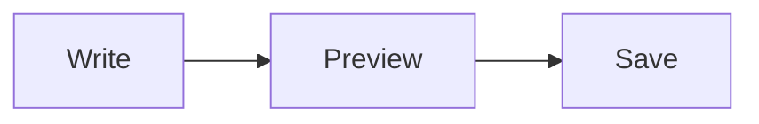

# Writing pages

Pages are written in Markdown: [CommonMark](https://commonmark.org) with GitHub's extensions, math, Mermaid diagrams, TikZ pictures, attachments and links between pages. The editor shows the Markdown as it will look while you type it (bold and italics, larger headings, code on its own background and highlighted by language, with the Markdown's own marks kept but dimmed); its "Show preview" shows a page as readers will see it, and its toolbar writes the Markdown for you: select some text and choose a button, or choose one with nothing selected and type over what it puts in. Each button's title names its shortcut (Ctrl+B bold, Ctrl+I italic, Ctrl+K link, Ctrl+Shift+K link to a page of the wiki, Ctrl+E code, Ctrl+Shift+8 and Ctrl+Shift+7 lists, Ctrl+Alt+P the preview; Cmd for Ctrl on a Mac). This page is written in everything it describes, so its source shows how.

## Text

Paragraphs are separated by a blank line. *Emphasis*, **strong emphasis**, ~~strikethrough~~ and `inline code` work as usual, and so do emoji: [Emoji](#emoji) below.

A line break in the text is a line break on the page, in quotations and boxes too:
so this sentence is on a line of its own,
and so is this one. Write a paragraph on one line, however long, and break a line where you mean a break. (Plain Markdown would join the lines into one, and break only after two spaces or a backslash; both still break here.)

> A block quote is a paragraph with `>` in front of it.

A line of three dashes is a thematic break:

---

## Emoji

A name between colons is an emoji: `:tada:` is :tada:, `:rocket:` is :rocket:, `:white_check_mark:` is :white_check_mark: and `:+1:` is :+1:. Pointing at one shows its name. The names are GitHub's, from its list [gemoji](https://github.com/github/gemoji/blob/master/db/emoji.json), through the `emojis` package that commonmark-extensions uses. A name from elsewhere, such as Slack, works only if GitHub's list has it: 🤔 is `:thinking:`, not `:thinking_face:`. A name that is not in the list stays text, as written. The newest emoji have no name in the list yet: paste them as they are.

A name in the list is an emoji wherever it is, even between digits: `1:100:2` is 1:100:2. To keep it text, put a backslash before its first colon: `1\:100:2` is 1\:100:2, and `\:tada:` is \:tada:. In inline code and in code blocks, colons are always text: `` `:tada:` `` is `:tada:`.

The editor completes emoji. A colon that starts a word (at the start of a line, or after a space) opens a list of emoji, the common ones first; the letters of a name typed after it narrow the list to the names that start with them, then those with a later word that does (`:roc` offers :rocket:, `:check` offers :white_check_mark:). Tab or a click writes the one chosen as `:name:`, and so does Enter once two letters are typed or an entry was chosen with the arrows; before that Enter is a new line, so a colon or a smiley such as `:p` at the end of a line stays as typed. A character that no name has (`:)`, a space) closes the list, and a colon after a letter or a digit (`10:30`, `Note:`) opens none. Escape closes the list and writes a backslash before the colon, `\:`, which keeps it text; one undo takes the backslash back. In code, in a link, in HTML and in math nothing opens. The toolbar's "Emoji" button opens a field to search the same names and a grid of the emoji found; a click, or Enter, writes the one chosen at the cursor.

An item of a bulleted list that starts with an emoji shows the emoji in place of its bullet:

```markdown
- :white_check_mark: Written
- :construction: Being reviewed
- Not started
```

The emoji is still the item's first character, for search, comments and slides. A task keeps its box (`- [ ] :tada:`), a numbered list its numbers, and an item whose name is escaped (`- \:tada:`) its bullet. The PDF and Word exports keep the bullet before the emoji. In the editor, `-:` at the start of a line, after any indentation, opens the same list and writes such an item: `-:tada` and Tab give `- :tada: `. It is the editor's shorthand, not Markdown: `-:` left alone stays as typed, and on a table's line it opens nothing. Escape there writes `-\:`.

## Headings

Every heading gets an `id` made from its text, so that a link can point at it: this section is `#headings`, and a link to it is [Headings](#headings). The `id` is the text in lower case, with spaces made dashes and punctuation left out; letters of every alphabet stay as they are, so `## Zażółć gęślą` is `#zażółć-gęślą`. A second heading with the same text gets `-2` added, a third `-3`, and so on down the page. To choose the `id` yourself, put it in braces after the heading: `## Setup {#install}`. Pointing at a heading shows a `#` after it, a link to it: follow it, and the address bar has the heading's address, to copy and pass on.

A page with three headings or more has a "Contents" panel beside it (above it on a narrow screen), which lists them and marks the section being read. To put the list in the page instead, write `[[!toc]]` on a line of its own where it should go; the panel is then not shown. Without the exclamation mark, `[[toc]]` is a wiki link to a page named `toc`, like any `[[page]]`.

## Lists

- Bulleted lists use `-`, `*` or `+`.
- Items can hold
  - nested lists, and
  - more paragraphs.

1. Numbered lists use `1.` or `1)`.
2. They may start from any number.

Task lists show a checkbox, and a done task is struck through:

- [x] write the page
- [ ] review it

Whoever may edit a page ticks its tasks in the page itself, without the editor. A tick is not saved at once, since every save keeps a whole copy of the page: the ticks are held as changes not saved yet, and a bar at the bottom of the page counts the boxes changed, with "Save", which saves them all as one version, and "Discard", which drops them. The version saved differs from the page only in its boxes: a box ticked is written `[x]`, one unticked `[ ]`, and a box left as it was keeps its spelling (`[X]` stays). Leaving the page with ticks not saved asks first, as leaving the editor does, and so does the browser before the tab is closed. Rename, Move and Delete ask you to save or discard the ticks first. A version of the page, its source, its history, its slides, comments and the editor's preview show the boxes as they are, not to be ticked.

A task with tasks under it (in the list nested in its item) goes with them: ticking it ticks every task under it, ticking the last task under it not done ticks it too, at every depth, and unticking a task unticks the tasks above it.

If someone else saves the page while you have ticks not saved, "Save" does not overwrite their version. When their version has the same tasks (as many, in the same places, each written the same but for its box: a changed word, link, image or line under a task makes it another task; text outside the tasks may change), your ticks are kept on it, and the bar asks you to save again; when it has not, nothing is saved, and the bar offers to reload the page, which loses your ticks.

`{.sorted}` on the line before a list of tasks shows its done tasks after the others, each part in its order, and so does every list nested in it, each by itself. Only the page shows them so: the text keeps its order, and the exports too.

{.sorted}
- [x] book the room
- [ ] send the invitations
- [ ] order the cake

An item without a box ends a list of tasks there (the next items are another list), so `{.sorted}` sorts the tasks up to it. To sort several lists, put them in a box of the class: `[[!div]]{.sorted}` … `[[/div]]`.

## Links

A link to a page of the wiki is a path, relative to the current page or, starting with `/`, to the wiki: [the guide](guide), [setup](../setup), [a team's page](/engineering/onboarding). A page's own address in the wiki, `/s/engineering/p/onboarding/` (what the address bar shows after the wiki's own part), links to that page too, even where a subspace has the page's name; the editor's "Link to a page" (Ctrl+Shift+K) writes links this way, after you pick the page, and one of its sections if you like. A wiki link is shorter: [[onboarding]] links to the page `onboarding`, and [[onboarding|our onboarding]] does too, with another label.

A permanent link is a link to a page as it was at one moment: "Copy permanent link" among a page's buttons copies one, `/l/<page id>/?version=<time>`, by the page's id, which never changes, and the time the version shown was saved. It keeps showing that version after the page is edited, and keeps working after the page is moved, in its space or to another; the page it opens says which version it is and links to the page as it is now. Written as a link's address, with a section after it if you like (`[the setup](/l/4f1c9a2e/?version=2026-10-24T09%3A30%3A12Z#setup)`), it is read the same way, and so is a wiki link to it. Without the version, `/l/<page id>/` leads to the page as it is now, wherever it has moved. The wiki's front page has no address of a version, and does not offer "Copy permanent link". A permanent link to a page the reader may not view, or that has been deleted, leads to the wiki's "not found", as a path to it would.

A link to the web is a URL: <https://example.com>, or [with a label](https://example.com "and a title"). A bare URL such as https://example.com is a link too. Links that leave the wiki get `rel="noopener"`. A `javascript:` link is shown as its text.

A link that names nothing the wiki knows is shown as broken, as its text.

## Mentions

`@` and someone's login mentions them: @ada is told of it, under the bell at the top of the wiki and by mail if they chose so, when the page is saved or the comment made (a page saved again does not tell again of a mention it had). To someone signed in, a mention of one of the wiki's users is a link to a search for the mention, titled with their name; a login that is nobody's, and every mention to someone not signed in, is the text as written.

A mention starts a word: the `@` in an address such as ada@example.org, or in a path, mentions nobody. A login is written with letters, digits, `_`, `.` and `-`, and does not end in a `.` or a `-`, which are taken to be the sentence's: "thanks, @ada." mentions `ada`. A login with other characters cannot be mentioned. Nothing in code, `` `@ada` ``, or in a link's text is a mention; to write an `@` before a word without mentioning anyone, put it in code.

The editor completes mentions. Typing `@` and two letters or more, where a mention counts, opens a list of the users whose login or display name starts with those letters, whatever their case: at most ten, by display name, each with their login after it. A user whose login a mention cannot name (one with a space or an `@` in it, or ending in `.` or `-`) is not offered. The arrows move in the list, Enter or Tab writes `@login` and a space, and Escape closes it. In code, in a link, in HTML and in math nothing opens; brackets that make no link (`[note @an]` with no `[note @an]: …` defined) are text, and there it opens. The list is offered to someone signed in; the demo offers its own users. On a server that keeps the wiki in SQLite, only the letters of ASCII are matched without regard to case: another letter is matched in the case it was typed in, so `@Łu` finds Łukasz there and `@łu` does not.

## Images, video and attachments

An image is ``: 

Attachments of the page are named with `attachment:`. Embedded with `!`, an attachment shows as what it is: an image as an image, a video as a video player, audio as an audio player, and anything else as a link that downloads it. The media type the wiki recorded when the file was uploaded decides; failing that, the file name's extension does.


Without `!` an attachment is a download link: [the specification](attachment:spec.pdf). A name with spaces goes in angle brackets, `[notes](<attachment:meeting notes.txt>)`, or with `%20` in place of each space.

A video on the web is embedded the same way, by its extension: `` shows a video player. A URL whose extension is not a known image, video or audio format is shown as an image.

Width and height in pixels can follow an image or a video in braces: `{width=120}`.

A presentation embedded with the class `presentation`, `{.presentation}` (any form of a page's address: a path, a relative one, its permanent address), is shown in the page one slide at a time ([Presentations](#presentations)). Without the class, in a link's text, for a page that is a document, or for one the reader may not read, it is the link to the page, as any embedded page is.

An SVG attachment is an image, in which nothing runs. With the class `interactive` it is shown in a frame that runs its scripts, for an SVG that needs them, such as a flame graph that zooms on a click and searches:

```
{.interactive}
```

The scripts run cut off from the wiki. The frame has an origin of its own and the server sends the file to it with a policy that lets the SVG's own scripts and styles run and nothing else: they cannot read the reader's cookies or the wiki's storage, reach the page around the frame, fetch anything from the wiki or anywhere else, load an image from an address, navigate the page, open a tab or show a dialog. The most a script can do is load another of the wiki's addresses into its own frame, without the reader's session, as any other site could; and Chromium lets a page's script open a WebRTC connection, which could send what the SVG holds and what the reader types into it, but nothing of the wiki's. The server gives this form to a frame alone: the same address opened in a tab is the plain file, a download, so nobody can hand out a scripted page under the wiki's address. The frame needs a secure page, HTTPS or the machine's own address (`localhost`), since only there do browsers tell the server that a frame is asking; over plain HTTP to another host the SVG is shown as an image. So it is when the wiki cannot be reached as the page is shown, offline or with the page read from what the browser kept (the image, if the browser has kept the file), and inside a link's text, `[{.interactive}](…)`, where a frame could not be clicked through. Only an attachment the wiki stored as an SVG (`image/svg+xml`) is framed; an SVG at an address on the web, another type of file, and an SVG without the class are shown as before. The frame is as wide as the text and 500 pixels high, or what a height in pixels says, `{.interactive height=700}` (at most 4000, read as an `html` fence's); the reader can drag its corner, since the page cannot measure what is inside. *Download flame.svg*, under the frame, downloads the file. A feed, an export and the demo, which has no server to send that policy, show the image.

The editor writes these references for you: a file dropped onto the editor or pasted into it (a screenshot, an image copied in a browser, a file copied in a file manager), or chosen with *Attach files*, is attached to the page and its reference put in where the cursor is, embedded with `!` if it is an image, a video or audio and a link otherwise, its name in angle brackets if it has spaces. A new page takes files once it has been saved.

## Code

Inline code is in backticks: `git status`. A block of code is fenced with three backticks, with its language after them for highlighting:

```haskell
main :: IO ()
main = putStrLn "Hello, wiki"
```

Code indented by four spaces is a block too, without a language.

Every block of code has a **Copy** button in its top right corner, shown when the pointer is over the block or the button has the keyboard's focus (always, on a touch screen). It puts the code on the clipboard exactly as written, without the highlighting, and says "Copied" for a moment, or "Not copied" if the browser refused. A listing that scrolls keeps the button in its corner.

These languages are highlighted, by the names a fence may give them (in any case); code in any other language is shown as it is, unhighlighted:

| Language | Fence names |
|----------|-------------|
| Ada | `ada`, `adb`, `ads` |
| ARM assembly | `armasm`, `arm` |
| Awk | `awk` |
| Bash and other shells' scripts | `bash`, `sh`, `zsh`, `shell-script` |
| Batch files | `dos`, `bat`, `batch`, `cmd` |
| C | `c`, `h` |
| C++ | `cpp`, `c++`, `cc`, `cxx`, `hpp`, `h++`, `hh`, `hxx` |
| C# | `csharp`, `cs`, `c#` |
| Clojure | `clojure`, `clj`, `edn` |
| CMake | `cmake` |
| CSS, Less, SCSS | `css`, `less`, `scss` |
| Dart | `dart` |
| Delphi and Object Pascal | `delphi`, `pascal`, `pas`, `dpr` |
| diff | `diff`, `patch` |
| Dockerfile | `dockerfile`, `docker` |
| Elixir | `elixir`, `ex`, `exs` |
| Elm | `elm` |
| Erlang | `erlang`, `erl` |
| Fortran | `fortran`, `f90`, `f95`, `f`, `for`, `f77`, `f03`, `f08` |
| Go | `go`, `golang` |
| GraphQL | `graphql`, `gql` |
| Groovy | `groovy`, `gradle` |
| Haskell | `haskell`, `hs` |
| HTML and XML | `html` (with `{.norender}`), `xml`, `svg`, `xhtml` |
| INI and TOML | `ini`, `toml` |
| Java | `java`, `jsp` |
| JavaScript | `javascript`, `js`, `jsx`, `mjs`, `cjs` |
| JSON | `json` |
| Julia | `julia`, `jl` |
| Kotlin | `kotlin`, `kt`, `kts` |
| LaTeX | `latex` (with `{.norender}`), `tex` |
| Lisp | `lisp`, `cl`, `common-lisp`, `elisp`, `el` |
| Lua | `lua` |
| Makefile | `makefile`, `make`, `mk` |
| Markdown | `markdown`, `md` |
| MATLAB | `matlab`, `m`, `octave` |
| MIPS assembly | `mipsasm`, `mips` |
| Nginx configuration | `nginx` |
| Nix | `nix` |
| Objective-C | `objectivec`, `objc`, `mm` |
| OCaml | `ocaml`, `ml` |
| Perl | `perl`, `pl`, `pm` |
| PHP | `php` |
| PowerShell | `powershell`, `ps1`, `pwsh`, `ps` |
| Prolog | `prolog` |
| Protocol Buffers | `protobuf`, `proto` |
| Python, and its sessions | `python`, `py`, `gyp`; `python-repl`, `pycon` |
| R | `r` |
| Ruby | `ruby`, `rb`, `gemspec` |
| Rust | `rust`, `rs` |
| SAS | `sas` |
| Scala | `scala` |
| Scheme | `scheme`, `scm` |
| Shell sessions (commands and their output) | `shell`, `console`, `shellsession` |
| SQL | `sql` |
| Swift | `swift` |
| Tcl | `tcl`, `tk` |
| TypeScript | `typescript`, `ts`, `tsx`, `mts`, `cts` |
| VBScript and VBA | `vbscript`, `vbs`, `vba` |
| Visual Basic .NET | `vbnet`, `vb` |
| WebAssembly text | `wasm` |
| x86 assembly | `x86asm`, `asm`, `nasm`, `x86` |
| YAML | `yaml`, `yml` |

`m` is MATLAB; Objective-C is `objc`. COBOL, Fish, Zig and Scratch are not highlighted: highlight.js, which the wiki highlights with, has no grammar for them.

Some fences are not listings: the wiki renders them. `html` is HTML in a frame (see HTML), `latex` and `math` are display math (see Math), `mermaid` a diagram and `tikz` a picture. The class `norender` keeps such a fence a listing of its language, highlighted as that language: ` ```html {.norender} `, or ` ```{.html .norender} `. A `math` fence kept this way is highlighted as `latex`. `norender` changes nothing on any other fence, and the page shows no class of a listing, this one included. A page written before the wiki rendered `html` and `latex` fences shows them rendered now; `{.norender}` after the language shows such a listing as it was.

```latex {.norender}
\frac{a}{b} % shown as TeX, not set
```

A long listing can be shown a few lines at a time: `rows=N` in braces after the fence's language (` ```haskell {rows=3} `, or ` ```{.haskell rows=3} `) makes the block that many lines high, and the rest of the code scrolls inside it. A value that is not a whole number above zero is ignored, and the block is as long as its code. The toolbar's code block button writes a fence without it.

The class `numbered` puts a number before each line: ` ```haskell {.numbered} `, also with `rows` (` ```haskell {.numbered rows=3} `, or ` ```{.haskell .numbered rows=3} `). The numbers are in a margin beside the code, dimmed: they are not selected with the code, not copied by the **Copy** button, and not searched. In a listing that scrolls they scroll with the code. An export numbers the same listings in a PDF; a Word document shows the code without numbers.

```haskell {rows=3}
-- Only three of these lines show; scroll the block for the rest.
fibs :: [Integer]
fibs = 0 : 1 : zipWith (+) fibs (tail fibs)

main :: IO ()
main = print (take 20 fibs)
```

## Math

Inline math is between single dollars: $e^{i\pi} + 1 = 0$. The opening dollar has no space after it and the closing one no space before it nor a digit after it, so prices such as $5 and $10 stay text. Display math is between double dollars, on its own or in a paragraph:

$$
\int_0^1 x^2 \, dx = \frac{1}{3}
$$

LaTeX's own delimiters work too, and mean the same: inline math is between `\(` and `\)`, as in \(a^2 + b^2 = c^2\), and display math between `\[` and `\]`, on its own or in a paragraph:

\[
\sum_{k=1}^{n} k = \frac{n(n+1)}{2}
\]

So `\(` and `\[` start math rather than escaping a parenthesis or a bracket, as in pandoc. One that no `\)` or `\]` closes later in the same paragraph stays the escape it was, and `\\[` (an escaped backslash, then a bracket) is not math. A bracket needs no backslash in text, [like this]; in a link's text, where brackets have to pair, write a lone one as `&#91;` or `&#93;`.

A `math` fence is display math too, and so is a `latex` fence, exactly as `$$` is: the same macros, the same errors, the same export.

```math
\sum_{n=1}^{\infty} \frac{1}{n^2} = \frac{\pi^2}{6}
```

```latex
\binom{n}{k} = \frac{n!}{k!\,(n-k)!}
```

A `tex` fence stays a listing of TeX, and either fence with `{.norender}` is one too (see Code).

### What KaTeX sets

Formulas are set by [KaTeX](https://katex.org), in the browser. It reads the mathematics of LaTeX with `amsmath`, `amssymb` and much of `mathtools`: fractions, roots, sums and integrals, matrices (`matrix`, `pmatrix`, `bmatrix` and the rest), `cases`, `aligned`, `gathered`, `array`, and in display math `align`, `gather`, `equation`, `split` and `CD`; accents, arrows (`\xrightarrow{f}`), `\operatorname`, `\text`, `\textbf`, `\color`, `\boxed`, `\cancel`, `\bm`, `\mathbb`, `\mathcal`, `\mathfrak`, `\mathscr` and `\tag`. [KaTeX's list](https://katex.org/docs/supported) has all of it.

It has no `\usepackage`: what it supports is fixed. So it does not have:

- `siunitx` (`\SI`, `\si`, `\num`): write quantities with mhchem's `\pu` (below), or by hand, `3\,\mathrm{m/s}`;
- `physics` (`\qty`, `\dv`, `\pdv`, `\abs`, `\norm` with its own spacing): the built-in macros below have the common ones;
- `\DeclareMathOperator`: write `\operatorname{Tr}`, or a macro for it, `\newcommand{\Tr}{\operatorname{Tr}}`;
- `\label`, `\ref` and `\eqref`: each formula is set on its own, with no numbering across a page; `\tag{1}` labels one by hand;
- `\newenvironment`, and LaTeX's text mode: `\section`, `itemize`, a paragraph of text. Write those in Markdown around the formula;
- `\href` and `\includegraphics`, which a page could misuse, are off;
- TikZ, which has a fence of its own (see Pictures).

Chemistry is mhchem's `\ce`, which KaTeX comes with: $\ce{2 H2 + O2 -> 2 H2O}$, $\ce{SO4^2-}$, $\ce{CO2 + C <=> 2 CO}$, and its quantities with units, $\pu{123 kJ/mol}$.

### Macros

KaTeX extends with macros instead, in three layers; the nearest wins.

1. **Built in**, for every page (`web/src/katex-macros.tex`). An administrator keeps them in the administration's Editor section, under "Built-in math macros": the first time the section is opened it copies the shipped ones below, and from then on the block there is what every formula has, to add to or take from. Before a block that takes macros out is saved, the section names the pages that use them. The shipped ones are:

   | Macro | Is | Example |
   | --- | --- | --- |
   | `\C`, `\Q`, `\F` | $\C$, $\Q$, $\F$ | with KaTeX's own `\N`, `\Z`, `\R` |
   | `\abs{x}`, `\norm{x}` | $\abs{x}$, $\norm{x}$ | delimiters that grow with what they hold |
   | `\floor{x}`, `\ceil{x}` | $\floor{x}$, $\ceil{x}$ | |
   | `\inner{u}{v}` | $\inner{u}{v}$ | |
   | `\dd` | $\int f(x) \dd x$ | an upright d |
   | `\dv{f}{x}`, `\pdv{f}{x}` | $\dv{f}{x}$, $\pdv{f}{x}$ | `physics`' two-argument forms |
   | `\sgn`, `\tr`, `\rank`, `\diag`, `\lcm` | $\sgn$, $\tr$, $\rank$, $\diag$, $\lcm$ | operators |
   | `\E`, `\Prob`, `\Var`, `\Cov` | $\E$, $\Prob$, $\Var$, $\Cov$ | probability |
   | `\eps`, `\bigO`, `\defeq` | $\eps$, $\bigO(n)$, $\defeq$ | |

   KaTeX itself has `\N`, `\R`, `\Z`, `\set{x \mid x > 0}`, `\argmin`, `\argmax`, `\bra`, `\ket` and `\braket`, among others.
2. **A space's**: in a space's settings, "Math macros" (for whoever may edit the whole space), or the editor's "Math macros" button, takes a block of definitions, one `\newcommand` a line, which every page of the space and of its subspaces has. A subspace has its parent's and its own, its own winning. The form shows KaTeX's error for a block it cannot read, and does not save it; a formula typed under the block shows what the macros make. Everyone sees a space's macros, and its ancestors', under "Math macros" on the space.
3. **A page's**: a definition in one formula holds in every later formula of the page, in the order of the page, as in a LaTeX document:

   $$
   \newcommand{\dist}[2]{d\left(#1, #2\right)}
   \dist{x}{z} \le \dist{x}{y} + \dist{y}{z}
   $$

   and from here on $\dist{x}{x} = 0$. A definition inside braces holds only inside them, as in TeX. The editor's preview sets a page the same way. A display formula of nothing but definitions shows nothing, so a page may keep its macros in one `math` block under its title; the editor's "Math macros" button edits that block as "This page's".

A nearer layer may define a macro of a farther one again with `\newcommand`, without an error: a page's `\newcommand{\eps}{\epsilon}` replaces the built-in `\eps` on that page, from that formula on. `\renewcommand` works too. KaTeX's own commands (`\R`, `\vec`, `\set` and the rest) are another matter: one of those is changed with `\renewcommand` only, as in LaTeX. `\def`, `\gdef` and `\let` are read too.

## Diagrams

A `mermaid` fence is drawn as a [Mermaid](https://mermaid.js.org) diagram:



## Pictures

A `tikz` fence is drawn with [TikZ](https://tikz.dev), for a figure whose every point you place: a geometry sketch, a plot with labelled axes, a commutative diagram. The fence holds the commands of a picture, which are drawn as a `tikzpicture`:

```tikz
\draw[->] (0,0) -- (2,0) node[right] {$x$};
\draw[->] (0,0) -- (0,1.5) node[above] {$y$};
\draw[thick] (0,0) parabola (1.8,1.3);
```

or a whole `\begin{tikzpicture}[...]` ... `\end{tikzpicture}`, or a `\begin{tikzcd}` ... `\end{tikzcd}` diagram. Lines at the top that load a package or a library (`\usepackage{...}`, `\usetikzlibrary{...}`) are read before the picture, as LaTeX wants; a `tikzcd` diagram loads `tikz-cd`, and an `axis` loads `pgfplots`, by themselves.

The picture is drawn in your browser by [TikZJax](https://github.com/drgrice1/tikzjax), real TeX, so the first picture a page shows takes a moment while TeX loads; a page without one never loads it. Black in a picture is drawn in the page's text colour, so it shows on a dark page too; other colours stay as you chose them. A picture TeX cannot draw shows its source with TeX's error under it, and the line TeX names is the fence's.

Text in a picture is set in TeX's Computer Modern fonts. They have the letters of Polish (`ą ć ę ł ń ó ś ź ż` and their capitals) and German (`ä ö ü ß`), the accented letters of French, Spanish, Portuguese, Italian, Dutch, Danish, Norwegian, Swedish, Finnish, Czech, Slovak and Hungarian, and dashes and quotation marks (`– — ‘ ’ “ ”`). Type them as they are, or as LaTeX writes them (`\'o`, `\"u`, `\k{a}`, `\l`). The fonts have no euro sign (`€`), degree sign (`°`) or pound sign (`£`), nor the other signs LaTeX takes from its TS1 fonts (`§ ¶ © µ ± × · ½`): a picture with one shows the error "The fonts TeX has here cannot draw '€'", with the line it is on. Write a degree as `$^\circ$`, and `±` or `×` as `$\pm$` or `$\times$`. Guillemets (`« »`) and the low quotation mark (`„`) are not there either, and TeX's own error says so.

What TeX has, besides TikZ itself and nearly every TikZ library (`arrows.meta`, `calc`, `positioning`, `decorations.*`, `shapes.*`, `patterns`, `shadows`, `automata`, `graphs`, `matrix`, `trees`, `3d`, `angles`, `quotes`, `intersections` and most of the rest; not `external`, which has no use here):

- `tikz-cd`, commutative diagrams;
- `pgfplots`, plots (version 1.18, without its own libraries such as `fillbetween` or `groupplots`);
- `tikz-3dplot`, three-dimensional pictures;
- `amsmath`, `amssymb`, `amsfonts`, for the mathematics in labels;
- `array`, `etoolbox`, `ifthen`, `xparse` and `hf-tikz`.

Any other package is not there, and asking for it is an error.

## Tables

| Feature  | Syntax        | Aligned |
|----------|:-------------:|--------:|
| Bold     | `**bold**`    |   right |
| Math     | `$x$`         |      42 |

The colons in the line under the header align a column: on the left, on both sides (centred) or on the right.

## Footnotes

A footnote is a reference in the text[^1] and the note anywhere after it, which is shown at the end of the page[^why].

[^1]: Like this one.
[^why]: Notes are numbered in the order they are written, and each links back to where it was referenced.

## Notes and boxes

A quotation whose first line is a kind in brackets, `> [!KIND]`, is a box. GitHub's five kinds each have a look of their own:

> [!NOTE]
> Something worth knowing.

> [!WARNING]
> Something that may go wrong.

The five are `NOTE`, `TIP`, `IMPORTANT`, `WARNING` and `CAUTION`. Any other word of letters and dashes makes a box too, titled with the word, capitalised, with spaces for its dashes: `> [!EXERCISE]` is a box titled "Exercise", `> [!FUN-FACT]` one titled "Fun fact". The kind is read in any case, so `[!exercise]` is the same kind.

> [!EXERCISE]
> Prove that the sum of two even numbers is even.

An administrator can define a kind, in the administration's Editor section, under "Boxes": the title its boxes show, a colour of the theme (blue, green, purple, amber, red, teal, orange, pink or grey) or a custom one picked with a colour picker, and an icon (info, lightbulb, pencil, question, check, star, book, flag, or none). The theme's colours change with the light and the dark scheme; a custom colour is the same in both. A kind nobody defined is a plain box. The five keep their own look and cannot be defined. In the editor, the toolbar's **Box** button lists the five and the kinds defined, and writes the first line of the box chosen (around the lines selected, if any); for an administrator it ends with **New kind…**, which opens a dialog with the same form as the administration's, and writes a box of the kind saved there.

Boxes are numbered, each kind on its own: a page's tips are Tip 1, Tip 2, and its first exercise is Exercise 1. A space chooses how, in its settings, under "Numbers of boxes":

- within the page: `Tip 3`, the default;
- after the page's number, its place under its parent in the space's order (by hand or not): `Tip 2.3`;
- after the page's and the section's numbers: `Tip 2.1.3`. A section starts at each `##` heading (the page's title is its `#` line), the boxes of each section are counted from 1, and those before the first `##` are in section 0;
- no numbers.

A star after the kind makes a box without a number, which is not counted, as LaTeX's `equation*`:

> [!NOTE*]
> This note has no number.

Text after the kind, on the same line, after a space, is that box's title, for any kind, the five too. It comes after the box's label and number (`Tip 3: Before you start`); a box without a number shows the title alone. The title is read as a line of Markdown text: emphasis, code and math in it are shown as such, and `$$…$$` is set in display style on the title's line.

> [!TIP] Before you start, mind $\varepsilon$
> Read the whole page once.

Exported, the five are pandoc's own alerts, and any other kind a box with its title and number, so a Word document, a web page or a PDF shows it as a box. A box in a footnote has no number in a document.

A box of any other sort is a `div` block with a class, which the wiki's style sheet may give a look:

[[!div]]{.summary}
A start marker with the class in braces, the content, an end marker.
[[/div]]

## Blocks of the wiki's own

The wiki's own blocks are written between two lines of their own: a start marker, `[[!name]]`, then the blocks, then an end marker, `[[/name]]`. The exclamation mark keeps a marker apart from a link to a page: a page's address cannot hold one.

- `[[!spoiler]]{name}(Description)` … `[[/spoiler]]`: a block spoiler ([Spoilers](#spoilers)).
- `[[!notes]]` … `[[/notes]]`: a presentation's speaker notes ([Presentations](#presentations)).
- `[[!incremental]]` … `[[/incremental]]`: lists a presentation shows item by item.
- `[[!div]]{.class}` … `[[/div]]`: a box with the classes its braces give.

Three are one line each, with no end marker: `[[!style]]{theme=dark aspect=4:3}`, a presentation's look; `[[!pause]]`, the next step of a slide; and `[[!toc]]`, the page's contents ([Headings](#headings)). Every page reads them alike; in a document, where nothing is presented, the editor marks `[[!notes]]`, `[[!incremental]]`, `[[!style]]` and `[[!pause]]` in yellow, as doing nothing more than a document shows of them.

Braces after the name hold attributes, as after a code fence or a heading: `#id`, `.class` and `key=value`, as in `[[!div]]{#summary .wide}`. Only a spoiler takes a description in parentheses. A marker is a marker only at the start of a line; in the middle of one, `[[!notes]]` is a link that leads nowhere. Between the markers goes any Markdown, without a prefix on its lines, other blocks of the wiki's own among it, so blocks nest. An end marker ends the innermost open block when it has the block's name. Where no block of its name is open, `[[/notes]]` is the text it is, a wiki link to a page `/notes`.

What is wrong shows in red where it is, in the page and in the editor's preview, with the reason under it: a start marker of a name the wiki does not have (names are in lower case), parentheses or text after a marker that takes none, braces that hold no attributes, an end marker that crosses another block open inside its own, a block never closed (its blocks follow in red, as they are), and a pause in a footnote, or among the words of a heading, a table, emphasis or a link.

## Spoilers

Text between two pairs of bars is an inline spoiler: the culprit is ||the butler||. It is blurred until the reader clicks it, or presses Enter or Space on it, and a second click hides it again. It may hold emphasis, code and math, as `||**bold** and $x$||`. A single bar, and a table's bars, stay what they were. The toolbar's **Inline spoiler** button (an eye struck through) puts the bars around the selected words.

A block spoiler hides whole blocks until the reader opens it. It starts with a line of its own, `[[!spoiler]]{name}(Description)`, and ends with another, `[[/spoiler]]`:

[[!spoiler]]{answer}(The answer, and how to *find* it)
Forty-two, by this program:

```python
print(6 * 7)
```
[[/spoiler]]

The name, in braces, is one word of letters, digits, `-` and `_`, as a name in code is; `{#answer}` is the same name as `{answer}`. It is not an `id`: two spoilers may share one, and no link leads to it. A spoiler takes no class or other attribute. The description, in parentheses, is what the reader sees and clicks, and may hold emphasis, code and math. Spaces between the three parts are allowed, and nothing else on the line. Between the markers goes any Markdown, without a prefix on its lines: paragraphs, lists, code, tables, boxes, and other spoilers. The end marker may repeat the name, `[[/spoiler]]{answer}`; then it ends the innermost open spoiler only when the names agree:

[[!spoiler]]{hint}(A hint first)
Think of what six times seven is.

[[!spoiler]]{solution}(Then the solution)
Forty-two.
[[/spoiler]]{solution}
[[/spoiler]]{hint}

The toolbar's **Block spoiler** button puts the two markers around the selected lines, with `name` selected for you to type over.

A spoiler lies within one section, or wraps a whole one: either it holds no heading, or its first line is a heading, every other heading in it is deeper, and the next block after it is a heading of the same or a higher level, or nothing. The section's entry stays in the page's contents, and following it, or any link to the heading, opens the spoiler. Section spoilers nest the same way, a subsection's inside its section's.

A heading can hide its own section, with no end marker: start its text with `[[!spoiler]]` and a space.

```markdown
### [[!spoiler]] What is X?

X is what this page is about.

#### [[!spoiler]]{x-why} Why does it matter?

Because the rest depends on it.
```

The heading is shown, in its level's size, with its anchor and its entry in the contents, and a click on it opens the section: from the heading to just before the next heading of the same or a higher level, or to the end of the page, or of the quotation, box, `div` or spoiler the heading is in. A deeper heading spoiler inside is a spoiler of its own subsection, as `x-why` is above. A name in braces right after the marker (`[[!spoiler]]{x-why}` or `[[!spoiler]]{#x-why}`, one word as for the marker pair) is what the reader's browser remembers the spoiler by; without one, it is remembered by the heading's anchor, so renaming the heading forgets it. The marker counts only at the very start of the heading's text, written as here: `[[!spoiler]]` anywhere else in a heading, or without a space and text after it, is a link that leads nowhere. The contents, search and links read the heading without the marker. A marker pair that starts inside a heading spoiler's section and ends after it, or the other way round, cuts a section and shows in red.

In the editor, a block spoiler and a heading spoiler's section fold: the arrow in the margin beside the first line hides the lines after it, down to the end marker or the end of the section, and a click on the mark left at the end of the first line, or on the arrow, shows them again. Ctrl+Shift+[ and Ctrl+Shift+] (Cmd+Option+[ and Cmd+Option+] on a Mac) fold and unfold the spoiler on the cursor's line. A fold only hides lines in the editor: the preview, the draft and the saved page have the whole text.

What is wrong shows in red where it is, in the page and in the editor's preview as you type: a start marker without its name in braces or its description in parentheses, an end marker whose name is not that of the innermost open spoiler, or that has more after it, and the marker of a spoiler that is never closed or that cuts a section, with the reason under it. A spoiler that is not closed, or cuts a section, has its blocks shown in red after its marker, as they are, so that nothing is lost while you fix it.

A spoiler starts closed. Whether a reader left it open is kept in their browser, for each page and each name, and it opens again when they come back; a reader not signed in is one reader. Two spoilers with one name on one page open and close together. The state is kept in that browser only: on another device the spoilers start closed again.

Exported, a document cannot hide anything: a block spoiler is a box titled with its description, its content shown, a heading spoiler is its heading (without the marker) and its section as they are, with no box, and an inline spoiler is its text. A blog's feed shows a heading spoiler's section the same way, and a presentation shows it as its slide, as written. A spoiler shown in red is exported as its marker line and the reason as text, then its blocks.

## Presentations

A presentation is a kind of page: "New page" offers a document or a presentation, a presentation starting blank or from the starter deck, and "Presentation", among a page's actions, makes a page one or a document again (not a space's home page, which is a document). "Present", above a presentation, opens it full screen, one slide at a time; a document is not presented, and its address of slides says so. The page of a presentation shows it in a viewer, one slide at a time, and under it the page as a document, where comments, the contents and the headings' links work as on any page. The kind decides how a page is shown, not what its Markdown means: a presentation's text read as a document is the same page. How a presentation is cut into slides is written in it:

- Each `##` heading at the page's top level starts a slide and is its title, shown in the slide's title bar; so does a setext heading of level two (a line underlined with `---`). Each `#` heading starts a title slide: the title large in the middle, the rest under it, as for a talk's first slide or a section's. The page's own title line, `# Title`, is the first, and the lines under it, up to the first `##`, are its subtitle. Anything before the first such heading is a slide without a title.
- A `###` heading or deeper is a heading on its slide, and so is a heading of any level inside a list, a quotation or a box; the editor marks a `#` or `##` heading there in yellow, as opening no slide. A thematic break, `---` after a blank line, is a rule on its slide.
- A heading spoiler, `## [[!spoiler]] Question`, is its slide as written: its heading is the slide's title, and the slide shows its section.
- `[[!notes]]` … `[[/notes]]` holds the speaker's notes for its slide. They are not on the slide: "Notes" (or the key **n**) shows them under it. On the page they show as a box marked "Speaker notes".
- A footnote is shown at the foot of the first slide that refers to it.
- `[[!style]]` with attributes, a line of its own at the top level of the page, says how the deck looks; it shows nothing. The theme is `beamer` (the default: a title bar, and a footer with the page's title and the slide's number), `light` or `dark`; the aspect `16:9` (the default) or `4:3`. The look is a line with attributes, as every one-line block of the wiki's own is, not a block with its settings inside. Only the first one at the top level counts; the editor marks any other in yellow.

```markdown
[[!style]]{theme=dark aspect=4:3}
```

A slide can show its content in steps:

- `[[!pause]]`, a line of its own, is a pause: what follows it on the slide is shown one step later. A pause is read on the slide itself, in a box, a spoiler, a quotation and a list item, and what comes after the box, the quotation or the list waits for it too, as after Beamer's `\pause` in an environment. It is read among the words of a paragraph or of a list item's text too, `First [[!pause]] then`, as Beamer's `\pause` is in running text: the rest of the paragraph, and what follows it, waits. A line that starts with `[[!pause]]` and has words after it is such a paragraph, not a pause on a line of its own. The export puts the pause exactly where the marker was, adding no space around it. In a footnote, a table, a heading, a box's title, emphasis or a link's text it shows in red, with the reason. Beamer's manual allows `\pause` almost anywhere in a frame (not in amsmath's environments such as `align`); not reading it in those places is the wiki's own rule: each of them is an argument of a command in the Beamer export, where Beamer's pause does not work, and the wiki shows a table and a footnote whole, so that the steps the Beamer export makes are the steps "Present" shows. Three dots, `. . .`, are text.
- `[[!incremental]]` … `[[/incremental]]`, or a line `{.incremental}` just before a list, shows the items of the lists in it one at a time: the first with what comes before the list, each further one a step later, nested lists' items in their turn. What follows the list without a pause shows with its first item, as in Beamer; a pause after the list waits for its last item.

```markdown
## Plan

First this.

[[!pause]]

Then this.

{.incremental}
- one
- two
```

On the page, where nothing is presented, a pause shows nothing and an `incremental` box is an ordinary box.

Everything a page shows a slide shows: formulas set with the macros defined on the slides before them, diagrams, pictures, code, tables, images and the HTML a page may hold.

### Embedding a presentation

`{.presentation}` shows a presentation in another page: the slide, as a card of the deck's shape and look, with buttons to the first slide, the step before, the step after and the last slide, the slide's number out of the deck's, and "Present", which opens the slides view at that slide. With the focus in the viewer (a click on it, or Tab), the left and right arrows go through the steps and Home and End to the first and the last slide; with the focus elsewhere these keys are the page's. Printed, the viewer is the slide shown, whole. The viewer starts as the embed's link, which is what a reader sees first and what the page is without its script, and becomes the viewer once the page has been read, as the reader may read it: for a document, a page of a space the reader cannot see, or one the server refuses, it stays the link, with nothing of that page's text in the page. In an encrypted space the page is read with the reader's key, as any page is. Inside a viewer, and in a feed, an export or the slides view, an embedded presentation is its link, so a presentation that embeds itself shows one viewer, with the link in it.

### Editing a presentation

The editor shows a presentation slide by slide: each slide folded to its first line, but the one the cursor is on. Each slide's first line starts with a button that opens or closes it; opening one closes the others, and with Ctrl (Cmd on a Mac) held the others stay open. Each slide but the title slide (and what comes before the first heading) has a handle beside its button: dragged onto another slide's lines, the slide goes there, its whole text, blank lines included, as one edit that one undo takes back. Alt+Up and Alt+Down move the slide the cursor is on one place up or down. "New slide" adds a `##` heading at the end, its title selected, to be typed over. A move adds nothing to the text but line breaks where two slides would run together: after a last slide that does not end with one, and before a slide whose title is underlined with `---`, which the line above would otherwise take as its own. A move that would put other slides inside a fence or a box left open at the end of a slide is not made.

"Raw" shows the Markdown as it is, unfolded; "Slides" goes back. The browser remembers the choice. Neither changes a byte of the text: folding is how the text is shown. A text with carriage returns (`\r`) has no slides to fold or move in the editor, which says so; it is edited as written.

The preview shows the slide the cursor is on, as a card of the deck's shape and look, with its notes under it and every step shown; with "Raw", the whole deck, or the cursor's slide alone with "One slide". The deck is rendered whole either way, as "Present" renders it, so a slide shows what earlier slides give it: a formula's macros, a footnote's number. A formula, a diagram or a picture that cannot be drawn on any slide is marked in the text, as in a document, whether the preview is shown or not.

The editor also says whether each slide's content fits on it. Every slide is laid out 1024 pixels wide at the deck's aspect, the smallest a deck is promised to be shown at without cutting it (an image's width in pixels, a frame's height take more of a smaller slide), and measured: a dot beside the slide's handle, and on its card in the preview, is green when half a line or more is to spare, yellow when less, or up to a line goes beyond the slide's foot ("may be cut slightly"), red when more than a line does ("cut"), and grey until the slide is measured, or after a change of it not measured yet. A yellow slide is a warning among the page's problems, a red one an error, over the slide's lines. The measure is taken again when an image loads, a diagram or a formula is drawn, or a font arrives. A slide shown on a screen narrower than 1024 pixels can cut more than the mark says. An `html` frame on a slide is as tall as the slide's body allows, not as the window does, so that it scales with the slide.

Presenting, the right arrow, Space and PageDown show the next step of the slide and then the next slide; the left arrow and PageUp hide the last step shown, or go back to the slide before, whole. Home and End go to the first slide and the last, **f** fills the screen (Escape leaves it), **n** shows the notes and **o** every slide, whole, to pick one; on a touch screen, swipe. A step appears in place, with a short fade (none where the system asks for reduced motion): the content shown already does not move. The slide and the step shown are in the address (`?slide=3&step=2`), so a reload or a link comes back to them. "Print" puts one slide on each page, whole, the page the slide's shape, so that the browser's "Save as PDF" keeps the deck as a file; with "with notes" ticked, each slide is printed on its own A4 page above its notes, and with "each step on its own page" ticked, a slide with steps takes a page for each step.

### Exported as documents

On a wiki served by its server, "Export" above a page downloads it as a Word document, a web page, an e-book or (where the server has a TeX engine) a PDF; a presentation also as PowerPoint and as a Beamer presentation, its LaTeX or its PDF; and a space's "Export" makes one document of all its pages. A document holds what the page shows as far as its format can: the images attached, the formulas (as Word's equations in a Word document, with the macros expanded into them), tables, code, footnotes, and the HTML a page may hold. A Mermaid diagram needs a browser to be drawn, so a document says so and gives its source; a TikZ picture is drawn in the PDFs and the Beamer source, and given the same way elsewhere. Links to other pages lead to them on the wiki. A presentation's slides are cut as "Present" cuts them, and a rule stays on its slide (PowerPoint leaves it out); its first slide, when it is a title slide, is the presentation's title page; its theme and aspect carry over to Beamer (`beamer` is Beamer's Madrid, `light` its plain look, `dark` light on dark), while PowerPoint gets 16:9 and its own plain look. A deck's steps are Beamer's overlays: a pause is `\pause` and an `incremental` box's lists are `[<+->]`, so a Beamer PDF has a page for each step, the same steps "Present" shows. That page per step is what a transition is in a PDF: PDF viewers show no animated transitions, and the wiki writes none. PowerPoint shows an incremental list one item at a time; it has no pauses, so a pause there is left out and the slide is shown at once. Every other document shows a deck's content once, without the pauses, and an `incremental` box as an ordinary one.

## HTML

Where Markdown has no word for something, HTML may say it: press <kbd>Ctrl</kbd>+<kbd>S</kbd> to save, H<sub>2</sub>O, x<sup>2</sup>, <mark>a highlight</mark>, <abbr title="HyperText Markup Language">HTML</abbr>. Among the text of a paragraph, what is between two tags is still Markdown: <mark>this is *emphasised*</mark>. The toolbar's HTML menu puts these around the selection: Mark (`<mark>`), Keyboard key, Superscript, Subscript, Underline, Small print and Collapsible section (`<details>`).

A line that starts with a block's tag (`<div>`, `<details>`, `<table>` and the like) starts a block of HTML, which goes on to the next blank line. Inside it the text is not Markdown, so write the whole element in one block, without blank lines; an element left open ends where its block ends.

<details>
<summary>A part of the page that opens on a click</summary>
Written in HTML, so <b>this is bold</b> and **this is not**.
</details>

Only some elements and attributes are kept, so that what is written in a page cannot run code or change the page around it. The elements:

- formatting: `b`, `i`, `em`, `strong`, `u`, `s`, `sub`, `sup`, `mark`, `small`, `abbr`, `kbd`, `code`, `span`, `br`, and links, `a`;
- structure: `h1` to `h6`, `div`, `p`, `details`, `summary`, `blockquote`, `pre`, `hr`, `ul`, `ol`, `li`, `dl`, `dt`, `dd`, `table`, `caption`, `thead`, `tbody`, `tfoot`, `tr`, `th`, `td`, `figure`, `figcaption`;
- media: `img`, `video`, `audio`, `source`.

Among the text of a paragraph only formatting, links and media count: a paragraph cannot hold a block. Any other element is left out and its content kept (the text of a `<font>` shows, without the font), except `script`, `style`, `iframe`, `object`, `embed`, `template`, `noscript`, `svg`, `math`, `textarea` and `select`, which are left out with everything in them.

The attributes: `class`, `id` and `title` on any element, and where they mean something `href` (`a`), `src` (`img`, `video`, `audio`, `source`), `alt` (`img`), `width` and `height` in pixels (`img`, `video`; `width` on tables and cells too), `colspan` and `rowspan` (cells), `open` (`details`), `controls` (`video`, `audio`), `poster` (`video`) and `start` (`ol`). Every other attribute is left out: no `style`, and no `onclick` or other event handler.

An address in `href`, `src` or `poster` is a URL starting with `http:` or `https:` (or `mailto:`, for a link), or a path. A path is read as in a Markdown link, and failing that as the name of one of the page's attachments, so `` shows the attachment `team.jpg`; a source is looked for among the attachments first. `attachment:name` works as in Markdown. Any other address, such as `javascript:` or `data:`, is left out, and a link that leads nowhere is shown as broken.

### HTML with its own styles

HTML in a page has no styles of its own: a `style` could restyle the wiki around it, or imitate it. An `html` fence may have them. It is shown in a frame of its own, as wide as the text, as high as what it holds (but no higher than 80% of the window's height: a longer block scrolls inside), with no border and the page's background, so its styles reach nothing outside the frame. The toolbar's "HTML block" button writes the fence, around the lines selected or with an example to type over:

```html
<style>
  .card { border: 2px solid; border-radius: 8px; padding: 0 1em; }
  .card h3 { margin-top: 0.5em; }
</style>
<div class="card">
  <h3>A card</h3>
  <p style="font-style: italic">Styled by its own CSS, with the wiki's <span class="c-red">red</span> and <mark class="h-yellow">yellow</mark>.</p>
</div>
```

Inside the block, the window is the frame at its largest: `100vh`, a height in percent of the page, and a media query on the height all mean the frame at 80% of the window's height, so a box `50vh` high makes the frame half that. A block with anything placed `fixed` in it (an element, or a `::before` or `::after`) is shown at 80% of the window's height, since such content is placed against the frame itself and moves with its height.

A height in pixels after the language, `` ```html {height=300} `` (or `300px`; at most 4000), makes the frame that high, scrolling what is taller, and no higher than 80% of the window's height; anything else there is ignored. It is the way to size a block whose CSS the page cannot measure.

The frame holds the wiki's stylesheet, in the page's colour scheme, so the wiki's classes (the colours above, a table's look, a box's) work as in the page, and the block's own rules come after it and win over the wiki's. What the block may hold is what HTML in a page may hold, with two more things: a `style` attribute on any element, and `<style>` elements. Everything else is left out as in a page: no `script`, no event handler (`onclick` and the rest), no `iframe`, `object`, `embed` or `svg`, no `form` (its content is kept, without the fields), no `meta`, `base` or `link`, and no `javascript:` or `data:` address. The frame is sandboxed besides, so nothing in it could run even if it were there.

Addresses are read as in the page: `attachment:name`, a path to a page, a page's attachment. A link opens in a new tab, since the frame cannot show another page; a link to a place in the page (`#intro`) has nowhere to lead from the frame, and shows its text alone. A link in the block is not one of the page's links: it does not make a backlink.

The block's text is searched as the page's is, without its tags and its CSS. A comment cannot quote what is inside the frame. A feed shows the block's source as a listing, since a feed reader has no frame to keep its styles in. An export shows its HTML as it shows HTML in a page, without the block's styles.

## Comments

A comment is text in a page's source that the page does not show: `<!--`, the text, `-->`. It may be among a paragraph's text, <!-- like this one, --> on a line of its own, or over several lines:

<!-- A note for the next author: the dates below come from the release notes. -->

<!--
This paragraph and the list after it are kept out of the page
until they are checked.

- one
- two
-->

Between `<!--` and `-->` nothing is read as Markdown, so a comment around blocks keeps them out of the page, headings and all; the page's contents, its search and its exports leave them out too. A comment is hidden from the page, not from its readers: anyone who may read the page may read its source with "View source", comments and all. Write nothing in one that a reader must not see.

### Colours

The toolbar's "Colour" button writes colours as HTML with a class, never a `style`, which a page may not have: text in <span class="c-red">red</span>, <span class="c-teal">teal</span> or <span class="c-purple">purple</span>, a <mark class="h-yellow">yellow</mark> or <mark class="h-blue">blue</mark> highlight, or <mark class="h-green"><span class="c-blue">both</span></mark>. Each colour has a look of its own in the light theme and the dark one, and reads in both. The classes:

| Text colour | Class | Highlight | Class |
| ----------- | ----- | --------- | ----- |
| <span class="c-red">Red</span> | `c-red` | <mark class="h-yellow">Yellow</mark> | `h-yellow` |
| <span class="c-orange">Orange</span> | `c-orange` | <mark class="h-green">Green</mark> | `h-green` |
| <span class="c-green">Green</span> | `c-green` | <mark class="h-blue">Blue</mark> | `h-blue` |
| <span class="c-teal">Teal</span> | `c-teal` | <mark class="h-pink">Pink</mark> | `h-pink` |
| <span class="c-blue">Blue</span> | `c-blue` | <mark class="h-purple">Purple</mark> | `h-purple` |
| <span class="c-purple">Purple</span> | `c-purple` | | |
| <span class="c-pink">Pink</span> | `c-pink` | | |
| <span class="c-grey">Grey</span> | `c-grey` | | |

Choosing a colour for text that has one replaces it, rather than putting one inside the other; choosing one for part of a coloured text leaves the rest as it was; "No text colour" and "No highlight" take a colour away. With nothing selected and the cursor in coloured text, all of that text changes; elsewhere a colour puts in a placeholder to type over. Each line of a selection gets its own pair of tags, after a list item's marker, so colouring several items keeps the list. A text colour and a highlight are two tags, and a word may have both.
